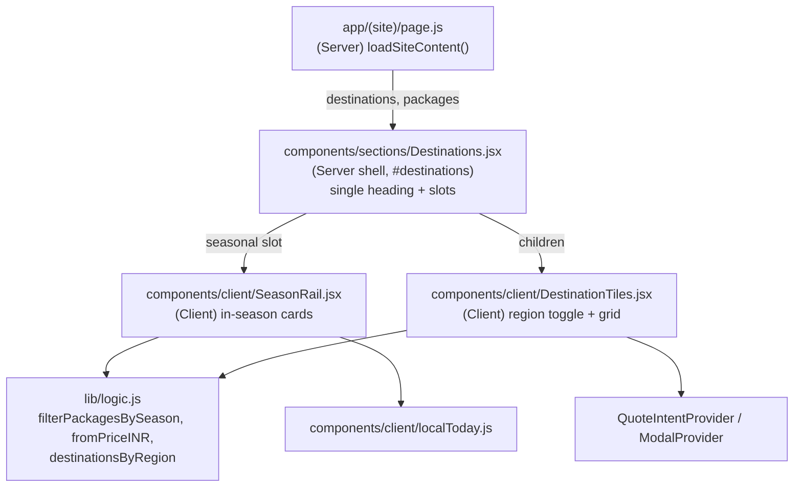
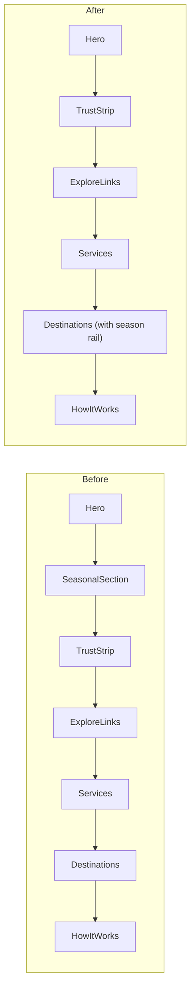

# Design Document: Merge "Plan Your Next Getaway" into "Where Would You Like to Go"

## Overview

The home page is long. Two adjacent-in-purpose sections each carry a "next getaway" message:

- `SeasonalSection` (`#best-time`, "Top picks for your next getaway"): a 3D carousel of in-season packages. The carousel track alone is 480px tall on desktop, plus heading, label, dots and hint link.
- `Destinations` (`#destinations`, currently titled "Plan Your Next Getaway Today"): International (3-up) and Domestic (4-up) tile grids stacked vertically.

This design merges them into one section, "Where would you like to go?", with two compact parts inside a single `<section>` and a single heading:

1. A slim "Best for {Month}" rail of up to 3 in-season package cards (replaces the 480px carousel).
2. The destination tiles, with International and Domestic switched by a segmented toggle instead of stacked, so only one grid is visible at a time.

Net effect: one section header and one band instead of two, a rail of about 220px instead of about 600px of carousel, and one region grid visible instead of two. Data, filtering logic and modals are unchanged. No new Next.js APIs are used (only existing `next/link`, Server/Client component split already in the repo).

### Interpretation note

The user wrote "plan ur next gateway" (getaway). In the code that phrase appears in two places: the `Destinations` heading ("Plan Your Next Getaway Today") and the `SeasonalSection` heading ("next getaway"). The only separate section to fold in is `SeasonalSection`, so that is what moves into `Destinations`. The "Where would you like to go?" wording becomes the new merged heading.

## Architecture



Page order before and after:



### Layout inside the merged section

```
[eyebrow] Plan Your Next Getaway
Where would you like to go?
(lead) Pick a destination, or start with what is best this month.

  * Best for May                         See all packages ->
  [ card ] [ card ] [ card ]          <- compact rail, max 3

  [ International | Domestic ]       <- segmented toggle
  [ tile ][ tile ][ tile ]( [ tile ] )
```

### Key decisions

- Keep the Server shell plus Client slots pattern used throughout `app/(site)/page.js`. `Destinations` gains an optional `seasonal` prop (a ReactNode slot); `children` stays the destination tiles.
- Replace the 3D carousel with a static rail. The carousel (auto-advance every 4s, blur and 3D transforms, arrows, dots) is the main height cost and is redundant when sharing a section with a tile grid. Three cards fit in one row on desktop and scroll-snap horizontally on mobile, matching the existing `.grid` mobile pattern in `Destinations.module.css`.
- Replace the stacked region groups with a segmented toggle. Reuses the segmented-control look already used by `CategoryFilter`. With JS off, the server fallback still renders both groups (unchanged).
- Anchor compatibility: `#destinations` stays. `#best-time` is removed; nothing in the repo links to it (verified by grep). Add `id="best-time"` on the rail wrapper so any external link to `/#best-time` still lands in the right place.
- Delete `SeasonalSection.jsx`, `SeasonalSection.module.css`, `SeasonFilter.jsx` and `SeasonFilter.module.css` once `SeasonRail` replaces them, to avoid dead code. `filterPackagesBySeason`, `MONTH_NAMES`, and `useLocalTodayISO` are reused as-is.

## Components and Interfaces

### Destinations (Server shell) — modified

```js
/**
 * @param {{
 *   destinations?: object[],
 *   packages?: object[],
 *   seasonal?: React.ReactNode,   // NEW: <SeasonRail /> mounted by page.js
 *   children?: React.ReactNode    // <DestinationTiles />
 * }} props
 */
export default function Destinations({ destinations = [], packages = [], seasonal, children }) {
  const hasChildren = children != null && children !== false;
  const packageIds = new Set(packages.map((p) => p.id));
  return (
    <section id="destinations" className="section" aria-labelledby="destinations-title">
      <div className="container">
        <header className="section-head">
          <p className="eyebrow">Plan Your Next Getaway</p>
          <h2 id="destinations-title">Where would you like to go?</h2>
          <p className="lead">Pick a destination, or start with what is best this month.</p>
        </header>

        {seasonal ?? null}

        {hasChildren ? children : /* existing static International + Domestic fallback */ null}
      </div>
    </section>
  );
}
```

Responsibilities: single `<h2>`, section landmark, slot composition, no-JS fallback of the tile grids.

### SeasonRail (Client) — new, replaces SeasonFilter

```js
"use client";
/** @param {{ packages?: object[] }} props */
export function SeasonRail({ packages = [] }) { /* ... */ }
export default SeasonRail;
```

Responsibilities:
- Resolve current month via `useLocalTodayISO()` (hydration-safe, same as today).
- `picks = filterPackagesBySeason(packages, month).slice(0, 3)`.
- Render nothing visible beyond a short label while month is unresolved (reserve a fixed min-height to avoid layout shift).
- Render nothing at all when `picks` is empty (no "No packages yet" block; the tiles below already stand alone). This removes dead height.
- Each card: image (`SafeImage`), region and duration meta, title, from-price, "View Package" link to `/trips`. Whole-card layout is horizontal on desktop (3 columns) and scroll-snap on mobile.
- Header row: "Best for {Month}" label and "See all packages" link to `/trips`.
- No auto-advance, no arrows, no dots.

### DestinationTiles (Client) — modified

Adds a region toggle. Existing quote and itinerary handlers are untouched.

```js
const REGIONS = [
  { region: "international", title: "International", gridClass: s.grid3 },
  { region: "domestic", title: "Domestic", gridClass: s.grid4 },
];

export function DestinationTiles({ destinations = [], packages = [] }) {
  const available = REGIONS.filter((r) => destinationsByRegion(destinations, r.region).length > 0);
  const [active, setActive] = useState(available[0]?.region ?? null);
  // render: segmented toggle (only if available.length > 1) + the active region's <ul>
}
```

Toggle semantics: `role="tablist"` with `role="tab"` buttons, `aria-selected`, `aria-controls` pointing at a `role="tabpanel"` wrapper; arrow keys move between tabs. The inactive panel is not rendered.

## Data Models

No schema or data changes. Existing shapes are used:

```js
// package (subset used by the rail)
{ id, title, image, region: "domestic" | "international", nights, days, seasons: number[], /* pricing for fromPriceINR */ }
// destination
{ id, name, tagline, image, region, packageId }
```

Validation rules: unchanged (`validateDestination`, package validators in `lib/server/content.js`).

## Algorithmic Pseudocode

```pascal
ALGORITHM renderSeasonRail(packages, isoDate)
INPUT: packages: list of Package, isoDate: String or NULL (NULL before hydration)
OUTPUT: UI fragment

BEGIN
  IF isoDate = NULL THEN
    RETURN placeholder with reserved height          // avoids hydration mismatch and CLS
  END IF

  month ← parseInt(isoDate[5..7])
  picks ← filterPackagesBySeason(packages, month)
  picks ← first MAX_CARDS (3) of picks

  IF length(picks) = 0 THEN
    RETURN nothing                                   // collapses, no empty-state block
  END IF

  RETURN header(MONTH_NAMES[month - 1]) + cards(picks) + link("/trips")
END
```

**Preconditions:** `packages` is an array (may be empty). `isoDate` is `YYYY-MM-DD` or null.
**Postconditions:** at most 3 cards rendered; every card's package has `month` in its `seasons`; when `picks` is empty no rail DOM is output.
**Loop invariants:** N/A (no loops beyond a bounded map over at most 3 items).

```pascal
ALGORITHM selectRegion(destinations, active, requested)
INPUT: destinations, current active region, requested region
OUTPUT: active region

BEGIN
  available ← regions r WHERE destinationsByRegion(destinations, r) is not empty
  IF requested IN available THEN RETURN requested END IF
  IF active IN available THEN RETURN active END IF
  RETURN first(available) OR NULL
END
```

**Preconditions:** `destinations` is an array.
**Postconditions:** result is NULL only when no region has destinations; otherwise result is a region with at least one destination.

## Key Functions with Formal Specifications

### SeasonRail(packages)
- Pre: `packages` array of plain objects.
- Post: renders 0 to 3 cards; no timers or intervals are registered (unlike `SeasonFilter`).

### DestinationTiles({ destinations, packages })
- Pre: `destinations` and `packages` are arrays of plain objects.
- Post: exactly one region grid visible when JS is available; toggle hidden when only one region has data; "Get a Quote" calls `quoteDestination(dest.name)`; "View Package" opens the `itinerary` modal only when `dest.packageId` resolves to a package.

## Example Usage

```js
// app/(site)/page.js (after)
<Hero />
<TrustStrip />
<ExploreLinks />
<Services />
<Destinations destinations={destinations} packages={packages}
              seasonal={<SeasonRail packages={packages} />}>
  <DestinationTiles destinations={destinations} packages={packages} />
</Destinations>
<HowItWorks />
```

Remove the `SeasonalSection` and `SeasonFilter` imports and usages, and update the story-order comment (the "gateway" step now lives inside "where").

## CSS Plan

- `Destinations.module.css`: add `.rail`, `.railHead`, `.railGrid` (mobile scroll-snap row, 3 columns from 768px), `.railCard`, and `.regionTabs` (segmented control, reusing the `CategoryFilter` tokens). Add `.toggleWrap` spacing so the rail and toggle have 32px between them.
- New `SeasonRail.module.css` for card internals (or fold into `Destinations.module.css` if under about 80 lines).
- Section background: `Destinations` keeps plain `.section`. The `section--alt` band from `SeasonalSection` is dropped, which also changes band alternation downstream. Check that `HowItWorks` / `Expert` still alternate; if two plain sections now touch, toggle `section--alt` on the neighbour.
- Respect `prefers-reduced-motion` for hover lift (already handled in `.tile`; mirror on `.railCard`).

## Correctness Properties

*A property is a characteristic or behavior that should hold true across all valid executions of a system-essentially, a formal statement about what the system should do. Properties serve as the bridge between human-readable specifications and machine-verifiable correctness guarantees.*

### Property 1: Rail selection is in-season and capped

For any month m in 1..12 and any package list L, the packages selected for `SeasonRail` all have m in `pkg.seasons`, and the count is at most 3.

**Validates: Requirements 1.1, 1.2**

### Property 2: Empty selection renders nothing

For any month m and package list L where no package has m in `pkg.seasons`, the selection for `SeasonRail` is empty, so no cards and no empty-state text are rendered.

**Validates: Requirements 1.5**

### Property 3: Region toggle loses no destination

For any destinations list, the union of the tiles reachable through the region toggle equals the set of all destinations whose region is international or domestic.

**Validates: Requirements 2.1, 2.2, 2.7**

### Property 4: Region selection falls back to an available region

For any destinations list, active region and requested region, `selectRegion` returns null only when no region has destinations; otherwise it returns a region that has at least one destination.

**Validates: Requirements 2.3, 2.4**
## Error Handling

- Package with a missing image: `SafeImage` already falls back; reuse it.
- Unknown or missing `seasons` on a package: `filterPackagesBySeason` excludes it; no crash.
- `destinations` empty: `DestinationTiles` returns null; the heading and rail still render.
- Active region becomes empty after a content refresh: `selectRegion` falls back to the first available region.
- `useLocalTodayISO()` returns null until hydration: render a fixed-height placeholder, not an error state.

## Testing Strategy

### Unit
- `SeasonRail`: renders 3 cards when 5 packages match; renders nothing when none match; shows month name; contains no interval (fake timers, assert `setInterval` not called).
- `DestinationTiles`: toggle switches grids; toggle hidden with single region; Get a Quote and View Package handlers fire as before.
- `Destinations`: renders `seasonal` slot above children; renders fallback when no children.

### Property-based
Library: `fast-check` (add only if not already in the repo; otherwise use the existing test runner's table-driven style).
- P1 and P2 over generated `seasons` arrays and months 1..12.
- P3 over generated destination lists with arbitrary region mixes.

### Manual / visual
- Compare page height before and after at 1280px and 390px widths; expect a reduction of roughly one carousel (about 600px) plus one stacked grid group.
- Keyboard: tab, arrow keys on the region toggle; focus ring visible.
- Check `/#destinations` anchor scroll offset against the sticky header.

## Performance Considerations

- Removes the 4s interval re-render loop and 3D transform layers from the home page.
- Rail images use `SafeImage` with explicit dimensions (no layout shift); only the first three in-season cards load.
- Only one region grid is mounted at a time, which reduces image requests on first paint.

## Security Considerations

No new inputs, endpoints or auth surface. Links are internal (`/trips`, `/quote`). Content comes from the same published-row loader.

## Accessibility

- Single `h2` for the merged section; rail cards use `h3`; tile names currently use `h3` and stay under the same heading level (the old region `h3` group titles become tab labels).
- Region toggle follows the WAI-ARIA tabs pattern. Full WCAG validation still needs manual testing with assistive technologies.

## Dependencies

- Existing only: `next/link`, `@/lib/logic`, `@/lib/data` (`MONTH_NAMES`), `localToday`, `SafeImage`, `QuoteIntentProvider`, `ModalProvider`, `ItineraryModal`.
- Relevant prior specs: `seasonal-package-display` (introduced the season logic reused here) and `prototype-visual-parity` (styling conventions).
