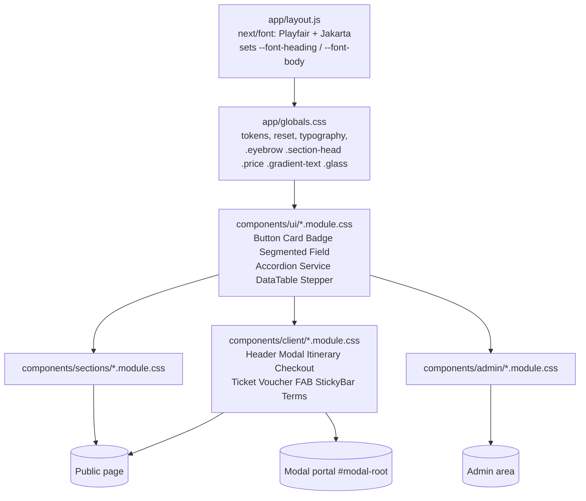

# Design Document: prototype-visual-parity

## Overview

This feature restyles the whole Travel Guru Raipur site (public page, overlays, admin) to match `prototype/index.html`: gold on navy, Playfair Display headings, Plus Jakarta Sans body. It is a visual-only change. Section order, copy, data, `lib/`, `app/api/` and all behaviour stay as they are.

The work is almost entirely CSS:

1. Replace the token layer in `app/globals.css` (palette, gold gradient, gold shadow, focus ring, selection, global classes).
2. Swap the heading font in `app/layout.js` from Poppins to Playfair Display (the `--font-heading` and `--font-body` variable names stay, so no component has to change its `font-family` reference).
3. Re-point every CSS Module that used a Legacy_Token or a blue/orange/indigo literal to the Gold_Palette, and adjust dimensions where the prototype differs.
4. Update the documentation (header comment in `globals.css`, "Superseded" notes in the old design doc).
5. Add static-analysis tests (node:test + fast-check) that pin the palette, the absence of the retired theme, token resolution, contrast and reduced motion.

Language for code samples: JavaScript (Next.js App Router, CSS Modules). Tests run with `node --test` (existing `npm test`), `fast-check` 4.10.2 is already a devDependency.

### How this design was produced

- `prototype/index.html` was read in full (718 lines). The earlier phase stopped at about line 410. Lines 410 to 718 hold the reviews markup, FAQ, CTA band, footer, floating controls, both sample modals, the itinerary modal styles (`.timeline`, `.hotel-table`, `.pay-box`, `.cols2`, lines 480 to 508) and the page script (line 542 on). The script only drives behaviour (filters, currency, modal open/close, header `scrolled` at 40px, reveal) and has no visual rules beyond the class names already listed.
- Every CSS Module under `components/**` was read or scanned and compared with the matching prototype block (see Components and Interfaces).
- The Next.js font guide `node_modules/next/dist/docs/01-app/03-api-reference/02-components/font.md` was read, and the loader source in `node_modules/next/dist/compiled/@next/font/dist/google/` was checked for the two behaviours the design depends on (see Next.js Font Handling).
- WCAG contrast ratios were computed with a script (relative luminance, alpha compositing over the stated surface). Results are in Contrast Results.

## Decisions and Open Issues

These are decisions made while reading the code. Items marked "Requirement conflict" need a decision from the owner; the design states the default it follows.

| ID | Topic | Decision |
|----|-------|----------|
| D4 | `--text-lo` | Stays `#8a93ab`. The prototype's `#7a849c` is 4.47:1 on `--bg-2` (fails 4.5:1, Req 17.1). `#8a93ab` is 6.41 / 5.99 / 5.46 on bg-0 / bg-1 / bg-2. Req 1.4 does not list `--text-lo`, so this does not conflict with it. Recommend adding D4 to the Decision Record in `requirements.md`. |
| DD1 | Playfair loading | `Playfair_Display({ subsets: ["latin"], style: ["normal","italic"], display: "swap", variable: "--font-heading" })` with no `weight`. The loader then selects the variable font: two files (normal, italic) covering weights 400 to 900. This satisfies Req 3.1 (400, 600, 700, italic 600) and avoids six static files. See Next.js Font Handling. |
| DD2 | `themeColor` | `lib/seo.js` exports `THEME_COLOR = "#070a1a"` and `tests/seo.basic.test.js` asserts it. `lib/` is frozen (Req 18.2), so `app/layout.js` overrides it: `export const viewport = { ...buildViewport(), themeColor: "#070b14" }`. The test keeps passing because it calls `buildViewport()` directly. |
| DD3 | Overrides across modules | CSS Modules do not guarantee stylesheet order between components. Where one module overrides a rule from a shared module (`Badge`, `Button`, `Card`), use a doubled or element-qualified selector (`p.guarantee`, `.badge.badge`), never a bare single-class selector. |
| DD4 | Mobile hero overlay | The prototype's 90-degree overlay drops to `.35` on the right edge. On narrow screens the copy spans the full width, so below 1024px the overlay stops are raised to `.95 / .85 / .7`. Legibility over a photo cannot be computed; verify visually. |
| DD5 | Field font size | Inputs keep `1rem`. The prototype uses `.9375rem`, which makes iOS Safari zoom on focus. |
| DD6 | Modal widths | `.md` stays 760px (Checkout needs two columns), `.lg` becomes 860px (prototype itinerary). The prototype's 560px default is not adopted for Ticket and Voucher. |
| DD7 | Itinerary image strip | The prototype's hero image bleeds to the modal edges. The real strip sits inside the padded dialog beside a sticky floated close button; bleeding it would need negative margins that fight that button. Kept inset. |
| DD8 | Service icon shape | Prototype `.s-icon` is a 52px rounded square (radius 14px), not a circle. Parity wins over the word "circle" in Req 2.5. Colours follow Req 2.5 exactly. |
| DD9 | Service tokens | All eight `--svc-*` tokens are `#d4af37`. The per-accent classes in `Service.module.css` stay (they are imported by `ServiceGlyph.jsx`) and each sets `--svc-accent: var(--svc-x)`. The icon fill no longer depends on them. |

Requirement conflicts and gaps:

| ID | Requirement | Problem | Default followed |
|----|-------------|---------|------------------|
| OI-1 | 4.5 vs 17.1 | White text on `#25D366` is 1.98:1. | Keep dark `--on-cta` (= bg-0) text: 9.92:1. Lift on hover as required. The floating button's white glyph is a pre-existing icon-only exception, unchanged. |
| OI-2 | 7.9 | `TrustStrip.jsx` renders free text ("8 Services, 1 Expert"). There is no separate numeral or caption element, and copy and markup may not change (18.3). | Style the strip (bg-1, borders, four columns, gold-2 stars). Numeral and caption styling is not possible. Recommend rewording 7.9 to "where the item exposes a numeral". |
| OI-3 | 12.1 | `Reviews.jsx` already prints curly quotes inside the `<p>`. A decorative gold quote mark would double them. | Presentational markup exception PM-1: remove the literal quote characters from the `<p>` in `Reviews.jsx` and draw the mark with `.figure::before { content: "\201C" / ""; }`. The words are unchanged. If PM-1 is rejected, drop the decorative mark and keep the inline quotes. |
| OI-4 | 14.2 | The prototype's hotel table uses `--text-lo` headers and `rgba(255,255,255,.06)` separators. The requirement says `--gold-2` and `--glass-border`. | Follow the requirement. |
| OI-5 | 14.1 | "Lines in `--gold-2`". The prototype line is `rgba(212,175,55,.4)` (2.37:1 on bg-1). It is decorative; the day labels carry the order. | Gold-2 at 40% alpha, as in the prototype. |
| OI-6 | 3.1 | Literal weights "400, 600, 700". | Met by the variable font (DD1). |
| OI-7 | Scope | `public/assets/logo.png` stays blue and orange. It will sit next to a gold UI. | Out of scope per requirements. Noted as a visible mismatch. |

## Architecture



Layers and rules:

- Tokens live only in `:root` of `globals.css`. Modules consume them with `var(--token)`. No module may declare a hex colour for a palette colour; opacity variants come from the `--gold-aNN` tokens.
- The `#modal-root` portal sits inside `<body>`, so it inherits the font variables set on `<html>`.
- Shared UI modules (`Button`, `Card`, `Badge`, `Segmented`, `Field`) carry most of the visual change. Section and client modules only fix what is specific to them.

## Next.js Font Handling

Source: the Next.js font guide and the loader source, as read for this design.

Facts used by this design:

1. A Google font that has a `variable` weight and no `weight` option loads as a variable font. The guide recommends variable fonts for performance. `font-data.json` lists Playfair Display weights `400..900, variable`, styles `normal, italic`, axis `wght 400..900`.
2. With explicit weights, the loader builds one variant per weight and style combination (`getGoogleFontsUrl`). `['400','600','700']` with `['normal','italic']` would request six files; the variable font requests two.
3. `style` accepts an array for any font (validated against the font's `styles` list). `weight` must not mix `variable` with other values.
4. `variable: "--font-heading"` declares the CSS variable on the element that receives `heading.variable`. It must go on `<html>` (as today) so the modal portal and `body` inherit it.
5. `subsets` must be set, or preloading warns. `display: "swap"` and the automatic fallback metrics (`adjustFontFallback`, default true) limit layout shift.
6. Fonts are downloaded from Google at build time and self-hosted. `next build` needs network access to `fonts.googleapis.com`. The browser sends no request to Google.

Target `app/layout.js`:

```js
import { Playfair_Display, Plus_Jakarta_Sans } from "next/font/google";
import "./globals.css";
import { BUSINESS } from "@/lib/data";
import { buildMetadata, buildViewport } from "@/lib/seo";

// Headings, prices, numerals, review quotes, FAQ summaries. Variable font: weights 400-900,
// normal + italic (accent words are italic). Exposed as var(--font-heading).
const playfair = Playfair_Display({
  subsets: ["latin"],
  style: ["normal", "italic"],
  display: "swap",
  variable: "--font-heading",
});

// UI, body copy, forms. Unchanged. Exposed as var(--font-body).
const jakarta = Plus_Jakarta_Sans({
  weight: ["400", "500", "600", "700"],
  subsets: ["latin"],
  display: "swap",
  variable: "--font-body",
});

export const metadata = buildMetadata(BUSINESS);
// lib/seo.js is frozen and still returns #070a1a; match the new --bg-0 here.
export const viewport = { ...buildViewport(), themeColor: "#070b14" };

// <html className={`${playfair.variable} ${jakarta.variable}`}> stays as is.
```

Fallback if the build rejects the variable form: use the documented static form `weight: ["400","600","700"]` with the same `style` array. Nothing else changes.

`globals.css` font stacks:

```css
--font-heading-stack: var(--font-heading, "Playfair Display"), Georgia, serif;
--font-body-stack: var(--font-body, "Plus Jakarta Sans"), system-ui, sans-serif;
```

Modules that wrote `var(--font-heading), sans-serif` (admin, LogoImage, ItineraryModal) switch to `var(--font-heading-stack)`.

## Data Models

The data model of this feature is the CSS custom property catalogue in `app/globals.css` `:root`, plus the generic gold-treatment mapping from retired tokens. There is no runtime data change.

### Token catalogue

New and changed tokens. Everything not listed (spacing, layout, motion durations, radii, `--fs-*`) is unchanged.

```css
:root {
  /* Canvas */
  --bg-0: #070b14;  --bg-1: #0d1424;  --bg-2: #141d33;
  --glass: rgba(255, 255, 255, 0.04);
  --glass-border: rgba(252, 229, 156, 0.14);
  --glass-border-hi: rgba(252, 229, 156, 0.35);   /* lifted card border */
  --hairline: rgba(255, 255, 255, 0.08);          /* field / tile / divider borders */
  --hairline-soft: rgba(255, 255, 255, 0.06);

  /* Gold */
  --gold-1: #fce59c;
  --gold-2: #d4af37;
  --gold-grad: linear-gradient(135deg, #fce59c 0%, #d4af37 100%);
  --gold-a06: rgba(212, 175, 55, 0.06);  /* ticket fill */
  --gold-a08: rgba(212, 175, 55, 0.08);  /* guarantee fill, active row */
  --gold-a10: rgba(212, 175, 55, 0.10);  /* icon fill, checked tile, outline hover */
  --gold-a12: rgba(212, 175, 55, 0.12);  /* gold chip */
  --gold-a30: rgba(212, 175, 55, 0.30);  /* icon / chip border */
  --gold-a35: rgba(212, 175, 55, 0.35);  /* field ring, CTA band borders, selection */
  --gold-a40: rgba(212, 175, 55, 0.40);  /* guarantee border, timeline line */

  /* Status */
  --emerald: #10b981;  --emerald-soft: #6ee7b7;  /* emerald chip text */
  --whatsapp: #25D366;  --danger: #f87171;

  /* Text */
  --text-hi: #f5f1e8;  --text-md: #b8bfd0;
  --text-lo: #8a93ab;                 /* D4: not the prototype's #7a849c */
  --on-cta: #070b14;                  /* text on gold and WhatsApp fills */

  /* Service accents (names are asserted by tests/data.services.test.js; DD9) */
  --svc-blue: #d4af37; --svc-orange: #d4af37; --svc-purple: #d4af37; --svc-red: #d4af37;
  --svc-green: #d4af37; --svc-teal: #d4af37; --svc-violet: #d4af37; --svc-pink: #d4af37;

  /* Shadows */
  --shadow-card: 0 10px 30px -10px rgba(0, 0, 0, 0.6);
  --shadow-gold: 0 8px 28px -8px rgba(212, 175, 55, 0.45);

  /* Focus */
  --focus-ring: 2px solid var(--gold-2);
}
```

Removed: `--brand-indigo`, `--brand-blue`, `--brand-sky`, `--brand-orange`, `--brand-orange-deep`, `--brand-grad`, `--cta-grad`, `--blue-grad`, `--shadow-brand`.

### Global rules that change

| Rule | Change |
|------|--------|
| `h1,h2,h3,h4` | Heading stack, weight 600 (h1 800 and h2 700 removed), line-height 1.15 (h3 too); `h1` letter-spacing removed. Sizes unchanged. |
| `.display` | Weight 600, line-height 1.15. |
| `.eyebrow` | Colour `--gold-2`; hairline `32px x 1px`, `background: var(--gold-2)`. |
| `.section-head` | Remove the 720px max-width; bottom margin 56px; `p` gets `max-width: 620px; margin: 16px auto 0`. |
| `.gradient-text`, `.price` | `background: var(--gold-grad)`, fallback colour `--gold-2`. |
| `h1/h2/h3 .gradient-text` | `font-style: italic; padding-inline-end: .06em; margin-inline-end: -.06em;` (the padding stops `background-clip:text` clipping the italic overhang). Not applied to the footer motto, which is not in a heading. |
| `a` | `color: var(--gold-1)`; hover underline kept. |
| `::selection` | `background: var(--gold-a35); color: var(--text-hi)`. |
| `.glass` | Transition `transform, border-color, box-shadow` 300ms `--ease`; no resting shadow. `.lift:hover` equivalent lives in `Card.module.css`. |
| `.skip-link`, `:focus-visible` | Use the gold ring (token change only). |
| Header comment | Rewritten to list Gold_Palette tokens, Heading_Font, Body_Font and no Legacy_Tokens (Req 16.1). |

## Components and Interfaces

The "interface" of each component here is its CSS Module class API. Class names and the JSX that uses them stay as they are; only declarations change. Each table lists only differences from the prototype, using the token names from the Data Models section.

### Shared UI modules

| File | Change |
|------|--------|
| `Button.module.css` | `.btn` focus outline `2px var(--gold-2)`, offset 3px. `.primary`: `background-image: var(--gold-grad); background-size: 200% 200%; color: var(--on-cta)`, hover `box-shadow: var(--shadow-gold); background-position: 100% 0`. `.secondary`: border and text `--gold-2` / `--gold-1`, hover `var(--gold-a10)`. `.whatsapp`: keep `--on-cta` text (OI-1); hover shadow `0 8px 28px -8px rgba(37,211,102,.5)`. |
| `Card.module.css` | `.glass`: no resting shadow, transition 300ms on transform, border-color, box-shadow. `.interactive:hover/:focus-within`: `translateY(-6px)`, `border-color: var(--glass-border-hi)`, `box-shadow: var(--shadow-card)`. Reduced-motion block kept. |
| `Badge.module.css` | `.brand` becomes the gold chip: `background: var(--gold-a12); border-color: var(--gold-a30); color: var(--gold-1)`; remove gradient text and the mask pseudo-element. `.emerald`: border `rgba(16,185,129,.3)`, fill `rgba(16,185,129,.12)`, text `--emerald-soft`. `.neutral`: fill `rgba(255,255,255,.06)`, text `--text-md`, no border colour. Font size `.75rem`. |
| `Segmented.module.css`, `CategoryFilter.module.css`, `CheckoutModal.module.css` (`.tab`) | Checked segment: `background: var(--gold-grad); color: var(--bg-0)`. Track border `rgba(255,255,255,.06)`. Focus outline gold-2. Hover text `--text-hi` (already). Heights stay 40px+ (touch target). |
| `Field.module.css` | Border `var(--hairline)`; padding `12px 14px`; `.required` colour `--gold-2`; select chevron gradients use `--gold-2`; label gap 6px; `.error` `.75rem` with `margin-top: 4px`; `:focus-visible { outline: 2px solid transparent; border-color: var(--gold-2); box-shadow: 0 0 0 2px var(--gold-a35); }` (transparent outline keeps a visible indicator in forced-colors mode). Font size stays `1rem` (DD5). |
| `Service.module.css` | `.iconCircle`: 52x52, `border-radius: 14px`, `background: var(--gold-a10)`, `border: 1px solid var(--gold-a30)`, `color: var(--gold-1)`. The eight accent classes set `--svc-accent` only (DD9). Tile: radius `--r-sm`, padding `10px 16px`, border `var(--hairline)`, `.check` becomes a 16px square (radius 4px, border `1.5px solid var(--text-lo)`); checked: tile border `--gold-2`, fill `--gold-a10`, mark `--gold-grad` with a `--bg-0` tick; hover border `--gold-a40`; focus outline gold-2. Icon inside a tile is 36px, radius 10px. |
| `Accordion.module.css` | Trigger: heading stack, `1.1875rem`, weight 400, padding `22px 0`, hover `--gold-1`. Remove `.list { border-top }` (prototype has bottom borders only). Icon colour `--gold-2`, rotation transition 300ms `--ease`. |
| `DataTable.module.css` | `th` colour `--gold-2` (OI-4); `td.num` colour `--gold-1`; separators stay `--glass-border`; body `--text-md`. |
| `Stepper.module.css` | Button border `--gold-2`, text `--gold-1`, hover fill `--gold-a10`; focus outline gold-2. |

### Sections

| File | Current | Prototype / target |
|------|---------|--------------------|
| `Header.module.css` | Scrolled fill `rgba(7,10,26,.9)`; brand 15px/800/.04em; tagline `--text-md`; link hover `--text-hi`. | Fill `rgba(7,11,20,.9)`, blur 12px, border `--glass-border` (already). Brand: heading stack, weight 600, `1.25rem` and `.12em` at >= 1024px (smaller sizes below keep their existing steps). Tagline: `--text-lo`, uppercase, `.6875rem`, `.2em`. Link hover `--gold-1`. Mobile scrim `rgba(7,11,20,.6)`. |
| `Hero.module.css` | Bottom-up indigo overlay, Ken Burns to 1.1, title `max-width: 14ch`, brand-grad hairline badge, white shimmer. | Overlay: `linear-gradient(90deg, rgba(7,11,20,.95) 0%, rgba(7,11,20,.7) 50%, rgba(7,11,20,.35) 100%), linear-gradient(0deg, var(--bg-0) 0%, transparent 40%)`; below 1024px stops `.95/.85/.7` (DD4). Ken Burns `scale(1)` to `scale(1.12)`, 20s alternate. Title `max-width: 780px`. Copy `max-width: 560px; margin: 24px 0 36px`. CTA gap 14px. Badge: `background: var(--gold-a08); border: 1px solid var(--gold-a40); color: var(--gold-1)`; remove the mask `::before`; `::after` shimmer `width: 40%; left: 0; background: linear-gradient(100deg, transparent, rgba(252,229,156,.25), transparent)`, keyframes `0%,80% { transform: translateX(-150%) } 100% { transform: translateX(325%) }`, 6s infinite. `.badgeIcon` and `.star` use `--gold-1` / `--gold-2`. |
| `TrustStrip.module.css` | No fill (the `section--alt` class gives bg-1), orange star, bordered columns from 640px. | Keep structure. Star `--gold-2`. Items stay body font (OI-2). Borders already `--glass-border`. |
| `Services.module.css` | Card padding 24px; subtitle `--brand-sky`; dot bullets in `--brand-grad`; enquire `--brand-orange` / hover sky. | Card padding `32px 28px`. Subtitle `--gold-2`. Bullets: `li::before { content: "\2713"; color: var(--emerald); font-weight: 700 }`, `padding-left: 22px`. Enquire `--gold-1`, hover `--gold-2`. Grid unchanged (1 / 2 / 4 columns). |
| `Collections.module.css`, `Destinations.module.css` | `.media` background `--brand-grad`; meta `--brand-sky`; grid gap 24px. | `.media { background: linear-gradient(135deg, var(--bg-2), var(--bg-1)) }`. `.meta` `--gold-2`, `letter-spacing: .14em`, `justify-content: space-between`, last child `--text-lo`. Grid gap 28px at >= 1024px. Image `transition: transform 600ms var(--ease)`; card hover `scale(1.05)` (reduced-motion: none). `.empty a` `--gold-1`. |
| `CategoryFilter.module.css` | Active tab blue gradient, white text. | See the Segmented row under Shared UI modules. |
| `HowItWorks.module.css` | 4 columns from 1024px; number circle has a sky border and `--bg-1` fill; 2px `--brand-grad` connectors between steps; vertical list below 1024px. | 4 columns from 640px (Req 10.2). `.steps { position: relative }` with `.steps::before { content: ""; position: absolute; top: 28px; left: 12%; right: 12%; height: 1px; background: linear-gradient(90deg, transparent, var(--gold-2), transparent) }`. `.num`: 56px, `background: var(--gold-grad); color: var(--bg-0); box-shadow: 0 0 0 8px var(--ring-bg, var(--bg-0))`, heading stack 1.375rem/700. Remove the per-step `::after` connectors. Below 640px: one column, centred text, `.steps::before { display: none }`. |
| `QuoteSection.module.css` | Perks use text check; links sky; guarantee is a `badge.brand` pill. | `.benefits li { display: flex; gap: 12px; align-items: center; color: var(--text-hi) }` with `::before` a 24px circle, `background: rgba(16,185,129,.15)`, `color: var(--emerald)`, `.75rem`, weight 700. Links `--gold-1`. `p.guarantee` (DD3): `background: var(--gold-a08); border: 1px solid var(--gold-a40); color: var(--gold-1); padding: 16px 24px; position: relative; overflow: hidden` plus the same shimmer as Hero. |
| `QuoteForm.module.css` | Padding 24px / 32px; step title 1.125rem; sky step number. | `.form { padding: 24px; border-radius: var(--r-lg) }`, `36px` from 640px. `.stepTitle` and `.stepNo`: body font, `.75rem`, `letter-spacing: .18em`, uppercase, weight 700, `--gold-2` (if `.stepNo` is nested in `.stepTitle` it inherits). `.or`: `.75rem`, `letter-spacing: .2em`, rules `var(--hairline)`. `.privacy` `.75rem`. Focus outlines gold-2. |
| `Reviews.module.css` | `.quote` body font; avatar blue gradient, 36px, white; stars orange. | Card is `card.glass card.padded` already; padding 32px. `.quote` and its `p`: heading stack, italic, `1.0625rem`, line-height 1.6, `--text-hi`. `.figure::before { content: "\201C" / ""; font-family: var(--font-heading-stack); font-size: 3rem; line-height: .5; color: var(--gold-2); display: block; margin-bottom: 16px }` (PM-1). `.avatar` 44px, `--gold-grad`, `--bg-0`, `.875rem`. `.stars` `--gold-2`, `letter-spacing: 2px`. `.rating strong` heading stack. Badge list items: `padding: 10px 18px; font-size: .8125rem`. |
| `Faq.module.css` (fallback `<details>`) | List border-top; sky plus swapped for a multiplication sign when open. | Remove `border-top`. Summary heading stack `1.1875rem`, weight 400, padding `22px 0`. Plus `--gold-2`, `1.5rem`; open state `transform: rotate(45deg)` over 300ms (no glyph swap). Links `--gold-1`. |
| `FinalCta.module.css` | Hairline `::before/::after` in `--brand-grad`. | Remove pseudo-elements. `.band { border-block: 1px solid var(--gold-a35); background: radial-gradient(ellipse at center, var(--gold-a08), transparent 70%) }`. Title `max-width: 700px; margin: 0 auto 32px`. |
| `Footer.module.css` | Grid `1.4fr repeat(3,1fr)`; headings heading stack 1rem; bottom border white 8%; hover sky; top border. | Grid `2fr 1fr 1fr 1.4fr` at >= 1024px (gap 40px), 2 columns 640 to 1023px, 1 below. Remove the footer top border (the CTA band already closes the page above it). `.heading`: body font, `.75rem`, `letter-spacing: .2em`, uppercase, weight 700, `--gold-2`, margin-bottom 16px. Link hover `--gold-1`. `.bottom { border-top: 1px solid var(--glass-border); padding-top: 24px }`. `.brandName` and `.motto` weight 600. Rating star `--gold-2`. |
| `Expert.module.css` | Indigo border, indigo halo, sky radial. | Border `1px solid var(--gold-a30)`, halo `0 0 0 6px var(--gold-a08)`, radial `rgba(212,175,55,.12)`, `.role` `--gold-2`. |
| `Terms.module.css`, `TermsTabs.module.css` | Sky hover and selected tint. | Hover border `--gold-2`, text `--gold-1`. Selected tab: `--gold-grad` fill, `--bg-0` text (Segmented variant, Req 14.3). Panel focus outline gold-2. |

### Client overlays and floating controls

| File | Change |
|------|--------|
| `Modal.module.css` | Backdrop `rgba(7,11,20,.75)`, blur 6px (unchanged). Dialog padding 36px. `.close`: 36px circle, border `--glass-border`, hover border `--gold-2`, focus outline gold-2, keeps `--bg-2` fill so scrolled content never shows through the sticky button. `.lg` max-width 860px (DD6). Mobile (< 640px) becomes a bottom sheet: `.backdrop { align-items: flex-end; padding: 0 }`, `.dialog { width: 100%; height: auto; max-height: 92dvh; border: 1px solid var(--glass-border); border-bottom: 0; border-radius: var(--r-lg) var(--r-lg) 0 0 }` with the existing safe-area padding and `sheetIn/sheetOut`. |
| `ItineraryModal.module.css` | See the itinerary verification below. |
| `CheckoutModal.module.css` | See the pay-box mapping below. Tabs: see Segmented. `.inlineLink`, `.termsLink`, checkbox `accent-color` use `--gold-1` / `--gold-2`. `.demo` fill `var(--gold-a08)`. |
| `TicketModal.module.css`, `VoucherModal.module.css` | `.ticketBox` / `.refBox`: `border: 1px dashed var(--gold-2); background: var(--gold-a06)`. `.ticketId` / `.ref`: monospace, `--gold-grad` text with `-webkit-background-clip: text`. `.status` pill `--gold-2` border and text. `.advance` `--gold-1`. `.link` `--gold-1`. Success check keeps emerald. Title font follows the global `h2/h3` rule. Voucher print block gets a gradient-text reset (see Error Handling and Property 7). |
| `FloatingWhatsApp.module.css` | Tooltip `background: var(--bg-1)`; tooltip transition 250ms with `translateX(8px)` to 0; shadow `0 10px 30px -6px rgba(37,211,102,.6)`; pulse `0% { scale(1); opacity: .8 } 100% { scale(1.6); opacity: 0 }`, 2s infinite. Focus ring gold-2. Reduced motion unchanged. |
| `MobileStickyBar.module.css` | Fill `rgba(7,11,20,.95)`; gap 10px. Height rule unchanged (uses `--sticky-bar-h`). |
| `SafeImage.module.css` | Fallback radials become `rgba(212,175,55,.18)` and `rgba(252,229,156,.10)`. |
| `LogoImage.module.css` | Ring `2px solid var(--gold-2)`, inner hairline `inset 0 0 0 1px var(--gold-1)`, initials `--gold-grad`, heading stack weight 600. |
| `Header`, `CurrencyProvider` | Covered above. `CurrencyProvider.module.css` had no legacy references. |

### Itinerary timeline, hotel table, pay-box and modal: verification results

The prototype blocks are at lines 480 to 508 (itinerary styles) and 228 to 241 (modal base). The real site differs from the prototype in structure in three places, which affects how each block maps.

**Timeline** (`ItineraryModal.module.css`: `.timeline`, `.day`, `.dayHead`, `.dayNum`, `.dayTitle`)

| Property | Prototype | Current | Target |
|----------|-----------|---------|--------|
| Line | one `border-left: 1px solid rgba(212,175,55,.4)` on the list, `padding-left: 24px` | per-day `::after`, 2px, `--glass-border`, `padding-left: 32px` | per-day `::after`, `width: 1px; left: 10px; background: var(--gold-a40)` (the list is a grid of `li`, so the line stays per item) |
| Dot | 11px, `--gold-grad`, ring `0 0 0 4px var(--bg-1)`, `left: -30px; top: 6px` | 12px, `--brand-grad`, no ring | 11px, `--gold-grad`, `box-shadow: 0 0 0 4px var(--bg-1)`, `left: 5px; top: 6px` (centre x = 10.5, same as the line) |
| Day label | body font `.75rem`, `--gold-2`, `.12em`, uppercase | `--brand-sky`, 700 | same as prototype (`.dayNum`) |
| Day title | heading font `1.0625rem`, `--text-hi` | body, 600, `--text-hi` | heading stack, `1.0625rem`, weight 600 |
| Item text | `.875rem`, `--text-md` | `.9375rem`, `--text-md` | keep `.9375rem` (larger is more readable) |

The dialog background is `--bg-1`, so the dot ring matches the surface, as in the prototype.

**Hotel table.** The real itinerary has no table like the prototype's City / Hotel / Room table. It has (a) the tier comparison `DataTable` and (b) a `ul.hotels` grid. Mapping:

| Prototype `.hotel-table` | Real counterpart | Target |
|--------------------------|------------------|--------|
| `th`: `--text-lo`, `.75rem`, uppercase, `.1em` | `DataTable th`: `--text-lo`, `.8125rem`, `.04em` | `--gold-2`, `.75rem`, `.1em` (Req 14.2, OI-4) |
| `td` padding `10px 12px`, border `rgba(255,255,255,.06)` | `12px 16px`, `--glass-border` | keep padding; keep `--glass-border` (Req 14.2) |
| first column `--gold-1` | not applicable (first column is the tier name; the same table also renders cancellation charges) | not applied |
| price column | `td.num` `--brand-orange` 700 | `--gold-1` 700 |
| active row | `.activeRow td` sky tint | `var(--gold-a08)`; `--text-lo` on it is 4.77:1 on bg-2, so the tint stays <= 8% |
| hotel list | `ul.hotels`: `.hotelWhere` `--text-hi`, `.roomType` `--text-lo` | unchanged (token colours only) |

**Pay-box.** The itinerary has no pay box. Its price block is `.priceLine` with a `.price` span, which becomes gold-gradient heading text through the global `.price` rule. The equivalents of the prototype `.pay-box` are `CheckoutModal .summary` and `VoucherModal .amounts`:

| Prototype `.pay-box` | Target |
|----------------------|--------|
| Glass card, padding 20px | `.summary`, `.amounts`: `background: var(--glass); border: 1px solid var(--glass-border); border-radius: var(--r-md); padding: 20px`. No backdrop blur: nothing sits behind a box inside an opaque dialog. |
| `.pay-row` `.9rem`, padding `6px 0` | `.row`, `.amountRow`: `.9375rem`, gap 8px (unchanged geometry) |
| `.total`: border-top `--glass-border`, padding-top 12px, `--text-hi` 600 | `.rowStrong` already matches |
| amount due `gold-text` 700 | `.advance`: `--gold-grad` text, heading stack 700 `1.25rem`. VoucherModal `.advance` is `--gold-1` (it is printed). |
| `.note` `.8125rem`, `--text-lo` | `.fine`, `.indicative` already match |

**Modal base**

| Property | Prototype | Current | Target |
|----------|-----------|---------|--------|
| Backdrop | `rgba(7,11,20,.75)`, blur 6px | `rgba(7,10,26,.75)`, blur 6px | colour literal updated |
| Box | max 560px (itinerary 860px), radius 24px, padding 36px, `--bg-1`, border `--glass-border` | md 760 / lg 920, padding 32px | md 760, lg 860, padding 36px (DD6) |
| Close | 36px circle, `--glass-border` | 40px, `--bg-2` | 36px (Req 13.7), `--bg-2` kept |
| Mobile | bottom sheet, max 92vh, top radius 24px | full-screen sheet | bottom sheet (Req 13.6) |
| Ticket box | dashed `--gold-2`, `rgba(212,175,55,.06)`, 1.75rem monospace, gradient text | dashed orange | as prototype |
| Success icon | 56px circle, `rgba(16,185,129,.15)`, emerald | 28px circle with emerald border | colours already match; size kept |
| Summary list | two-column `dl`, `--text-lo` / `--text-hi` | already so at >= 640px | unchanged |

### Admin

`AdminShell`, `LoginForm`, `LeadsTable`, `PackageForm`, `StatusSelect` use tokens only. Changes: `.link` colours `--brand-sky` to `--gold-1`; `accent-color` to `--gold-2`; focus outlines to `--gold-2`; `font-family: var(--font-heading), sans-serif` to `var(--font-heading-stack)`; weights 700 to 600. Primary actions and fields come from the shared `Button` and `Field` modules. No admin JS or JSX changes.

### Markup exceptions

Only one: PM-1 in `components/sections/Reviews.jsx` (remove the literal curly quotes inside the `<p>`; the mark is drawn by CSS). Nothing else in `.jsx` or `.js` files changes except `app/layout.js` (fonts, `themeColor`). If PM-1 is rejected, `Reviews.jsx` stays untouched.

## Contrast Results

WCAG 2.x relative luminance. Composites are alpha-blended over the stated surface.

Text tokens on surfaces (Req 17.1, 17.2):

| Foreground | bg-0 | bg-1 | bg-2 |
|------------|------|------|------|
| `--text-hi` `#f5f1e8` | 17.46 | 16.30 | 14.86 |
| `--text-md` `#b8bfd0` | 10.69 | 9.98 | 9.10 |
| `--text-lo` `#8a93ab` (kept) | 6.41 | 5.99 | 5.46 |
| `#7a849c` (prototype) | 5.26 | 4.91 | **4.47 (fails)** |
| `--gold-1` `#fce59c` | 15.77 | 14.73 | 13.43 |
| `--gold-2` `#d4af37` | 9.36 | 8.74 | 7.97 |
| `--emerald` | 7.76 | 7.25 | 6.61 |
| `--emerald-soft` `#6ee7b7` | 12.91 | 12.06 | 10.99 |
| `--danger` | 7.12 | 6.64 | 6.06 |

Gradient and composites:

| Pair | Ratio |
|------|-------|
| `--bg-0` on `--gold-1` end of gradient | 15.77 |
| `--bg-0` on gradient midpoint `#e8ca6a` | 12.27 |
| `--bg-0` on `--gold-2` end of gradient | 9.36 (minimum; luminance is monotonic along the gradient) |
| Gradient text on bg-2 (worst surface, gold-2 end) | 7.97 |
| `--gold-1` on gold chip fill (12% on bg-1) | 12.05 |
| `--emerald-soft` on emerald chip fill | 10.12 |
| `--text-hi` on checked tile (10% gold on bg-2) | 12.47 |
| `--text-hi` on selection (35% gold on bg-0) | 8.51 |
| `--gold-1` on outline hover (10% gold on bg-0) | 13.78 |
| `--gold-1` / `--text-md` on guarantee fill (8% gold on bg-1) | 13.04 / 8.84 |
| `--gold-2` on ticket fill (6% gold on bg-1) | 8.01 |
| `--text-lo` on active table row (8% gold on bg-2) | 4.77 |
| `--bg-0` on `--whatsapp` (button text) | 9.92 |
| `#fff` on `--whatsapp` (prototype) | 1.98 (fails; OI-1) |

Non-text: focus ring `--gold-2` against bg-0 / bg-1 / bg-2 is 9.36 / 8.74 / 7.97 (needs 3:1). Checkbox border `--text-lo` on bg-2 is 5.46. The timeline line (2.37:1) and `--glass-border` dividers (1.41:1) are decorative.

## Error Handling

- Font fails to load: `display: swap` with automatic metric-matched fallback, then `Georgia, serif` for headings and `system-ui, sans-serif` for body via the `*-stack` tokens.
- No `backdrop-filter`: the `@supports` fallback keeps solid `--bg-1` for glass cards; the scrolled header only loses its blur and keeps its `rgba(7,11,20,.9)` fill.
- No `background-clip: text`: `.gradient-text` and `.price` keep a solid `--gold-2` colour (declared before the gradient rule).
- Forced-colors mode: field focus keeps a transparent 2px outline so a visible indicator remains when `box-shadow` is dropped.
- Reduced motion: the global rule in `globals.css` already shortens all animation and transition durations. Each module that declares a keyframe animation also sets `animation: none` (and hover transforms to `none`) inside `@media (prefers-reduced-motion: reduce)`, as the current modules do. New keyframes (Hero shimmer, QuoteSection shimmer, FAB pulse, Ken Burns) follow the same pattern.
- Print: the global `body.no-scroll` print rules stay untouched. The voucher uses gradient text for the reference (`-webkit-text-fill-color: transparent`), and that property overrides `color`, so in print it would vanish. The `.voucher` print block adds `-webkit-text-fill-color: #000 !important; background-image: none !important;` for `.voucher, .voucher *`.
- Unresolved variables: guarded by the token-resolution test (Property 3), which also protects against typos after the Legacy_Tokens are removed.
- Specificity: overrides of shared-module rules use doubled selectors (DD3) so bundle order cannot flip the result.

## Implementation Order

1. `app/globals.css` tokens, global rules, header comment; `app/layout.js` fonts and `themeColor`.
2. `components/ui/*.module.css` (Button, Card, Badge, Segmented, Field, Accordion, Service, DataTable, Stepper).
3. `components/sections/*.module.css`.
4. `components/client/*.module.css` (Modal first, then Itinerary, Checkout, Ticket, Voucher, Header, FAB, sticky bar, Terms tabs, filters, logo, safe image).
5. `components/admin/*.module.css`.
6. PM-1 in `Reviews.jsx` (if approved).
7. Documentation: "Superseded by prototype-visual-parity" notes above `### 3.1 Style direction`, `### 3.2 Color tokens`, `### 3.3 Typography` in `.kiro/specs/travel-agency-website/design.md`, original text kept (Req 16.2, 16.3). The intro line at line 144 of that file also describes the retired theme and gets the same pointer.
8. Tests (see Testing Strategy), then `npm test`, `npm run lint`, `next build`, then a visual pass at 375, 768 and 1280px.

## Correctness Properties

*A property is a characteristic or behavior that should hold true across all valid executions of a system-essentially, a formal statement about what the system should do. Properties serve as the bridge between human-readable specifications and machine-verifiable correctness guarantees.*

This feature changes stylesheets, so the testable "executions" are static analyses of the CSS sources and arithmetic on colour values. Layout, spacing and visual fidelity are not computable properties; they are covered by rule-level example tests and a manual visual pass (see Testing Strategy). The prework analysis is stored for the feature; the reflection below records what was merged.

### Redundancy reflection

- Criteria 1.1 to 1.4 and 2.4 all compare `:root` values with an expected table, so they merge into one token-table property (Property 1).
- Criteria 2.1, 2.2, 2.3, 3.3, 14.5, 15.1 and the font-family allow-list from 3.6 all say "nothing from the retired theme appears anywhere in the CSS", so they merge into one scan (Property 2).
- Criteria 9.2 and 17.3 both ask for dark text on the gold gradient, and 17.2 asks for gradient text on the canvases. One continuous property over the gradient parameter covers all three (Property 5).
- Criteria 17.1, 17.2 (solid colours), 17.4, 4.5, 4.7, 11.5 and 1.6 are all "pair X on surface Y has ratio at least N", so they share one pair table (Property 4).
- Criteria 7.4, 7.7, 13.1, 9.6 and 17.5 all require motion to stop under Reduced_Motion, so they merge (Property 6).
- Property 8 does not come from a requirement. It checks the contrast and compositing helpers that Properties 4 and 5 rely on, so a wrong helper cannot silently pass them.
- Not property-testable: 5.1, 7.9 (not achievable, OI-2), 9.8, 15.2, 15.3, 16.3, 18.1 to 18.5 (diff and command verification), and every layout or dimension criterion (example tests and manual check).

### Property 1: Palette and service tokens match the specification

*For any* token in the Gold_Palette table (`--bg-0`, `--bg-1`, `--bg-2`, `--gold-1`, `--gold-2`, `--gold-grad`, `--glass-border`, `--shadow-gold`, `--emerald`, `--whatsapp`, `--danger`, `--text-hi`, `--text-md`, `--text-lo`), the value declared in the `:root` block of `app/globals.css` equals the specified value, and *for any* service in `SERVICES`, its `accent` token is declared in `:root` with a value from the Gold_Palette.

**Validates: Requirements 1.1, 1.2, 1.3, 1.4, 2.4**

### Property 2: The retired theme does not appear anywhere

*For any* stylesheet in `{app/globals.css} ∪ components/**/*.module.css` and *for any* Legacy_Token name, retired colour literal (`#2410b5`, `#1e6fe0`, `#29a9f5`, `#f7931e`, `#f26522`, in any letter case, and their `rgb()`/`rgba()` forms) or the font name `Poppins`, the stylesheet neither defines nor references it; and *for any* `font-family` declaration in those stylesheets, the value references only the heading stack, the body stack, or a monospace stack. The detector itself is checked: *for any* retired literal in any letter case appended to a clean stylesheet, the detector reports it.

**Validates: Requirements 2.1, 2.2, 2.3, 3.3, 3.6, 14.5, 15.1**

### Property 3: Every custom property reference resolves

*For any* stylesheet in `{app/globals.css} ∪ components/**/*.module.css` and *for any* `var(--name)` reference that has no fallback value, `--name` is declared in the `:root` block of `app/globals.css` or declared in the same stylesheet.

**Validates: Requirements 18.7**

### Property 4: Text, focus and composite colours meet contrast thresholds

*For any* (foreground, surface) pair in the pair table, the WCAG contrast ratio is at least its threshold. Text pairs (thresholds 4.5): `--text-hi`, `--text-md`, `--text-lo`, `--gold-1`, `--gold-2`, `--emerald`, `--danger` on each of `--bg-0`, `--bg-1`, `--bg-2`; `--emerald-soft` on the emerald chip fill; `--gold-1` on the gold chip fill; `--text-hi` on the checked-tile fill and on the selection tint; `--bg-0` on `--whatsapp`. Focus pairs (threshold 3.0): `--gold-2` on each of the three surfaces. Composite fills are computed by alpha-blending the translucent colour over its surface.

**Validates: Requirements 1.6, 4.5, 4.6, 4.7, 11.5, 17.1, 17.2, 17.4**

### Property 5: Dark text on the gold gradient, and gradient text on the canvases, stay readable at every point

*For any* parameter `t` in `[0, 1]` and the colour `c(t)` obtained by interpolating from `--gold-1` to `--gold-2`, the contrast of `--bg-0` on `c(t)` is at least 4.5, and the contrast of `c(t)` on each of `--bg-0`, `--bg-1` and `--bg-2` is at least 4.5.

**Validates: Requirements 9.2, 17.2, 17.3**

### Property 6: Motion is neutralised under Reduced_Motion

*For any* stylesheet in `components/**/*.module.css` that declares an `animation` (Ken Burns, shimmer, pulse, tier fade, sheet slide) or a hover/focus `transform` on an interactive surface (card lift, button lift, image zoom), the same stylesheet contains a `@media (prefers-reduced-motion: reduce)` block that sets `animation: none` or `transform: none` for that selector, or the global reduced-motion rule in `app/globals.css` covers it.

**Validates: Requirements 5.4, 7.4, 7.7, 9.6, 13.1, 17.5**

### Property 7: Gradient text survives printing

*For any* gradient-text rule in `components/client/VoucherModal.module.css` (a rule that sets `-webkit-text-fill-color: transparent` or `background-clip: text`), the print block resets `-webkit-text-fill-color` to a solid colour and removes the background image for `.voucher` and its descendants, and the global `body.no-scroll` print rules in `app/globals.css` are unchanged.

**Validates: Requirements 17.6**

### Property 8: Contrast helpers obey the WCAG laws

*For any* two sRGB colours `a` and `b`, `contrast(a, b) = contrast(b, a)`, `contrast(a, a) = 1`, and `1 ≤ contrast(a, b) ≤ 21`; and *for any* colour `c`, surface `s` and alpha in `[0, 1]`, `over(c, 0, s) = s` and `over(c, 1, s) = c`.

This property guards the harness that Properties 4 and 5 depend on.

**Validates: Requirements 17.1, 17.2, 17.3, 17.4**

## Testing Strategy

### Approach

- **Property tests** (node:test + fast-check 4.10.2, minimum 100 iterations): Properties 5 and 8 and the detector self-check in Property 2 use generated inputs. Properties 1, 3, 4, 6 and 7 range over a finite set (tokens, files, pairs); they enumerate the whole set, which is stronger than sampling 100 items.
- **Example tests** for rule-level criteria that do not vary with input (one table-driven file, see below). Kept short on purpose; the properties carry the coverage.
- **Verification commands**: `npm test`, `npm run lint`, `next build`, plus a diff check that `prototype/index.html`, `lib/**` and `app/api/**` are unchanged (Req 18.1, 18.2) and that no `.jsx`/`.js` file changed except `app/layout.js` and, if approved, `components/sections/Reviews.jsx`.
- **Manual visual pass** at 375, 768 and 1280px: header over hero, hero overlay legibility on mobile (DD4), trust strip, services grid, collections and filters, how-it-works line at 640 to 1023px, quote form focus and error states, reviews, FAQ, CTA band, footer, modals (desktop dialog and mobile bottom sheet), itinerary timeline, voucher print preview, admin login and tables.

### Test files

| File | Contents |
|------|----------|
| `tests/css-helpers.js` | `listCssFiles()`, `readRootTokens()`, `varRefs(css)`, `stripComments(css)`, colour parsing, `contrast`, `over`. |
| `tests/visual-parity.tokens.test.js` | Properties 1, 2, 3. |
| `tests/visual-parity.a11y.test.js` | Properties 4, 5, 6, 7, 8. |
| `tests/visual-parity.rules.test.js` | Table-driven example checks: eyebrow hairline and colour, section-head spacing, Ken Burns keyframe end `1.12`, modal padding 36px and close size 36px, mobile sheet `max-height: 92dvh`, step line `left/right: 12%`, footer grid template, FAB tooltip fill, `layout.js` loads Playfair and Jakarta and not Poppins, `themeColor` override. |

`tests/data.services.test.js` and `tests/seo.basic.test.js` stay unchanged (the first asserts token names, the second asserts `buildViewport()` from the frozen `lib/seo.js`). No existing test scans a retired token or font, so Req 18.6 needs no edit.

### Helper and property sketches

```js
// tests/css-helpers.js
export const channel = (c) => {
  const s = c / 255;
  return s <= 0.03928 ? s / 12.92 : ((s + 0.055) / 1.055) ** 2.4;
};
export const luminance = ([r, g, b]) => 0.2126 * channel(r) + 0.7152 * channel(g) + 0.0722 * channel(b);
export const contrast = (a, b) => {
  const [hi, lo] = [luminance(a), luminance(b)].sort((x, y) => y - x);
  return (hi + 0.05) / (lo + 0.05);
};
// Browsers blend in gamma-encoded sRGB, so blend the 0-255 channels directly.
export const over = (fg, alpha, bg) => fg.map((v, i) => v * alpha + bg[i] * (1 - alpha));
export const lerp = (a, b, t) => a.map((v, i) => v + (b[i] - v) * t);
```

```js
// tests/visual-parity.a11y.test.js
import test from "node:test";
import assert from "node:assert/strict";
import fc from "fast-check";
import { contrast, lerp } from "./css-helpers.js";

const GOLD1 = [0xfc, 0xe5, 0x9c];
const GOLD2 = [0xd4, 0xaf, 0x37];
const BG0 = [0x07, 0x0b, 0x14];
const SURFACES = [BG0, [0x0d, 0x14, 0x24], [0x14, 0x1d, 0x33]];

// Feature: prototype-visual-parity, Property 5: Dark text on the gold gradient,
// and gradient text on the canvases, stay readable at every point
test("gold gradient is readable at every point", () => {
  fc.assert(
    fc.property(fc.double({ min: 0, max: 1, noNaN: true }), (t) => {
      const c = lerp(GOLD1, GOLD2, t);
      return contrast(BG0, c) >= 4.5 && SURFACES.every((s) => contrast(c, s) >= 4.5);
    }),
    { numRuns: 200 },
  );
});

// Feature: prototype-visual-parity, Property 8: Contrast helpers obey the WCAG laws
test("contrast is symmetric, bounded, and 1 for equal colours", () => {
  const rgb = fc.tuple(fc.integer({ min: 0, max: 255 }), fc.integer({ min: 0, max: 255 }), fc.integer({ min: 0, max: 255 }));
  fc.assert(
    fc.property(rgb, rgb, (a, b) => {
      const r = contrast(a, b);
      return Math.abs(r - contrast(b, a)) < 1e-9 && r >= 1 && r <= 21.0001 && Math.abs(contrast(a, a) - 1) < 1e-9;
    }),
    { numRuns: 200 },
  );
});
```

Property 2's detector self-check generates a retired hex literal, randomises its letter case with `fc.constantFrom(...)`/`fc.mixedCase`, appends it to a clean sample stylesheet and asserts the scanner flags it. Property 3 builds the set of declared names from `:root` plus a per-file `--name:` scan and asserts every fallback-less `var(--name)` is in that set (this also catches a typo such as `--gold-2a`).

Each property test carries the tag **Feature: prototype-visual-parity, Property N: {property text}** in a comment above it, as in the sketch.
