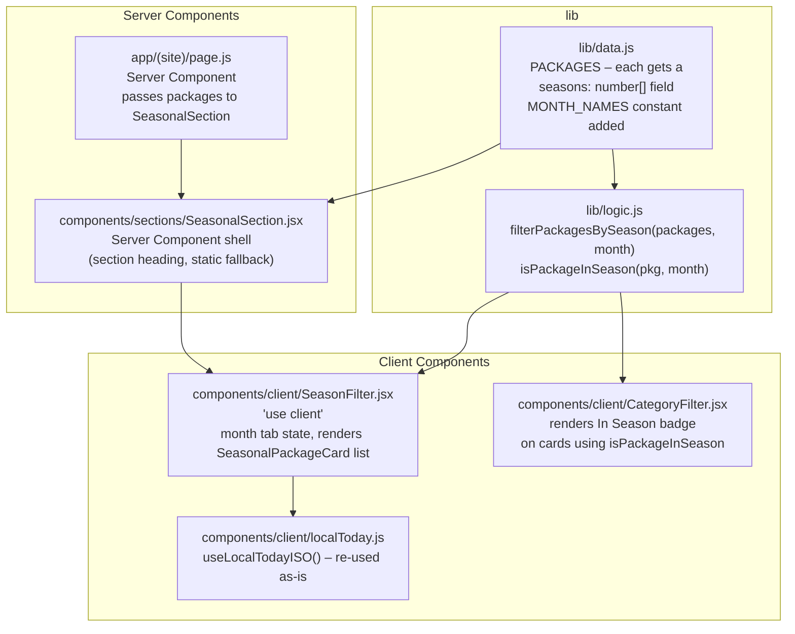
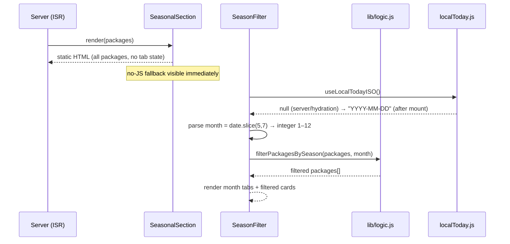
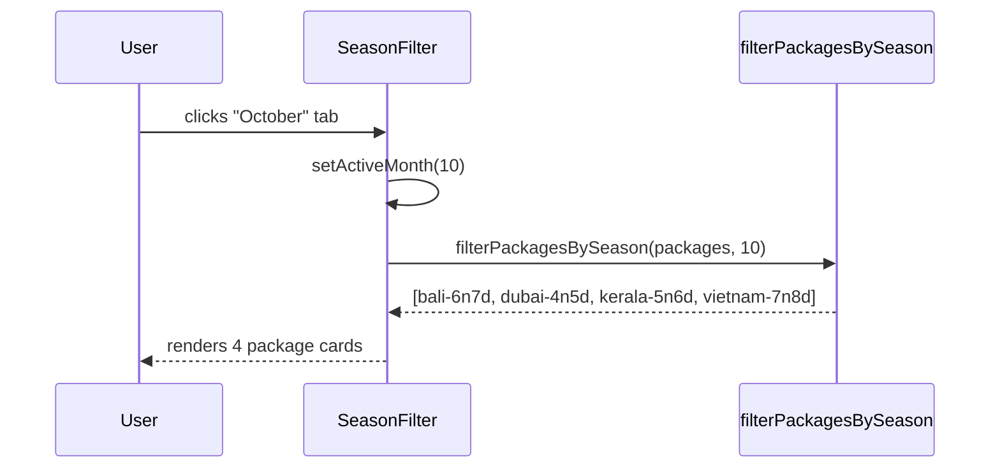
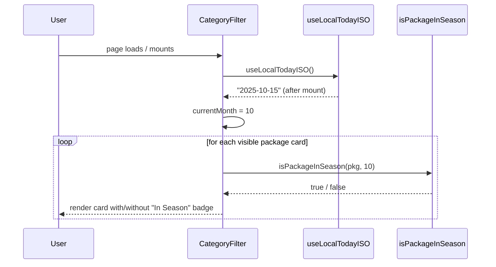

# Design Document: Seasonal Package Display

## Overview

Add a "Best Time to Travel" section to the Travel Guru Raipur public page that lets visitors browse packages by month. The section sits between the Collections section and the Popular Destinations section, presents 12 month tabs in a segmented-control style (matching `CategoryFilter`), and filters package cards to show only packages whose `seasons` array includes the selected month number (1–12). The current month is auto-selected on mount using the visitor's local clock. A compact emerald "In Season" badge is also surfaced on package cards elsewhere on the page (in the Collections section's `CategoryFilter`) to flag packages that are in season right now, without duplicating the section logic.

The feature touches four files in `lib/` (adding `seasons` data to `PACKAGES` in `data.js` and two pure functions to `logic.js`), introduces two new React components (`SeasonalSection` server shell and `SeasonFilter` client component) with their CSS Modules, and registers one new section in `app/(site)/page.js`.

---

## Architecture



**Key architecture decisions:**

- **Server Component shell + Client Component filter** — mirrors the existing `Collections` / `CategoryFilter` split exactly. The shell renders the section heading and a static no-JS fallback (all packages listed); the `SeasonFilter` client component hydrates on top and handles month state.
- **`seasons` is pure data in `lib/data.js`** — an array of month numbers (integers 1–12), added directly to each `PACKAGES` entry. No functions, no imports, consistent with the data-only constraint.
- **`filterPackagesBySeason` and `isPackageInSeason` in `lib/logic.js`** — pure functions with no side effects, importable by `node --test`.
- **Current month determined client-side** — the public page uses ISR (`revalidate = 300`); reading `new Date()` on the server would either bake a stale month into the HTML or force dynamic rendering. `useLocalTodayISO()` already exists in `localToday.js` and returns `null` on the server/during hydration, which is used as the "not yet mounted" state (the tab UI shows without a selection until hydration, then snaps to the current month).
- **"In Season" badge in `CategoryFilter`** — a single `isPackageInSeason(pkg, currentMonth)` call per card; `currentMonth` comes from `useLocalTodayISO()` parsed to a month integer. No new context or prop drilling needed.
- **CSS Modules only** — `SeasonalSection.module.css` for the shell layout and `SeasonFilter.module.css` for the tabs and card grid; tokens from `app/globals.css`.

---

## Main Algorithm / Workflow



---

## Data Shape: `seasons` Field

Each entry in `PACKAGES` gains a `seasons` array of month numbers (1 = January, 12 = December) representing ideal travel months from Raipur, based on destination climate and practical travel considerations.

### Seasonal Data per Package

| Package ID | Ideal Months | Rationale |
|---|---|---|
| `bali-6n7d` | `[10, 11, 12, 1, 2, 3]` | Dry season Oct–Mar; avoids Jul–Aug peak crowds and Apr–Jun shoulder rains |
| `dubai-4n5d` | `[10, 11, 12, 1, 2, 3, 4]` | Pleasant weather Oct–Apr; avoids May–Sep extreme heat (45°C+) |
| `singapore-4n5d` | `[2, 3, 4, 7, 8, 9]` | Drier periods Feb–Apr and Jul–Sep; year-round but these are best |
| `kerala-5n6d` | `[10, 11, 12, 1, 2, 3]` | Post-monsoon lush season Oct–Mar; cool and green after rains |
| `vietnam-7n8d` | `[10, 11, 12, 1, 2, 3]` | Northern/central dry season Oct–Mar; south year-round but best Oct–Mar |

### Data shape in `lib/data.js`:

```javascript
{
  id: "bali-6n7d",
  // ... existing fields ...
  seasons: [10, 11, 12, 1, 2, 3],  // new field: ideal months 1–12
}
```

---

## Core Interfaces / Types

### Package (extended)

```javascript
/**
 * @typedef {Object} Package
 * Existing fields unchanged. New field added:
 * @property {number[]} seasons - Month numbers 1–12 when this package is ideal.
 *   Empty array = year-round / unspecified. Must contain integers in [1, 12].
 */
```

### Month Tab Definition

```javascript
/**
 * MONTH_NAMES is a pure constant added to lib/data.js.
 * Index 0 = January (month number 1), index 11 = December (month number 12).
 */
export const MONTH_NAMES = [
  "January", "February", "March", "April", "May", "June",
  "July", "August", "September", "October", "November", "December",
];
```

### SeasonFilter Props

```javascript
/**
 * @param {Object} props
 * @param {Object[]} props.packages  - All published packages (plain objects)
 */
function SeasonFilter({ packages }) { ... }
```

### SeasonalSection Props

```javascript
/**
 * @param {Object} props
 * @param {Object[]} props.packages  - All published packages (plain objects)
 * @param {React.ReactNode} [props.children] - SeasonFilter client component
 */
function SeasonalSection({ packages, children }) { ... }
```

---

## Key Functions with Formal Specifications

### `filterPackagesBySeason(packages, month)`

```javascript
/**
 * Returns packages whose seasons array includes the given month number.
 * Packages with an empty or missing seasons array are excluded.
 *
 * @param {Object[]} packages - Array of package objects
 * @param {number} month      - Integer month 1–12
 * @returns {Object[]}        - New array, input order preserved
 */
export function filterPackagesBySeason(packages, month) { ... }
```

**Preconditions:**
- `packages` is an array (empty array returns empty array)
- `month` is an integer in [1, 12]

**Postconditions:**
- Returns a new array (never mutates input)
- Every returned package has `pkg.seasons.includes(month) === true`
- Packages whose `seasons` is missing, not an array, or empty are excluded
- Result preserves the original order of `packages`
- If `month` is not an integer in [1, 12], returns an empty array (graceful degradation)

**Loop Invariant:** All packages added to the result so far satisfy `pkg.seasons.includes(month)`.

---

### `isPackageInSeason(pkg, month)`

```javascript
/**
 * Returns true when a package is ideal for the given month.
 * Used to render the "In Season" badge on package cards.
 *
 * @param {Object} pkg   - A package object
 * @param {number} month - Integer month 1–12, or null/undefined (returns false)
 * @returns {boolean}
 */
export function isPackageInSeason(pkg, month) { ... }
```

**Preconditions:**
- `pkg` is an object (or any value — function never throws)
- `month` is an integer 1–12, or null/undefined

**Postconditions:**
- Returns `true` if and only if `pkg.seasons` is an array that includes `month`
- Returns `false` for any non-integer, out-of-range, null, or undefined `month`
- Never throws for any input
- Never mutates its arguments

---

## Algorithmic Pseudocode

### filterPackagesBySeason

```pascal
FUNCTION filterPackagesBySeason(packages, month)
  INPUT: packages (array of package objects), month (integer 1–12)
  OUTPUT: result (array of package objects)

  IF packages is not an Array THEN
    RETURN []
  END IF

  IF month is not an integer OR month < 1 OR month > 12 THEN
    RETURN []
  END IF

  result ← []

  FOR each pkg IN packages DO
    // Loop invariant: all items in result have seasons.includes(month)
    IF pkg.seasons is an Array
      AND pkg.seasons.length > 0
      AND pkg.seasons includes month
    THEN
      result.append(pkg)
    END IF
  END FOR

  RETURN result
END FUNCTION
```

### isPackageInSeason

```pascal
FUNCTION isPackageInSeason(pkg, month)
  INPUT: pkg (any value), month (any value)
  OUTPUT: isInSeason (boolean)

  IF pkg is null OR pkg is not an object THEN
    RETURN false
  END IF

  IF month is null OR month is undefined THEN
    RETURN false
  END IF

  IF month is not an integer OR month < 1 OR month > 12 THEN
    RETURN false
  END IF

  IF pkg.seasons is not an Array THEN
    RETURN false
  END IF

  RETURN pkg.seasons.includes(month)
END FUNCTION
```

### SeasonFilter client component state machine

```pascal
PROCEDURE SeasonFilter(packages)
  // On mount: read visitor's local month
  todayISO ← useLocalTodayISO()   // null until after hydration

  IF todayISO is not null THEN
    currentMonth ← parseInt(todayISO.slice(5, 7), 10)  // 1–12
  ELSE
    currentMonth ← null  // pre-hydration: no selection yet
  END IF

  // Initial tab state: sync with current month once known
  [activeMonth, setActiveMonth] ← useState(currentMonth)

  // Sync when currentMonth becomes known after hydration
  WHEN currentMonth changes from null to integer DO
    IF activeMonth is null THEN
      setActiveMonth(currentMonth)
    END IF
  END WHEN

  // Filter packages for active tab
  IF activeMonth is not null THEN
    visible ← filterPackagesBySeason(packages, activeMonth)
  ELSE
    visible ← []  // loading state during hydration
  END IF

  // Render month tabs + package cards
  RENDER tablist of 12 month tabs
  RENDER filtered package card list
END PROCEDURE
```

---

## Components and Interfaces

### SeasonalSection (Server Component shell)

**Purpose**: Renders the section wrapper, heading block and static no-JS fallback. Accepts the `SeasonFilter` client component as `children`.

**Interface:**
```javascript
/**
 * @param {{ packages?: object[], children?: React.ReactNode }} props
 */
function SeasonalSection({ packages, children }) { ... }
```

**Responsibilities:**
- Renders `<section id="best-time">` with the "Best Time to Travel" heading block
- Passes `children` (the `SeasonFilter`) when provided; otherwise renders a static list of all packages with INR prices (no-JS fallback)
- Applies the `section--alt` alternating background class

---

### SeasonFilter (Client Component)

**Purpose**: Interactive month-tab filter. Reads the visitor's local month, manages active tab state, filters packages, and renders the card grid.

**Interface:**
```javascript
/**
 * @param {{ packages?: object[] }} props
 */
function SeasonFilter({ packages }) { ... }
```

**Responsibilities:**
- Derives `activeMonth` (1–12) from `useLocalTodayISO()` after mount
- Renders the `role="tablist"` month tab control with 12 tabs
- Highlights the current calendar month with a small `--emerald` dot indicator
- Calls `filterPackagesBySeason(packages, activeMonth)` to get visible packages
- Renders a `SeasonalPackageCard` for each visible package in a responsive grid
- Shows an empty-state message with a `#collections` link when no packages match
- Implements roving-tabindex keyboard navigation (ArrowLeft/Right, Home, End)

---

### SeasonalPackageCard (internal to SeasonFilter)

**Purpose**: A simplified read-only package card for the seasonal browser. No booking or currency-switching; links to `#collections` for the full interactive experience.

**Interface:**
```javascript
/**
 * @param {{ pkg: object }} props
 */
function SeasonalPackageCard({ pkg }) { ... }
```

**Responsibilities:**
- Renders package image (lazy-loaded), title, region+duration meta, up to 2 highlights, from-price in INR
- Renders a "See All Packages →" anchor pointing to `#collections`

---

### CategoryFilter (modified — existing component)

**Purpose**: Existing component; gains "In Season" badge rendering on each card.

**Interface:** unchanged (`{ packages, onViewItinerary, onBook }`)

**Modification:**
- Calls `useLocalTodayISO()` to derive `currentMonth`
- Calls `isPackageInSeason(pkg, currentMonth)` per card
- Renders an `"✓ In Season"` emerald badge on matching cards (only after hydration)

---

## Component Structure

### `SeasonalSection` (Server Component)

```
components/
  sections/
    SeasonalSection.jsx          ← Server Component shell
    SeasonalSection.module.css   ← Shell layout styles
```

**Responsibilities:**
- Renders the section wrapper (`<section id="best-time">`)
- Renders the section header (eyebrow, H2, lead paragraph)
- Accepts `children` (the `SeasonFilter` client component) or falls back to a static package list

**Section copy:**
- Eyebrow: `"Best Time to Travel"`
- H2: `Ideal month for your next <em><span class="gradient-text">getaway</span></em>`
- Lead: `"Packages curated for Indian travellers departing from Raipur. Select a month to see what's in season."`

### `SeasonFilter` (Client Component)

```
components/
  client/
    SeasonFilter.jsx             ← 'use client' — month tabs + filtered cards
    SeasonFilter.module.css      ← Tab and card-grid styles
```

**Responsibilities:**
- Reads visitor's local month via `useLocalTodayISO()`
- Manages `activeMonth` state (integer 1–12 or null before hydration)
- Renders 12 month tab buttons in a scrollable segmented-control container
- Calls `filterPackagesBySeason(packages, activeMonth)` to get visible cards
- Renders `SeasonalPackageCard` for each visible package
- Shows an empty-state message when no packages match the selected month
- Implements keyboard navigation (ArrowLeft/ArrowRight, Home, End) on the tablist — same pattern as `CategoryFilter`

### `SeasonalPackageCard` (internal to `SeasonFilter`)

A read-only presentation card for seasonal browsing. Simpler than the `PackageCard` in `CategoryFilter` — no booking modal, no currency switcher. Shows: image, title, region+duration meta, highlights (up to 2), from-price in INR, and a "View All Packages" anchor scrolling to `#collections`.

---

## Sequence Diagrams

### Month Tab Interaction



### "In Season" Badge Rendering



---

## UI Design

### Month Tabs

The tab control follows the same segmented-control pattern as `CategoryFilter`:

- Container: horizontally scrollable, `scrollbar-width: none`, `overscroll-behavior-x: contain`
- Tab group: `role="tablist"`, inline-flex, `gap: 4px`, `padding: 4px`, pill-shaped border, `--bg-2` background
- Each tab: `role="tab"`, min-height 40px, `padding: 8px 18px`, `--r-pill`, `--text-md`, weight 600
- **Active tab:** `background: var(--gold-grad)` (matches existing active tab style from `CategoryFilter.module.css`)
- **Current month tab:** visually distinct indicator — a small dot or underline in `--emerald` to indicate "this is now", separate from the active/selected state
- Keyboard: roving tabindex (ArrowLeft/ArrowRight, Home, End); automatic activation on focus

```
┌──────────────────────────────────────────────────────────────────────────┐
│  ← Jan  Feb  Mar  Apr  May  Jun  Jul  Aug  Sep  [Oct ●]  Nov  Dec →      │
│                                                                           │
│  ┌──────────────┐  ┌──────────────┐  ┌──────────────┐  ┌─────────────┐  │
│  │ [img]        │  │ [img]        │  │ [img]        │  │ [img]       │  │
│  │ Trip to Bali │  │ Trip to      │  │ Trip to      │  │ Vietnam     │  │
│  │ Intl · 6N7D  │  │ Dubai        │  │ Kerala       │  │ Grand Disc. │  │
│  │ from ₹39,000 │  │ from ₹36,000 │  │ from ₹28,500 │  │ from ₹60k   │  │
│  │ [See Packages]│  │ [See Packages]│  │ [See Packages]│  │ [See Pkgs]  │  │
│  └──────────────┘  └──────────────┘  └──────────────┘  └─────────────┘  │
└──────────────────────────────────────────────────────────────────────────┘
```

Desktop: 3-column card grid (matching Collections). Tablet: 2-column. Mobile: 1-column, tabs scroll horizontally.

### "In Season" Badge

- Placement: in the package card body in `CategoryFilter`, just after `pkg.isSample` badge, before highlights
- Appearance: pill badge, `--emerald` background (solid, low opacity: `rgba(16, 185, 129, 0.15)`), `--emerald` text, `border: 1px solid rgba(16, 185, 129, 0.4)`
- Label: `"✓ In Season"` (checkmark + text; the checkmark is decorative `aria-hidden`)
- Only visible after client hydration (when `currentMonth` is known); rendered as nothing (`null`) during SSR/hydration to avoid mismatch

### Empty State (no packages in selected month)

```
No packages curated for [Month Name] yet.
Browse all → [Curated Collections ↓]
```

---

## Data Models

### Extended Package Object (with `seasons`)

```javascript
{
  id: "bali-6n7d",
  title: "Trip to Bali, Indonesia",
  destination: "Bali, Indonesia",
  region: "international",
  categories: ["international", "beach", "honeymoon", "family"],
  nights: 6,
  days: 7,
  image: "https://...",
  highlights: ["Private pool villa in Ubud", "Nusa Penida West Tour"],
  hotelStarRating: 4,
  mealPlan: "Breakfast in hotel",
  tiers: [ ... ],
  extras: { ... },
  itinerary: [ ... ],
  // NEW:
  seasons: [10, 11, 12, 1, 2, 3],
}
```

**Validation rules for `seasons`:**
- Must be an array (empty array is allowed; means year-round / unspecified in terms of filtering)
- Every element must be an integer in [1, 12]
- No duplicates within one package's seasons array
- `validatePackage` in `lib/logic.js` will be extended to validate this field

---

## Error Handling

### Hydration / clock unavailability

**Condition:** `useLocalTodayISO()` returns `null` (server render + hydration period)

**Response:** `activeMonth` is null; the tab control renders all 12 tabs with none selected (`aria-selected="false"` on all); the card grid shows nothing (empty state with loading copy: "Loading best season for you…")

**Recovery:** Once the client mounts and `useLocalTodayISO()` returns a date string, `activeMonth` is set to the current month and the tab becomes selected. This is a one-time snap, not a flicker loop.

### No packages for selected month

**Condition:** `filterPackagesBySeason(packages, month)` returns `[]`

**Response:** Empty state message with a link to `#collections`

**Recovery:** User clicks a different month tab

### Missing / malformed `seasons` field

**Condition:** A package in the catalogue has no `seasons` field, or it's not an array

**Response:** `filterPackagesBySeason` and `isPackageInSeason` treat such packages as "not in any season" — they are never returned/badged

**Recovery:** Fix the data in `lib/data.js`; no user-visible error

### Invalid month argument to logic functions

**Condition:** `filterPackagesBySeason` or `isPackageInSeason` receives a non-integer or out-of-range month

**Response:** Both functions return `[]` / `false` gracefully without throwing

---

## Testing Strategy

### Unit Testing Approach

Test `filterPackagesBySeason` and `isPackageInSeason` directly in `tests/` using `node:test`:

- `filterPackagesBySeason([], 10)` → `[]`
- `filterPackagesBySeason(packages, 10)` → packages with 10 in seasons
- `filterPackagesBySeason(packages, 6)` → only Singapore (months 7,8,9 include 6? No — only Singapore has Jun in its seasons? Let's be precise: `[2,3,4,7,8,9]` — 6 is not included. So result = `[]`)
- Packages with empty `seasons: []` are excluded
- Packages with missing `seasons` field are excluded
- Month 0, 13, -1, 1.5, NaN → `[]`
- `isPackageInSeason(baliPkg, 10)` → `true`
- `isPackageInSeason(baliPkg, 6)` → `false`
- `isPackageInSeason(null, 10)` → `false`
- `isPackageInSeason(baliPkg, null)` → `false`

### Property-Based Testing Approach

**Property Test Library:** fast-check (already pinned in the project)

Properties are documented in the Correctness Properties section below.

### Integration Testing Approach

- Verify that every entry in `PACKAGES` has a `seasons` field that is a non-empty array of integers in [1, 12]
- Verify that `validatePackage` (after extension) accepts all existing packages
- Verify section ordering: `SeasonalSection` renders after `Collections` and before `Destinations`

---

## Performance Considerations

- The `SeasonFilter` component re-filters on every tab click; with 5 packages this is O(5) — trivially fast
- No API calls; all filtering is in-memory from props passed at render
- Images in `SeasonalPackageCard` use `loading="lazy"` (below the fold) and the same `SafeImage` component or `` pattern as `Collections`
- The section uses `Reveal` for scroll animation, matching every other section

---

## Security Considerations

- No new API routes or server mutations introduced
- `seasons` data is static, defined in `lib/data.js`; no user input, no injection risk
- The month integer derived from `useLocalTodayISO()` is parsed with `parseInt` and validated before being passed to logic functions

---

## Dependencies

No new npm packages. All existing dependencies are re-used:

- `react` — `useState`, `useEffect`, `useId`, `useRef`
- `components/client/localToday.js` — `useLocalTodayISO()` (already exists)
- `lib/logic.js` — two new exported functions
- `lib/data.js` — `MONTH_NAMES` constant + `seasons` fields on `PACKAGES`
- CSS Modules (`SeasonalSection.module.css`, `SeasonFilter.module.css`)
- Shared UI: `components/ui/Card.module.css`, `components/ui/Badge.module.css`, `components/ui/Button.module.css`
- `components/client/SafeImage.jsx` — for package card images

---

## Correctness Properties

*A property is a characteristic or behavior that should hold true across all valid executions of a system — essentially, a formal statement about what the system should do. Properties serve as the bridge between human-readable specifications and machine-verifiable correctness guarantees.*

### Property 1: Season filter only returns in-season packages

*For any* array of packages and any valid month (integer 1–12), every package returned by `filterPackagesBySeason` must have that month in its `seasons` array.

**Validates: Requirements TBD**

### Property 2: Season filter excludes out-of-season packages

*For any* array of packages and any valid month, no package returned by `filterPackagesBySeason` should have a `seasons` array that excludes that month.

**Validates: Requirements TBD**

### Property 3: isPackageInSeason agrees with filterPackagesBySeason

*For any* array of packages and any valid month, a package appears in `filterPackagesBySeason(packages, month)` if and only if `isPackageInSeason(pkg, month)` returns `true`.

**Validates: Requirements TBD**

### Property 4: Season filter is a subset of all packages

*For any* array of packages and any valid month, the result of `filterPackagesBySeason` is a subset of (and no larger than) the input packages array.

**Validates: Requirements TBD**

### Property 5: Season filter preserves input order

*For any* array of packages and any valid month, the packages in the result of `filterPackagesBySeason` appear in the same relative order as they appear in the input.

**Validates: Requirements TBD**

### Property 6: Invalid month returns empty / false

*For any* packages array, calling `filterPackagesBySeason` with a non-integer, out-of-range, null, or undefined month must return an empty array; `isPackageInSeason` must return `false`.

**Validates: Requirements TBD**

### Property 7: All PACKAGES entries are valid after seasons field is added

*For all* entries in the `PACKAGES` constant in `lib/data.js`, `validatePackage(pkg)` must return `{ valid: true }` (i.e., adding the `seasons` field does not break existing validation, and the seasons values are valid month integers).

**Validates: Requirements TBD**
