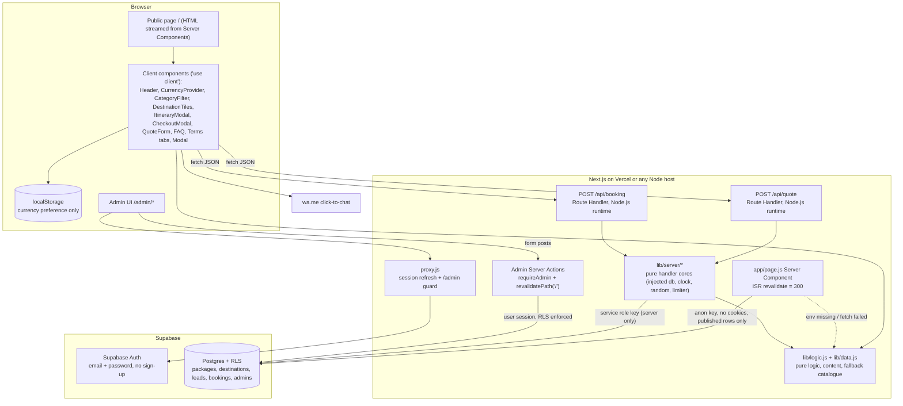

# Design Document: Travel Agency Website

> Status: APPROVED (aligned with Travel Guru Raipur's real business, quotations and policies). Brand revision approved: the design system, services, copy and contacts follow the agency's real logo and marketing poster (blue/orange on a dark indigo canvas, tagline "Your Journey, Our Priority", 8 services, Popular Destinations, Your Travel Expert). **Stack revision approved:** the vanilla static build is replaced by Next.js (App Router, React, plain JavaScript), CSS Modules, Next.js Route Handlers and Supabase (PostgreSQL, Auth, RLS) with an admin CMS. Open assumptions are listed in "Open Items to Confirm".

## Overview

A single public page plus a small admin area for **Travel Guru Raipur** ("Your Journey, Our Priority"), an independent tours and travel agency at VIP Chowk, Raipur. The public page keeps every approved section: the 8 poster services ("Complete Travel Solutions Under One Roof"), Popular Destinations (international and domestic grids), "Your Travel Expert", a filterable collections showcase built from the agency's real quotations (Bali, Dubai, Singapore, Kerala) with Deluxe / Superior / Premium tiers, adult and child pricing, separately priced extras, INR base pricing with an indicative currency switcher (persisted in `localStorage`), day-by-day itinerary modals, a dual-mode booking checkout (WhatsApp, or a booking request that follows Travel Guru's real payment policy), Terms & Policies, and a 24-hour call-back quotation engine with a WhatsApp instant-quote fallback.

What changes with the stack revision:

- **Framework:** Next.js App Router with React, plain JavaScript only (`.js` / `.jsx`, no TypeScript), `jsconfig.json` with the `@/*` path alias.
- **Styling:** vanilla CSS with CSS Modules (`*.module.css`) per component plus one global `app/globals.css` holding the design tokens. Fonts (Poppins, Plus Jakarta Sans) come from `next/font/google`, which self-hosts them at build time. No Tailwind. The whole design system below is unchanged.
- **Backend:** Next.js Route Handlers on the Node.js runtime: `POST /api/quote` stores a lead and returns a server-generated Ticket_ID; `POST /api/booking` recomputes the price from the database package and stores a booking request. Admin mutations are Server Actions.
- **Database:** Supabase Postgres with RLS on every table. Packages and destinations live in the database and are editable in `/admin` without code changes. Leads and bookings are written only by the route handlers with the service role key, which never leaves the server.
- **Rendering:** the public page is a Server Component with ISR (`revalidate = 300`, plus `revalidatePath("/")` on admin save). It reads published packages and destinations with a cookie-less anon client. **Fallback:** when the Supabase env vars are missing or the fetch fails, it uses the static catalogue in `lib/data.js`, so the site renders locally without a database.
- **Admin:** `/admin` behind Supabase Auth (email + password) with `@supabase/ssr` cookie sessions; `proxy.js` (Next.js 16's renamed middleware) guards `/admin/*`, and every page and mutation re-checks the admin role on the server. No public sign-up.
- **Pure core kept:** `lib/data.js` (content, configuration, seed and fallback catalogue) and `lib/logic.js` (pure business logic) stay framework-free ES modules that `node --test` imports directly. Route-handler logic is extracted into pure cores in `lib/server/` with injected database, clock, randomness and rate limiter, so it is unit and property tested without Next.js or Supabase.

Scope notes:

- **Payment stays a demo.** No payment is taken and no card data exists anywhere. Decision: the card number / expiry / CVC fields are removed (not kept display-only). Mode B now submits a booking request with the line "Demo: no payment is taken"; the server stores it as `pending` with server-computed advance and balance, and the agency collects the advance offline after confirming availability. Real payments later must use a hosted gateway page (for example Razorpay Payment Links) to stay out of PCI scope.
- WhatsApp flows (instant quote, booking confirm, greetings) stay client-side `wa.me` links and send nothing to the server.
- Currency conversions remain indicative static rates; all money math is whole INR.
- Superseded vanilla files: root `index.html`, `styles.css` and `app.js` are deleted after the port; root `data.js` and `logic.js` move to `lib/` (agreed migration). `prototype/index.html` stays as a visual reference.

## Architecture



File layout:

```
/
├── app/
│   ├── layout.js                 // fonts (next/font), globals.css, metadata from buildMetadata(BUSINESS), providers
│   ├── globals.css               // design tokens (:root), resets, shared utilities
│   ├── page.js                   // public page, Server Component, export const revalidate = 300
│   ├── page.module.css
│   ├── api/
│   │   ├── quote/route.js        // POST, runtime "nodejs", wires handleQuote
│   │   └── booking/route.js      // POST, runtime "nodejs", wires handleBooking
│   └── admin/
│       ├── layout.js             // robots noindex, dynamic, admin nav + logout
│       ├── actions.js            // 'use server': signIn, signOut, status updates, package/destination save/delete
│       ├── login/page.js
│       ├── page.js               // leads table
│       ├── bookings/page.js
│       ├── packages/page.js      // list
│       ├── packages/[id]/page.js // edit ("new" = create)
│       ├── destinations/page.js
│       └── destinations/[id]/page.js
├── components/
│   ├── sections/                 // Server Components + *.module.css: Hero, TrustStrip, Services, Collections,
│   │                             // Destinations, HowItWorks, QuoteSection, Expert, Reviews, Faq, Terms, FinalCta, Footer
│   ├── client/                   // 'use client': Header, CurrencyProvider, Price, CurrencySwitcher, CategoryFilter,
│   │                             // DestinationTiles, ItineraryModal, CheckoutModal, VoucherModal, QuoteForm, TicketModal,
│   │                             // QuoteIntentProvider, EnquireButton, FaqAccordion, TermsTabs, Modal, ModalProvider,
│   │                             // WhatsAppButton, FloatingWhatsApp, MobileStickyBar, SafeImage, LogoImage, Reveal
│   ├── ui/                       // shared CSS Modules: buttons, cards, badges, fields, steppers, segmented, table
│   └── admin/                    // LeadsTable, BookingsTable, StatusSelect, PackageForm, DestinationForm, LoginForm
├── lib/                          // plain ESM, relative imports only (no "@/"), importable by node --test
│   ├── data.js                   // MOVED from /data.js: configuration, content, seed + fallback catalogue
│   ├── logic.js                  // MOVED from /logic.js: pure functions (+ validatePackage, validateDestination)
│   ├── content-mapping.js        // pure: packageToRow, rowToPackage, destinationToRow, rowToDestination
│   ├── seo.js                    // pure: buildMetadata(BUSINESS), buildViewport()
│   ├── server/                   // pure handler cores, no Next.js or Supabase imports
│   │   ├── quote.js              // handleQuote
│   │   ├── booking.js            // handleBooking
│   │   ├── request.js            // parseJsonBody, clientIp, isSameOrigin
│   │   ├── rate-limit.js         // createRateLimiter (in-memory sliding window)
│   │   ├── time.js               // todayISOInZone
│   │   ├── content.js            // loadPublicContent (injected client, static fallback)
│   │   └── admin.js              // checkAdmin, runAdminMutation
│   └── supabase/                 // thin wiring, not imported by tests
│       ├── public.js             // anon client, no cookies (ISR-safe)
│       ├── server.js             // @supabase/ssr createServerClient with next/headers cookies (admin)
│       ├── service.js            // import "server-only"; service role client (route handlers, seed)
│       └── db.js                 // adapters: insertLead, insertBooking, getPublishedPackage (maps 23505)
├── proxy.js                      // Next.js 16 proxy (formerly middleware): /admin/:path* guard
├── next.config.js                // security headers (CSP etc.), poweredByHeader: false
├── jsconfig.json                 // { "compilerOptions": { "baseUrl": ".", "paths": { "@/*": ["./*"] } } }
├── eslint.config.mjs             // flat config with eslint-config-next
├── supabase/migrations/0001_init.sql
├── scripts/seed.js               // seeds 4 packages + 14 destinations from lib/data.js
├── public/assets/                // USER-SUPPLIED: logo.png, favicon.png, og-image.jpg, founder.jpg (moved from /assets)
├── tests/                        // node:test + fast-check; imports lib/ only
├── .env.local.example            // NEXT_PUBLIC_SUPABASE_URL, NEXT_PUBLIC_SUPABASE_ANON_KEY, SUPABASE_SERVICE_ROLE_KEY
└── package.json                  // "type": "module", pinned versions
```

Design decisions:

- **Pure core stays framework-free.** `lib/data.js`, `lib/logic.js`, `lib/content-mapping.js`, `lib/seo.js` and `lib/server/*` import nothing from Next.js, React or Supabase and use relative imports only, because `node --test` cannot resolve the `@/` alias. App and component files use `@/`.
- **Thin wiring, thick cores.** Each route handler reads the request, builds the dependencies (service client adapter, `new Date()`, `crypto.randomInt`, the module-level rate limiter) and calls a pure core that returns `{ status, headers, body }`. Tests call the cores with fakes.
- **Server Components by default.** Static sections render on the server with zero client JS; only interactive pieces are client components. Package and destination data are passed to client components as serialisable props.
- **ISR-safe reads.** Public reads use a cookie-less anon client (`lib/supabase/public.js`), because reading cookies would force dynamic rendering. Admin reads use the cookie session client and are always dynamic.
- **Money in whole INR.** Unchanged: other currencies are display-only conversions; the server recomputes every booking amount from the database package.
- **Clock and randomness injected.** Pure functions still never read the clock; the server's "today" is the business date in `BUSINESS.timeZone` ("Asia/Kolkata"), computed by `todayISOInZone(now, zone)`; the browser passes the visitor's local date for previews and input `min` attributes.
- **Ticket ID decision:** random `QT-YYYY-NNNN` with a `UNIQUE` constraint, not a Postgres sequence. The server draws `n = crypto.randomInt(0, 10000)`, formats it with the existing pure `generateTicketId(year, n)` (year from the IST business date) and retries on a unique violation, up to 5 attempts. This keeps the approved format and the pure function, and does not reveal lead volume the way sequential numbers would. Limitation: 10,000 IDs per year; collisions become frequent above a few thousand leads a year, at which point the format should be widened (open item).
- **Booking reference:** `generateBookingRef(n)` with `n = crypto.randomInt(0, 2**32)` (the range is exclusive at the top), the same `UNIQUE` + retry scheme.
- **Admin role decision:** an `admins` table (`user_id` → `auth.users.id`) with a `security definer` function `public.is_admin()` used in RLS policies, instead of `app_metadata.role`. Rows are added in the SQL editor after creating the user in the Supabase dashboard; no custom JWT claims are needed.
- **Images:** a small client `SafeImage` (`` with explicit width/height, `loading="lazy"`, `onError` → gradient placeholder) instead of `next/image`, because admins can enter image URLs and the onError fallbacks are required. Allowed hosts (`IMAGE_HOSTS`) are validated by `validatePackage` and mirrored in the CSP `img-src`.
- **Modal:** one accessible `Modal` component driven by a `ModalProvider` that allows a single open modal (focus trap, Escape, backdrop click, scroll lock, focus return).
