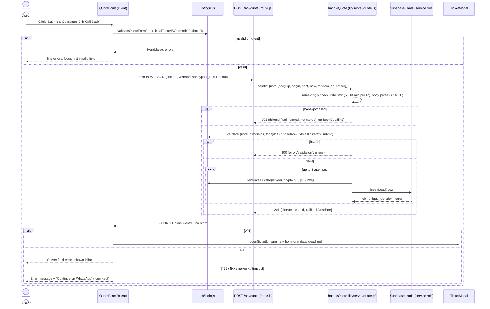
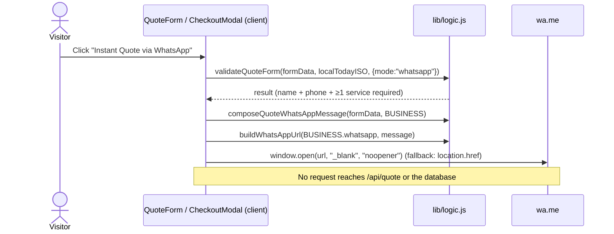
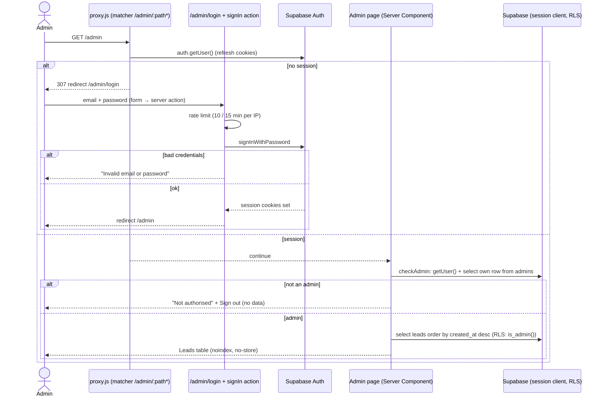
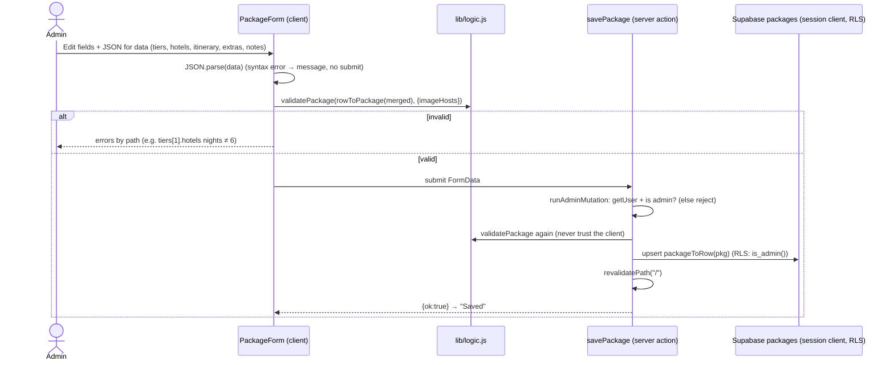

### 3.10 Brand assets and meta tags

| Asset | Path | Source | Used by |
|---|---|---|---|
| Logo | `public/assets/logo.png` (URL `/assets/logo.png`) | USER-SUPPLIED (transparent or black-background PNG) | Header (48px), footer (64px), quote-section `<noscript>` note |
| Favicon | `public/assets/favicon.png` | USER-SUPPLIED or generated from the logo (≥ 192×192, square crop of the ring) | `metadata.icons.icon` and `metadata.icons.apple` |
| OG image | `public/assets/og-image.jpg` | USER-SUPPLIED or generated (1200×630, logo on `--bg-0` with tagline) | `metadata.openGraph.images` as absolute URL `https://travelgururaipur.com/assets/og-image.jpg`, `twitter.card` `summary_large_image` |
| Founder photo | `public/assets/founder.jpg` | USER-SUPPLIED | Your Travel Expert section |

The existing `assets/` folder moves to `public/assets/`, and the `BUSINESS` paths become root-relative (`/assets/logo.png` and so on). `app/layout.js` exports `metadata = buildMetadata(BUSINESS)` and `viewport = buildViewport()` from `lib/seo.js`: `<title>` and `og:title` "Travel Guru Raipur · Your Journey, Our Priority", `metadataBase` and `og:url` = `BUSINESS.website`, `themeColor` `#070a1a`. Next.js renders these into the server HTML, so crawlers see them without running JS, and they can no longer drift from `BUSINESS`. A unit test checks `buildMetadata` output against `BUSINESS`.

## Sequence Diagrams

### 4.1 Quotation submit (primary pathway)



### 4.2 WhatsApp instant quote / booking (secondary pathway, client only)



### 4.3 Booking request (Mode B, server price recomputation)

```mermaid
sequenceDiagram
    actor U as Visitor
    participant C as CheckoutModal (client)
    participant L as lib/logic.js
    participant R as POST /api/booking
    participant H as handleBooking (lib/server/booking.js)
    participant P as packages (anon read, RLS: published)
    participant B as bookings (service role insert)
    participant V as VoucherModal
    U->>C: Book Now (packageId, tierId from modal or cheapest)
    U->>C: Tier, adults, children, travel date, name, email, phone, agree terms
    C->>L: computeBookingBreakdown(selection, date, localTodayISO, policy)
    L-->>C: preview (indicative; server is authoritative)
    U->>C: Confirm Booking Request
    C->>L: validateCheckout(form, localTodayISO, pkg)
    C->>R: POST {packageId, tierId, adults, children, travelDate, leadName, email, phone, agreeTerms}
    R->>H: handleBooking({body, ip, origin, host, now, random, db, limiter})
    H->>H: same-origin, rate limit, body parse, whitelist fields (prices / card keys ignored)
    H->>P: getPublishedPackage(packageId)
    alt missing or unpublished
        H-->>R: 400 {errors:{packageId}}
    else found
        H->>L: validateCheckout(fields, todayIST, dbPkg)
        H->>L: computeBookingBreakdown({tier: dbTier, adults, children}, travelDate, todayIST, BUSINESS.paymentPolicy)
        loop up to 5 attempts
            H->>L: generateBookingRef(crypto n ∈ [0, 2^32))
            H->>B: insertBooking(row with server amounts, status "pending")
        end
        H-->>R: 201 {bookingRef, breakdown}
    end
    R-->>C: JSON (no-store)
    C->>V: open(bookingRef, server breakdown, "No payment has been taken")
```

### 4.4 Public page render (ISR + fallback)

```mermaid
sequenceDiagram
    participant N as Next.js (app/page.js, revalidate = 300)
    participant S as loadPublicContent (lib/server/content.js)
    participant A as Anon client (no cookies)
    participant D as Supabase (RLS: is_published)
    participant F as lib/data.js
    N->>S: loadPublicContent({ client: publicClientOrNull(), fallback })
    alt env vars missing (client = null)
        S->>F: PACKAGES, DESTINATIONS
        S-->>N: {packages, destinations, source:"fallback"}
    else
        S->>A: select packages, destinations order by sort_order, id
        A->>D: REST query
        alt error / throw / timeout
            S->>F: static lists (per list)
            S-->>N: source "fallback" for that list (server log, no PII)
        else rows
            S->>S: rowToPackage / rowToDestination, drop rows failing validatePackage / validateDestination, null dangling packageId
            S-->>N: {packages, destinations, source:"database"}
        end
    end
    N-->>N: render Server Components, pass serialisable props to client components
    Note over N: Cached for 300 s; revalidatePath("/") after an admin save regenerates it on the next request
```

### 4.5 Admin sign-in and protected request



### 4.6 Admin edits a package



