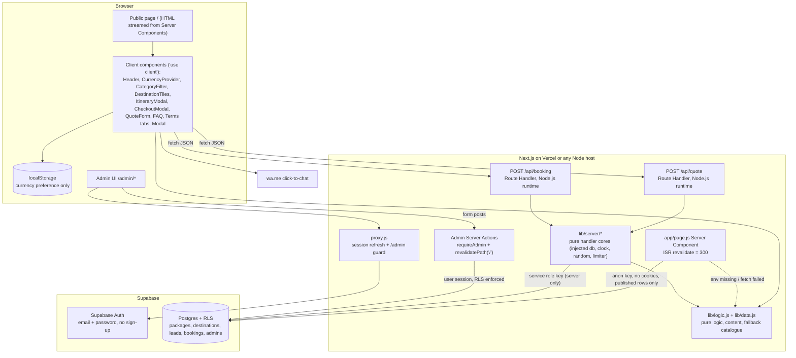
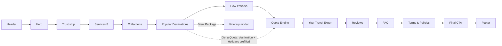
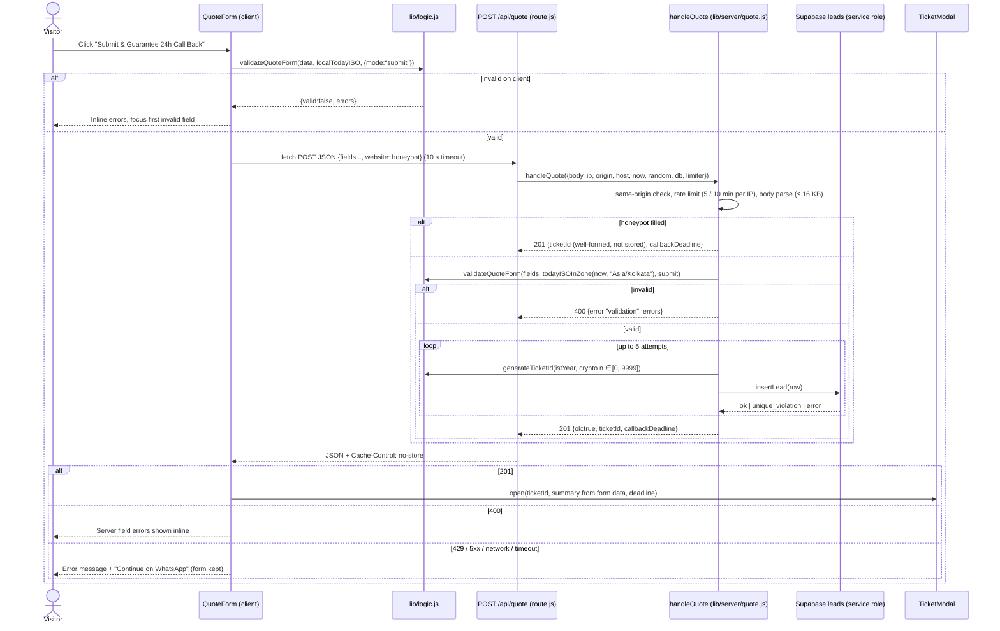
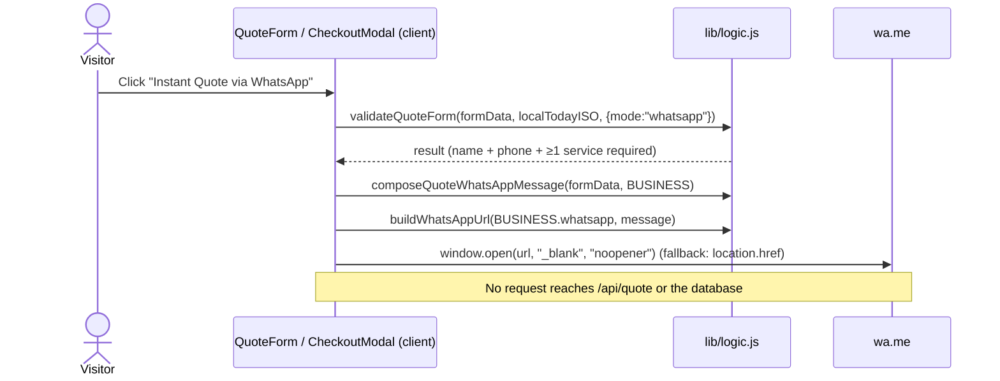
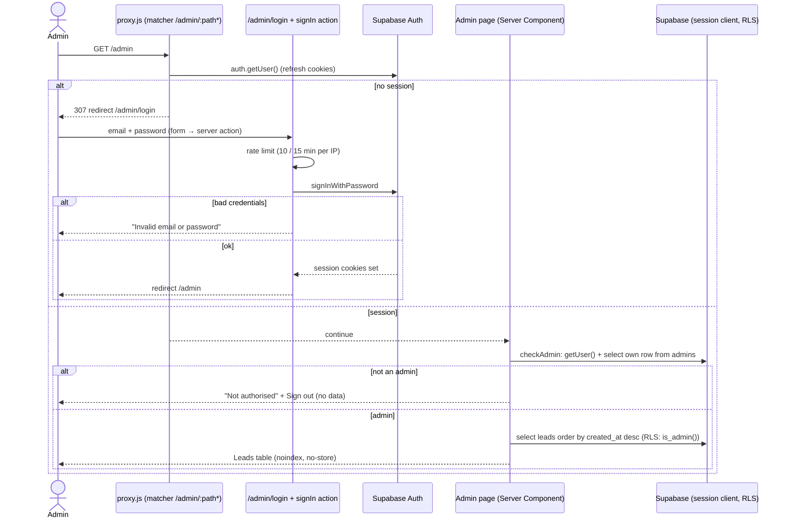
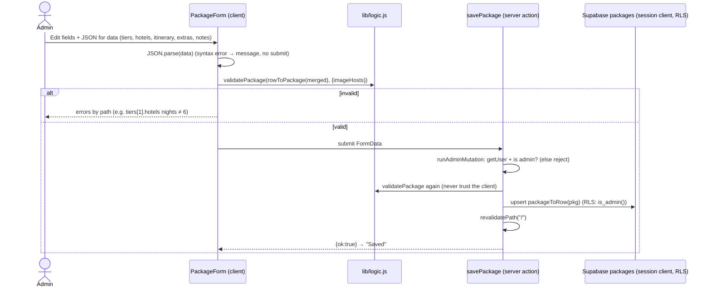

# Design Document: Travel Agency Website

> Status: APPROVED (aligned with Travel Guru Raipur's real business, quotations and policies). Brand revision approved: the design system, services, copy and contacts follow the agency's real logo and marketing poster (blue/orange on a dark indigo canvas, tagline "Your Journey, Our Priority", 8 services, Popular Destinations, Your Travel Expert). **Stack revision approved:** the vanilla static build is replaced by Next.js (App Router, React, plain JavaScript), CSS Modules, Next.js Route Handlers and Supabase (PostgreSQL, Auth, RLS) with an admin CMS. Open assumptions are listed in "Open Items to Confirm".

## Overview

A single public page plus a small admin area for **Travel Guru Raipur** ("Your Journey, Our Priority"), an independent tours and travel agency at VIP Chowk, Raipur. The public page keeps every approved section: the 8 poster services ("Complete Travel Solutions Under One Roof"), Popular Destinations (international and domestic grids), "Your Travel Expert", a filterable collections showcase built from the agency's real quotations (Bali, Dubai, Singapore, Kerala) with Deluxe / Superior / Premium tiers, adult and child pricing, separately priced extras, INR base pricing with an indicative currency switcher (persisted in `localStorage`), day-by-day itinerary modals, a dual-mode booking checkout (WhatsApp, or a booking request that follows Travel Guru's real payment policy), Terms & Policies, and a 24-hour call-back quotation engine with a WhatsApp instant-quote fallback.

What changes with the stack revision:

- **Framework:** Next.js App Router with React, plain JavaScript only (`.js` / `.jsx`, no TypeScript), `jsconfig.json` with the `@/*` path alias.
- **Styling:** vanilla CSS with CSS Modules (`*.module.css`) per component plus one global `app/globals.css` holding the design tokens. Fonts (Poppins, Plus Jakarta Sans) come from `next/font/google`, which self-hosts them at build time. No Tailwind. The whole design system below is unchanged.
- **Backend:** Next.js Route Handlers on the Node.js runtime: `POST /api/quote` stores a lead and returns a server-generated Ticket_ID; `POST /api/booking` recomputes the price from the database package and stores a booking request. Admin mutations are Server Actions.
- **Database:** Supabase Postgres with RLS on every table. Packages and destinations live in the database and are editable in `/admin` without code changes. Leads and bookings are written only by the route handlers with the service role key, which never leaves the server.
- **Rendering:** the public page is a Server Component with ISR (`revalidate = 300`, plus `revalidatePath("/")` on admin save). It reads published packages and destinations with a cookie-less anon client. **Fallback:** when the Supabase env vars are missing or the fetch fails, it uses the static catalogue in `lib/data.js`, so the site renders locally without a database.
- **Admin:** `/admin` behind Supabase Auth (email + password) with `@supabase/ssr` cookie sessions; `proxy.js` (Next.js 16's renamed middleware) guards `/admin/*`, and every page and mutation re-checks the admin role on the server. No public sign-up.
- **Pure core kept:** `lib/data.js` (content, configuration, seed and fallback catalogue) and `lib/logic.js` (pure business logic) stay framework-free ES modules that `node --test` imports directly. Route-handler logic is extracted into pure cores in `lib/server/` with injected database, clock, randomness and rate limiter, so it is unit and property tested without Next.js or Supabase.

Scope notes:

- **Payment stays a demo.** No payment is taken and no card data exists anywhere. Decision: the card number / expiry / CVC fields are removed (not kept display-only). Mode B now submits a booking request with the line "Demo: no payment is taken"; the server stores it as `pending` with server-computed advance and balance, and the agency collects the advance offline after confirming availability. Real payments later must use a hosted gateway page (for example Razorpay Payment Links) to stay out of PCI scope.
- WhatsApp flows (instant quote, booking confirm, greetings) stay client-side `wa.me` links and send nothing to the server.
- Currency conversions remain indicative static rates; all money math is whole INR.
- Superseded vanilla files: root `index.html`, `styles.css` and `app.js` are deleted after the port; root `data.js` and `logic.js` move to `lib/` (agreed migration). `prototype/index.html` stays as a visual reference.

## Architecture



File layout:

```
/
├── app/
│   ├── layout.js                 // fonts (next/font), globals.css, metadata from buildMetadata(BUSINESS), providers
│   ├── globals.css               // design tokens (:root), resets, shared utilities
│   ├── page.js                   // public page, Server Component, export const revalidate = 300
│   ├── page.module.css
│   ├── api/
│   │   ├── quote/route.js        // POST, runtime "nodejs", wires handleQuote
│   │   └── booking/route.js      // POST, runtime "nodejs", wires handleBooking
│   └── admin/
│       ├── layout.js             // robots noindex, dynamic, admin nav + logout
│       ├── actions.js            // 'use server': signIn, signOut, status updates, package/destination save/delete
│       ├── login/page.js
│       ├── page.js               // leads table
│       ├── bookings/page.js
│       ├── packages/page.js      // list
│       ├── packages/[id]/page.js // edit ("new" = create)
│       ├── destinations/page.js
│       └── destinations/[id]/page.js
├── components/
│   ├── sections/                 // Server Components + *.module.css: Hero, TrustStrip, Services, Collections,
│   │                             // Destinations, HowItWorks, QuoteSection, Expert, Reviews, Faq, Terms, FinalCta, Footer
│   ├── client/                   // 'use client': Header, CurrencyProvider, Price, CurrencySwitcher, CategoryFilter,
│   │                             // DestinationTiles, ItineraryModal, CheckoutModal, VoucherModal, QuoteForm, TicketModal,
│   │                             // QuoteIntentProvider, EnquireButton, FaqAccordion, TermsTabs, Modal, ModalProvider,
│   │                             // WhatsAppButton, FloatingWhatsApp, MobileStickyBar, SafeImage, LogoImage, Reveal
│   ├── ui/                       // shared CSS Modules: buttons, cards, badges, fields, steppers, segmented, table
│   └── admin/                    // LeadsTable, BookingsTable, StatusSelect, PackageForm, DestinationForm, LoginForm
├── lib/                          // plain ESM, relative imports only (no "@/"), importable by node --test
│   ├── data.js                   // MOVED from /data.js: configuration, content, seed + fallback catalogue
│   ├── logic.js                  // MOVED from /logic.js: pure functions (+ validatePackage, validateDestination)
│   ├── content-mapping.js        // pure: packageToRow, rowToPackage, destinationToRow, rowToDestination
│   ├── seo.js                    // pure: buildMetadata(BUSINESS), buildViewport()
│   ├── server/                   // pure handler cores, no Next.js or Supabase imports
│   │   ├── quote.js              // handleQuote
│   │   ├── booking.js            // handleBooking
│   │   ├── request.js            // parseJsonBody, clientIp, isSameOrigin
│   │   ├── rate-limit.js         // createRateLimiter (in-memory sliding window)
│   │   ├── time.js               // todayISOInZone
│   │   ├── content.js            // loadPublicContent (injected client, static fallback)
│   │   └── admin.js              // checkAdmin, runAdminMutation
│   └── supabase/                 // thin wiring, not imported by tests
│       ├── public.js             // anon client, no cookies (ISR-safe)
│       ├── server.js             // @supabase/ssr createServerClient with next/headers cookies (admin)
│       ├── service.js            // import "server-only"; service role client (route handlers, seed)
│       └── db.js                 // adapters: insertLead, insertBooking, getPublishedPackage (maps 23505)
├── proxy.js                      // Next.js 16 proxy (formerly middleware): /admin/:path* guard
├── next.config.js                // security headers (CSP etc.), poweredByHeader: false
├── jsconfig.json                 // { "compilerOptions": { "baseUrl": ".", "paths": { "@/*": ["./*"] } } }
├── eslint.config.mjs             // flat config with eslint-config-next
├── supabase/migrations/0001_init.sql
├── scripts/seed.js               // seeds 4 packages + 14 destinations from lib/data.js
├── public/assets/                // USER-SUPPLIED: logo.png, favicon.png, og-image.jpg, founder.jpg (moved from /assets)
├── tests/                        // node:test + fast-check; imports lib/ only
├── .env.local.example            // NEXT_PUBLIC_SUPABASE_URL, NEXT_PUBLIC_SUPABASE_ANON_KEY, SUPABASE_SERVICE_ROLE_KEY
└── package.json                  // "type": "module", pinned versions
```

Design decisions:

- **Pure core stays framework-free.** `lib/data.js`, `lib/logic.js`, `lib/content-mapping.js`, `lib/seo.js` and `lib/server/*` import nothing from Next.js, React or Supabase and use relative imports only, because `node --test` cannot resolve the `@/` alias. App and component files use `@/`.
- **Thin wiring, thick cores.** Each route handler reads the request, builds the dependencies (service client adapter, `new Date()`, `crypto.randomInt`, the module-level rate limiter) and calls a pure core that returns `{ status, headers, body }`. Tests call the cores with fakes.
- **Server Components by default.** Static sections render on the server with zero client JS; only interactive pieces are client components. Package and destination data are passed to client components as serialisable props.
- **ISR-safe reads.** Public reads use a cookie-less anon client (`lib/supabase/public.js`), because reading cookies would force dynamic rendering. Admin reads use the cookie session client and are always dynamic.
- **Money in whole INR.** Unchanged: other currencies are display-only conversions; the server recomputes every booking amount from the database package.
- **Clock and randomness injected.** Pure functions still never read the clock; the server's "today" is the business date in `BUSINESS.timeZone` ("Asia/Kolkata"), computed by `todayISOInZone(now, zone)`; the browser passes the visitor's local date for previews and input `min` attributes.
- **Ticket ID decision:** random `QT-YYYY-NNNN` with a `UNIQUE` constraint, not a Postgres sequence. The server draws `n = crypto.randomInt(0, 10000)`, formats it with the existing pure `generateTicketId(year, n)` (year from the IST business date) and retries on a unique violation, up to 5 attempts. This keeps the approved format and the pure function, and does not reveal lead volume the way sequential numbers would. Limitation: 10,000 IDs per year; collisions become frequent above a few thousand leads a year, at which point the format should be widened (open item).
- **Booking reference:** `generateBookingRef(n)` with `n = crypto.randomInt(0, 2**32)` (the range is exclusive at the top), the same `UNIQUE` + retry scheme.
- **Admin role decision:** an `admins` table (`user_id` → `auth.users.id`) with a `security definer` function `public.is_admin()` used in RLS policies, instead of `app_metadata.role`. Rows are added in the SQL editor after creating the user in the Supabase dashboard; no custom JWT claims are needed.
- **Images:** a small client `SafeImage` (`` with explicit width/height, `loading="lazy"`, `onError` → gradient placeholder) instead of `next/image`, because admins can enter image URLs and the onError fallbacks are required. Allowed hosts (`IMAGE_HOSTS`) are validated by `validatePackage` and mirrored in the CSP `img-src`.
- **Modal:** one accessible `Modal` component driven by a `ModalProvider` that allows a single open modal (focus trap, Escape, backdrop click, scroll lock, focus return).
## UI/UX Design System

Approved (brand revision): aligned with the agency's real logo and poster. Gold is removed; the brand's indigo, blue, sky and orange replace it on a dark indigo-tinted canvas. Visual changes affect Requirement 3 and the visual criteria of the section requirements, not the logic.

> **Superseded by prototype-visual-parity** — the gold-on-navy theme replaces the indigo/blue/orange palette described below. See Decision D1 in `.kiro/specs/prototype-visual-parity/requirements.md`

### 3.1 Style direction

Bold, modern and trustworthy, taken from the logo and poster: a deep indigo night canvas, generous whitespace, heavy sans-serif headlines with an orange-to-sky-blue gradient on accent words (like the "TG" letters in the logo), restrained glass cards and calm motion. Orange is the action colour (primary CTAs); sky blue is the interaction colour (secondary buttons, focus, links); the indigo of the logo ring frames the logo mark and active controls. Emerald signals trust and verification only ("Verified", "Trusted", "Included"); WhatsApp green stays for WhatsApp actions.

Brand fit: the logo is a royal-blue/indigo ring with orange→sky-blue "TG" letters on black, and the poster uses the same palette with coloured service icons. The dark canvas keeps the logo (black background PNG) seamless.

> **Superseded by prototype-visual-parity** — see Decision D1 in `.kiro/specs/prototype-visual-parity/requirements.md`

### 3.2 Color tokens

Decision: the canvases are tinted slightly toward indigo (instead of the previous neutral navy) so the logo ring and blue accents sit naturally on them.

| Token | Value | Usage |
|---|---|---|
| `--bg-0` | `#070a1a` | Page background, footer |
| `--bg-1` | `#0c1230` | Alternating section background, modal body |
| `--bg-2` | `#141b40` | Inputs, raised surfaces |
| `--glass` | `rgba(255,255,255,0.04)` | Glass card fill |
| `--glass-border` | `rgba(41,169,245,0.16)` | Card hairline borders (sky tint) |
| `--brand-indigo` | `#2410b5` | Logo ring, CSS logo mark ring, blue gradient end, hairlines (never as text on dark) |
| `--brand-blue` | `#1e6fe0` | Blue gradient start, links on light chips |
| `--brand-sky` | `#29a9f5` | Secondary button border/text, focus ring, active tab underline, icons |
| `--brand-orange` | `#f7931e` | Primary CTA gradient start, orange badge |
| `--brand-orange-deep` | `#f26522` | Primary CTA gradient end |
| `--brand-grad` | `linear-gradient(135deg,#f7931e 0%,#29a9f5 100%)` | Headline accent words, prices, brand badges, TG letters of the CSS logo mark, hairline accents |
| `--cta-grad` | `linear-gradient(135deg,#f7931e 0%,#f26522 100%)` | Primary CTA fill |
| `--blue-grad` | `linear-gradient(135deg,#1e6fe0 0%,#2410b5 100%)` | Active segmented-control segments |
| `--emerald` | `#10b981` | Verified / Trusted ticks, "included" chips, success states only |
| `--whatsapp` | `#25D366` | All WhatsApp buttons and the floating concierge |
| `--text-hi` | `#f5f1e8` | Headings, primary text (warm ivory) |
| `--text-md` | `#b8bfd0` | Body text |
| `--text-lo` | `#8a93ab` | Captions, placeholders (lightened from `#7a849c` to keep 4.5:1 on `--bg-2`) |
| `--on-cta` | `#070a1a` | Text on primary (orange) buttons |
| `--danger` | `#f87171` | Validation errors |

Service accent tokens (poster icon circles, decorative only; icon glyphs are white and `aria-hidden`):

| Token | Value | Service |
|---|---|---|
| `--svc-blue` | `#1e6fe0` | Flights |
| `--svc-orange` | `#f7931e` | Hotels |
| `--svc-purple` | `#9333ea` | Passport |
| `--svc-red` | `#ef4444` | Visa |
| `--svc-green` | `#22c55e` | Holidays |
| `--svc-teal` | `#14b8a6` | Travel Insurance |
| `--svc-violet` | `#7c3aed` | Train |
| `--svc-pink` | `#ec4899` | Packages |

All `--gold-*` tokens and `--shadow-gold` are removed.

Contrast (computed with the WCAG relative-luminance formula; full WCAG validation still needs manual testing with assistive technologies):

| Pair | Ratio | Result |
|---|---|---|
| `--text-hi` on `--bg-0` / `--bg-1` | ≈ 17.5:1 / ≈ 16:1 | AA/AAA |
| `--text-md` on `--bg-0` / `--bg-1` | ≈ 11:1 / ≈ 10:1 | AA/AAA |
| `--text-lo` on `--bg-1` / `--bg-2` | ≈ 5.9:1 / ≈ 5.4:1 | AA |
| `--on-cta` (#070a1a) on `#f7931e` / `#f26522` | ≈ 8.6:1 / ≈ 6.2:1 | AA (white on `#f26522` is only ≈ 3.2:1, so white is not used) |
| `--brand-sky` text/border on `--bg-0` / `--bg-1` | ≈ 7.6:1 / ≈ 7:1 | AA; focus ring ≥ 3:1 |
| `--brand-orange` gradient text on `--bg-0` | ≈ 8.6:1 (orange end), ≈ 7.6:1 (sky end) | AA |
| White on `--blue-grad` (`#1e6fe0` → `#2410b5`) | ≈ 4.8:1 → ≈ 11.5:1 | AA |
| White on `--whatsapp` | ≈ 1.9:1 | Fails AA, so WhatsApp buttons now use `--on-cta` (#070a1a) text and icon on `--whatsapp` (≈ 10:1); the floating icon-only button keeps a white glyph with an accessible name |

`--brand-indigo` on the dark canvases is below 3:1, so it is used only for the ring, borders and gradient ends, never for text or as the sole focus indicator.

> **Superseded by prototype-visual-parity** — see Decision D1 in `.kiro/specs/prototype-visual-parity/requirements.md`

### 3.3 Typography

Recommendation (adopted): switch headings from Playfair Display to **Poppins** (600, 700, 800), a heavy geometric sans that matches the poster's bold display lettering and the logo's rounded "TG". The poster's script accent is not reproduced as a font (one extra web font for a few words is not worth the weight); accent words use `--brand-grad` text instead.

- Headings, prices and display: **Poppins** (600, 700, 800).
- UI / body / forms: **Plus Jakarta Sans** (400, 500, 600, 700), unchanged.
- Loaded with `next/font/google` in `app/layout.js` (`Poppins({ weight: ["600","700","800"], subsets: ["latin"], display: "swap", variable: "--font-heading" })` and `Plus_Jakarta_Sans({ weight: ["400","500","600","700"], subsets: ["latin"], display: "swap", variable: "--font-body" })`). Next.js downloads the files at build time and serves them from the site's own origin, so no request goes to Google at runtime and no `preconnect` is needed. Fallbacks `sans-serif` for both.
- Tokens live in `app/globals.css` on `:root`; components consume them from their own `*.module.css` files (no Tailwind, no CSS-in-JS).

| Role | Font | Size (desktop → mobile, via `clamp`) | Weight | Notes |
|---|---|---|---|---|
| Display (hero H1) | Poppins | `clamp(2.5rem, 6vw, 4.75rem)` | 800 | One word in `--brand-grad` text |
| H2 section title | Poppins | `clamp(2rem, 4vw, 3rem)` | 700 | Preceded by eyebrow |
| H3 card title | Poppins | `1.375rem` | 600 | |
| Eyebrow | Jakarta | `0.75rem`, letter-spacing `0.24em`, uppercase | 600 | `--brand-sky`, with 32px `--brand-grad` line before |
| Body | Jakarta | `1rem` / line-height 1.7 | 400 | `--text-md` |
| Small / captions | Jakarta | `0.8125rem` | 500 | `--text-lo` |
| Button | Jakarta | `0.9375rem`, letter-spacing `0.02em` | 600 | |
| Price | Poppins | `1.75rem` | 700 | `--brand-grad` text |

### 3.4 Spacing, radius, elevation

- Spacing scale (px): 4, 8, 12, 16, 24, 32, 48, 64, 96, 128. Section vertical padding: 96px desktop, 64px tablet, 48px mobile.
- Container: max-width 1200px, side padding 24px (16px mobile).
- Radius: `--r-sm 8px` (inputs, chips), `--r-md 16px` (cards), `--r-lg 24px` (modals, quote panel), `--r-pill 999px` (buttons, badges).
- Shadows: `--shadow-card: 0 10px 30px -10px rgba(0,0,0,.6)`; `--shadow-brand: 0 8px 28px -8px rgba(247,147,30,.45)` (orange glow, primary CTA hover; replaces `--shadow-gold`).

### 3.5 Core components

| Component | Spec |
|---|---|
| Logo (header/footer) | ``, 48px tall in the header (64px in the footer), explicit width/height. On `error` the image is replaced by the CSS logo mark. |
| CSS logo mark (fallback) | 48px circle on `--bg-0` with a 3px `--brand-indigo` ring and a 1px white inner hairline, containing "TG" (`BUSINESS.logoInitials`) in Poppins 800 with `--brand-grad` text; `role="img"` with `aria-label="Travel Guru Raipur logo"`. |
| Primary button | Pill, `--cta-grad` fill, `--on-cta` text, 14px×28px padding. Hover: lift `translateY(-2px)`, `--shadow-brand`, gradient shifts via `background-position`. |
| Secondary button | Pill, transparent, 1px `--brand-sky` border, `--brand-sky` text. Hover: fill `rgba(41,169,245,.1)`. |
| WhatsApp button | Pill, `--whatsapp` fill, `--on-cta` text, WhatsApp SVG icon. |
| Glass card | `--glass` fill, `backdrop-filter: blur(14px) saturate(140%)`, 1px `--glass-border`, `--r-md`. Hover: lift 6px, border brightens to `rgba(41,169,245,.4)`. Fallback without backdrop-filter: solid `--bg-1`. |
| Service icon circle | 56px circle filled with the service's accent token (`--svc-*`), white icon glyph, `aria-hidden="true"`. |
| Destination tile | `--r-md` card, 4:3 image with bottom gradient overlay, name (H3), tagline (`--text-md`), "Get a Quote" secondary button, optional "View Package" primary button. |
| Badge / chip | Pill, 6px×12px, small text. Variants: brand (`--brand-grad` border/text: 24h guarantee, rating), emerald (Verified, Trusted, included), neutral (tags, "Priced separately"). |
| Form field | `--bg-2` fill, 1px `rgba(255,255,255,.08)` border, `--r-sm`, 48px min height. Focus: 2px `--brand-sky` ring. Error: red border + message below with `aria-describedby`. Labels sit above fields. |
| Service checkbox tile | Selectable card tile with the service's accent icon circle + label; checked state gets a `--brand-sky` border, sky-tinted fill and a check mark. Real `<input type="checkbox">` underneath. |
| Segmented control | Currency switcher, filter tabs and tier switcher: pill group, active segment `--blue-grad` with white text. Built on radio inputs. |
| Stepper | `[ − ] n [ + ]` for adults / children, real `<input type="number">` with min/max, buttons have `aria-label`. |
| Modal | Centered, max-width 760px (itinerary 920px), `--bg-1`, `--r-lg`, backdrop `rgba(7,10,26,.75)` with blur. Mobile: full-screen sheet sliding up. Focus trap, ESC closes, returns focus to trigger. |
| Accordion | Hairline-separated rows, `+` rotates to `×`, height animation via `grid-template-rows`. Used by FAQ and Terms & Policies. |
| Data table | Cancellation charges: hairline rows, right-aligned percentages in `--brand-orange`, becomes stacked label/value rows under 640px. |
| Floating WhatsApp | 60px circle bottom-right (24px inset), pulsing ring, tooltip "Typically replies in under 10 mins". |

### 3.6 Responsive breakpoints

| Name | Range | Grid behaviour |
|---|---|---|
| Mobile | < 640px | 1 column; destination grids become horizontal scroll-snap rows; Expert section stacks photo above text; nav collapses to hamburger drawer; modals full-screen; sticky bottom CTA bar ("Get Quote" + WhatsApp) |
| Tablet | 640–1023px | 2-column cards and destination tiles; Expert photo left / text right; quote form 2-column fields |
| Desktop | 1024–1439px | Services 4+4 grid, collections 3-col, international destinations 3-col (3+3), domestic destinations 4-col (4+4), Expert split 5/7, quote section split 5/7 |
| Wide | ≥ 1440px | Same as desktop, container capped at 1200px |

### 3.7 Motion and hover

- Easing `cubic-bezier(.2,.7,.2,1)`; durations 200ms (hover), 350ms (modals), 600ms (scroll reveals).
- Scroll reveal: sections fade up 24px via `IntersectionObserver`, once only.
- Card hover: lift + border glow + image zoom 1.05 inside card.
- Hero: slow Ken Burns zoom on background image (20s, alternate).
- Floating WhatsApp: 2s pulsing ring.
- Guarantee badge: subtle shimmer sweep every 6s.
- Currency and tier switch: prices and hotel list crossfade (150ms).
- All non-essential motion disabled under `prefers-reduced-motion: reduce`.

### 3.8 Page structure (section order)

1. Sticky header / nav (logo image)
2. Hero
3. Trust strip
4. Services (8)
5. Curated Collections (filter + currency switcher)
6. Popular Destinations (international + domestic grids) (NEW)
7. How It Works (4 steps)
8. 24h Quotation Engine
9. Your Travel Expert (NEW)
10. Reviews & Trust Badges
11. Operations FAQ
12. Terms & Policies
13. Final CTA band
14. Footer
15. Overlays: Itinerary modal, Booking checkout modal, Quotation ticket modal, Voucher modal, Floating WhatsApp, Mobile sticky CTA bar

Order decision: Popular Destinations follows Collections so visitors move from priced packages to "where else can we go", and its tiles hand off to the quote form two sections later. Your Travel Expert sits directly before Reviews, so the person behind the agency and the traveller stories form one trust block after the quote form.



### 3.9 Section-by-section wireframes (desktop, with mobile notes)

**1. Header (sticky, 72px; transparent over hero, becomes `--bg-0` at 90% opacity with blur after 40px scroll)**

```
┌──────────────────────────────────────────────────────────────────────────┐
│ [logo.png] TRAVEL GURU RAIPUR  Services Collections Destinations         │
│            Your Journey, Our Priority  How it Works Reviews FAQ Terms    │
│                                        [ ₹ INR ▾ ] [ Get Free Quote ✦ ]  │
└──────────────────────────────────────────────────────────────────────────┘
[logo.png] = , 48px tall;
on load error it is swapped for the CSS "TG" mark (indigo ring, orange→sky letters).
Mobile: logo left, currency + hamburger right; drawer slides in from right.
```

**2. Hero (min-height 92vh, full-bleed image with indigo gradient overlay bottom→top)**

```
┌──────────────────────────────────────────────────────────────────────────┐
│   — YOUR JOURNEY, OUR PRIORITY                                           │
│                                                                          │
│   Explore the *World*                                                    │
│   With Us.                      (accent word in --brand-grad)           │
│                                                                          │
│   Complete Travel Solutions Under One Roof: flights, hotels, passport,  │
│   visa, holidays, travel insurance, IRCTC trains and custom packages,   │
│   with your own travel expert who calls you back.                        │
│                                                                          │
│   [ ⚡ Get My Custom Quote ] (orange)  [ ◯ WhatsApp Us ]                  │
│                                                                          │
│   ┌──────────────────────────────────────────────┐                       │
│   │ ⚡ Guaranteed Call Back & Custom Quotation    │ (brand glass badge)  │
│   │    Within 24 Hours                            │                       │
│   └──────────────────────────────────────────────┘                       │
│                                                                          │
│   ★ 4.9 rated  ·  ✓ Verified  ·  ✓ Trusted  ·  VIP Chowk, Raipur         │
└──────────────────────────────────────────────────────────────────────────┘
Review count ("from N travellers") renders only when BUSINESS.rating.count is set.
Mobile: text left-aligned, CTAs stack full-width, badge below CTAs.
```

**3. Trust strip (bg-1, 96px)**

```
┌──────────────────────────────────────────────────────────────────────────┐
│  ★ 4.9 Rated │ 8 Services,        │ 24h Call Back │ Office at VIP Chowk,  │
│  ✓ Verified  │ 1 Expert           │ Guarantee     │ Telibandha, Raipur    │
└──────────────────────────────────────────────────────────────────────────┘
Only verifiable claims; "450+ airlines" / "IATA-style" removed.
"8" is derived from SERVICES.length.
Mobile: 2×2 grid.
```

**4. Services (8 glass cards; desktop 4 + 4, tablet 2-col, mobile 1-col)**

```
            — UNDER ONE ROOF
      Complete Travel Solutions Under One Roof
┌───────────┐ ┌───────────┐ ┌───────────┐ ┌───────────┐
│ (✈) blue  │ │ (⌂) orange│ │ (▤)purple │ │ (▣) red   │
│ Flights   │ │ Hotels    │ │ Passport  │ │ Visa      │
│ Domestic &│ │ Best Stays│ │ New /     │ │ Tourist / │
│ Internat. │ │ Worldwide │ │ Renewal   │ │ Business  │
│           │ │           │ │ Assistance│ │ Visa Supp.│
│ summary   │ │ summary   │ │ summary   │ │ summary   │
│ • bullets │ │ • bullets │ │ • bullets │ │ • bullets │
│ Enquire → │ │ Enquire → │ │ Enquire → │ │ Enquire → │
└───────────┘ └───────────┘ └───────────┘ └───────────┘
┌───────────┐ ┌───────────┐ ┌───────────┐ ┌───────────┐
│ (☀) green │ │ (⛨) teal  │ │ (🚆)violet│ │ (◫) pink  │
│ Holidays  │ │ Travel    │ │ Train     │ │ Packages  │
│ Domestic &│ │ Insurance │ │ IRCTC     │ │ Customized│
│ Internat. │ │ Travel    │ │ Ticket    │ │ & Group   │
│ Packages  │ │ Safe      │ │ Booking & │ │ Tour      │
│           │ │ Always    │ │ Assistance│ │ Packages  │
│ Enquire → │ │ Enquire → │ │ Enquire → │ │ Enquire → │
└───────────┘ └───────────┘ └───────────┘ └───────────┘
(icon) = 56px circle in the service accent token (--svc-*), white glyph.
Each card: icon circle, title, poster subtitle, 1–2 line summary, 1–3 bullets.
"Enquire →" scrolls to quote engine and pre-ticks that service checkbox.
```

**5. Curated Collections**

```
            — CURATED COLLECTIONS
        Handcrafted journeys, priced transparently
 [All] [International] [Domestic] [Honeymoon] [Family] [Beach & Islands]
            Prices in: [₹ INR|$ USD|€ EUR|£ GBP|A$ AUD|AED|S$ SGD]
            (non-INR prices are indicative conversions)
┌──────────────────────┐ ┌──────────────────────┐ ┌──────────────────────┐
│ [ image 4:3        ] │ │ [ image            ] │ │ [ image            ] │
│ INTERNATIONAL 6N/7D  │ │ INTERNATIONAL 4N/5D  │ │ DOMESTIC   5N/6D     │
│ Trip to Bali,        │ │ Trip to Dubai        │ │ Trip to Kerala       │
│ Indonesia            │ │                      │ │                      │
│ 4★ · Breakfast       │ │ Breakfast only       │ │ 4★ · Breakfast+Dinner│
│ ✓ Private transfers  │ │ ✓ Burj Khalifa ✓ Safari│ │ ✓ Houseboat ✓ Sedan │
│ from ₹39,000 /pp     │ │ from ₹36,000 /pp     │ │ from ₹28,500 /pp     │
│ land package         │ │ land package         │ │ land package         │
│ + flights & visa     │ │ + flights & visa     │ │ + flights priced     │
│   priced separately  │ │   priced separately  │ │   separately         │
│ [View Itinerary]     │ │ [View Itinerary]     │ │ [View Itinerary]     │
│ [Book Now ✦]         │ │ [Book Now ✦]         │ │ [Book Now ✦]         │
└──────────────────────┘ └──────────────────────┘ └──────────────────────┘
(4 real packages: Bali, Dubai, Singapore, Kerala; filter tabs scroll horizontally on mobile)
"from" = lowest adult tier price per person, in --brand-grad text. Price nodes carry data-price-inr.
Empty filter state: "No journeys here yet. Ask us to craft one →"
```

**6. Popular Destinations (NEW; bg-1; two grids from DESTINATIONS via destinationsByRegion)**

```
            — POPULAR DESTINATIONS
             Plan Your Next Getaway Today
  International
┌──────────────────┐ ┌──────────────────┐ ┌──────────────────┐
│ [ image 4:3    ] │ │ [ image        ] │ │ [ image        ] │
│ Thailand         │ │ Singapore        │ │ Malaysia         │
│ Beaches | Culture│ │ Modern | Fun |   │ │ City Life |      │
│ | Nightlife      │ │ Unforgettable    │ │ Shopping | Nature│
│ [Get a Quote]    │ │ [Get a Quote]    │ │ [Get a Quote]    │
│                  │ │ [View Package ✦] │ │                  │
└──────────────────┘ └──────────────────┘ └──────────────────┘
┌──────────────────┐ ┌──────────────────┐ ┌──────────────────┐
│ Europe           │ │ Dubai            │ │ Vietnam          │
│ History | Culture│ │ Luxury | Shopping│ │ Nature | Heritage│
│ | Adventure      │ │ | Modernity      │ │ | Food           │
│ [Get a Quote]    │ │ [Get a Quote]    │ │ [Get a Quote]    │
│                  │ │ [View Package ✦] │ │                  │
└──────────────────┘ └──────────────────┘ └──────────────────┘
  Domestic
┌────────────┐ ┌────────────┐ ┌────────────┐ ┌────────────┐
│ Kashmir    │ │ Shimla-    │ │ Kerala     │ │ Andaman    │
│ Heaven on  │ │ Manali     │ │ Backwaters │ │ Blue Waters│
│ Earth      │ │ Hills &    │ │ & Beaches  │ │ & Islands  │
│            │ │ Adventure  │ │ [View Pkg] │ │            │
└────────────┘ └────────────┘ └────────────┘ └────────────┘
┌────────────┐ ┌────────────┐ ┌────────────┐ ┌────────────┐
│ Char Dham  │ │ Vaishno    │ │ Udaipur-   │ │ Nepal      │
│ Spiritual  │ │ Devi       │ │ Jaisalmer  │ │ Nature &   │
│ Journey    │ │ Divine     │ │ Royal      │ │ Culture    │
│            │ │ Blessings  │ │ Heritage   │ │            │
└────────────┘ └────────────┘ └────────────┘ └────────────┘
(every tile has [Get a Quote]; domestic tiles abbreviated above)
"Get a Quote" scrolls to the quote engine, sets Destination(s) to the tile name
and ticks "Holidays" (other ticks are kept). "View Package" (only when
packageId is set: Singapore, Dubai, Kerala) opens that package's itinerary modal.
Bali is not a poster destination; it stays reachable as a Collections package.
Nepal is listed under Domestic exactly as on the poster (open item to confirm).
Images: Unsplash placeholders, lazy-loaded; on error the tile shows a gradient
placeholder and keeps name, tagline and buttons.
Mobile: each grid becomes a horizontal scroll-snap row with no page overflow.
```

**7. How It Works (4 numbered steps, horizontal on desktop with a --brand-grad connector line, vertical on mobile)**

```
 ①──────────────②──────────────③──────────────④
 Share your     Consultant      Receive your    Confirm with an
 wishlist       calls in <24h   custom quote    advance payment
                                (valid 24 hrs)
```

**8. 24h Quotation Engine (bg-1, split 5/7)**

```
┌───────────────────────────────┬──────────────────────────────────────────┐
│ — ZERO-OBLIGATION QUOTE       │  STEP 1 · What do you need?              │
│ Tell us your dream trip.      │  [☐ Flights] [☐ Hotels] [☐ Passport]     │
│ We'll do the rest.            │  [☐ Visa] [☑ Holidays] [☐ Travel Insur.] │
│                               │  [☐ Train] [☐ Packages]                  │
│ ┌───────────────────────────┐ │  STEP 2 · Trip details                   │
│ │ ⚡ Guaranteed Call Back &  │ │  Departure City [Raipur____] Destination(s)[__]│
│ │ Custom Quotation Within   │ │  Departure Date [📅 min=tomorrow]         │
│ │ 24 Hours                  │ │  Duration [5-7 ▾]  Trip type [Honeymoon ▾]│
│ └───────────────────────────┘ │  Adults [−] 2 [+]   Children [−] 1 [+]   │
│ ✓ Free, no-obligation quote   │  Child ages [e.g. 6, 9______] (free text)│
│ ✓ Real human consultant       │  Hotel [3★|4★|5★|Deluxe|Superior|Premium|Any]│
│ ✓ Deluxe / Superior / Premium │  Meal plan [Any ▾] (optional) Budget [▾] │
│   hotel options               │  STEP 3 · Your details                   │
│ ✓ Quotes valid for 24 hours   │  Full Name [______]  Phone/WhatsApp [___]│
│                               │  Email [_____________]                   │
│ Prefer chat? avg reply 8 min  │  Call-back slot [Anytime (Fastest) ▾]    │
│                               │  Special requests [textarea 4 rows]      │
│                               │  [ ⚡ Submit & Guarantee 24h Call Back    │
│                               │       with Quotation ] (orange, full-w.) │
│                               │  ───────────── or ─────────────          │
│                               │  [ ◯ Instant Quote via WhatsApp (<10 min)]│
│                               │  🔒 We never share your details.          │
└───────────────────────────────┴──────────────────────────────────────────┘
Service tiles show the same accent icon circles as the Services cards.
Departure City is prefilled with "Raipur" (editable).
A destination tile's "Get a Quote" sets Destination(s) and ticks Holidays.
The Child ages field is shown only when Children > 0 (optional free text, max 100 chars).
Mobile: left panel collapses to the badge only, above the form; fields 1-col.
Errors show inline under fields; first invalid field receives focus.
```

**Quotation Ticket modal**

```
┌───────────────────────────────────────────────┐
│ ✓ (emerald)   Request received                │
│ Your Quotation Ticket                          │
│ ┌───────────────────────────────────────────┐ │
│ │  QT-2026-4821        (orange, monospace) │ │
│ └───────────────────────────────────────────┘ │
│ Services:   Holidays, Flights, Visa            │
│ Route:      Raipur → Bali                      │
│ Departs:    14 Mar 2026 · 5-7 days             │
│ Travellers: 2 adults, 1 child (ages: 6)        │
│ Hotels: 4★ · Meals: Breakfast · Trip: Honeymoon│
│ Name/Phone/Email: …                            │
│ Call back:  Evening (4:00 PM – 8:00 PM)        │
│             by 13 Feb 2026, 6:42 PM (≤ 24h)   │
│ ⓘ Quoted prices are valid for 24 hours,        │
│   subject to availability.                     │
│ [ Copy Ticket ID ] [ Continue on WhatsApp ]   │
│                       [ Done ]                 │
└───────────────────────────────────────────────┘
```

**Itinerary modal (920px; mobile full-screen)**

```
┌──────────────────────────────────────────────────────────────┐
│ [ hero image strip ]                                     [×] │
│ INTERNATIONAL · 6N/7D · 4★ · Breakfast in hotel              │
│ Trip to Bali, Indonesia                                      │
│ Hotels: [ Deluxe ] [ Premium ]          (tier switcher)      │
│ Adult ₹39,000 /pp · Child ₹15,000 /pp   (land package)       │
│ Where you'll stay (Deluxe tier, Superior hotels):            │
│   Ubud · 3N      Barong Resort Ubud · One Bedroom Pool Villa │
│   Seminyak · 3N  Metland Seva Seminyak · Double Bed Room     │
│ Inclusions: [✓ 4★ hotels] [✓ Breakfast] [✓ Private transfers]│
│             [✓ Tours as per itinerary]                       │
│ ┌ Priced separately (not included) ──────────────────────┐   │
│ │ ✈ Flights ≈ ₹60,000 pp return, Raipur–Denpasar via     │   │
│ │   Delhi/Mumbai (IndiGo). Dynamic fare, subject to change│   │
│ │ On arrival, paid by you: Visa on arrival IDR 500,000   │   │
│ │   (≈ USD 35–40); International tourism levy IDR 150,000│   │
│ └────────────────────────────────────────────────────────┘   │
│ ─────────────────────────────────────────────────────────── │
│ ● Day 1  Arrival & transfer to Ubud            [Private]     │
│ │  Pickup from Bali (DPS) Airport ...                       │
│ ● Day 2  Kintamani Tour                        [Private]     │
│ │  ...                                                       │
│ ● Day 7  Departure                             [Private]     │
│ ─────────────────────────────────────────────────────────── │
│ Not included: return airfare unless quoted, GST 5% & TCS,   │
│ personal expenses, optional tours … [See all Terms →]        │
│ [ ◯ Confirm via WhatsApp ]   [ Book with Advance Payment ✦ ] │
└──────────────────────────────────────────────────────────────┘
Tier switcher updates hotels, prices and the checkout default tier.
Tier-level price notes (e.g. Singapore "based on 3 adults + 1 child sharing
a family room") render under the price line.
```

**Booking checkout modal (tabs: Mode A WhatsApp / Mode B Advance Payment)**

```
┌───────────────────────────────────────────────┐
│ Book: Trip to Bali, Indonesia             [×] │
│ [ ◯ WhatsApp Instant ] [ ✦ Booking Request ]  │
│ ── Mode B ──                                  │
│ Hotel tier  [ Deluxe | Premium ]              │
│ Adults   [ − ]  2  [ + ]   (1–12)             │
│ Children [ − ]  1  [ + ]   (0–8, shown only   │
│                             if tier has child price) │
│ Travel date [📅]  Lead guest name [____]      │
│ Email [____]  Phone [____]                    │
│ ┌───────────────────────────────────────────┐ │
│ │ Adults  2 × ₹39,000          ₹78,000      │ │
│ │ Children 1 × ₹15,000         ₹15,000      │ │
│ │ Land package total           ₹93,000      │ │
│ │ Advance due now (50%)   ₹46,500 (brand-grad)│ │
│ │ Balance                      ₹46,500      │ │
│ │   due by 21 Feb 2026 (21 days before dep.)│ │
│ │ Flights & visa quoted separately          │ │
│ └───────────────────────────────────────────┘ │
│ ⓘ Policy note (one of):                       │
│   "50% advance, balance 21 days before departure"│
│   "Full payment required: departure is within │
│    21 days"                                   │
│   "Full payment required: package is below    │
│    ₹25,000 per person"                        │
│ ≈ $1,116 total / $558 advance, indicative     │
│   (shown only if display currency ≠ INR)      │
│ [☐] I agree to the Terms & Cancellation Policy│
│     (opens #terms-cancellation in new tab)    │
│ ⓘ Demo: no payment is taken. We confirm       │
│   availability and send payment details.      │
│ [ Confirm Booking Request ✦ ]                 │
│   Advance due on confirmation: ₹46,500        │
└───────────────────────────────────────────────┘
No card number / expiry / CVC fields (removed by the stack revision).
Submitting POSTs to /api/booking; the server recomputes every amount from
the database package and stores a "pending" booking request.
→ Confirmation modal (Voucher_Modal): booking ref BK-XXXXXX, status
  "Pending confirmation", package, tier, adults/children, date, land total,
  advance due, balance + balance due date (or "Full payment due"), all from
  the server response; "No payment has been taken"; "Flights & visa quoted
  separately"; Travel Guru phones/email; link to Cancellation Policy;
  [Print]. On 429 / 5xx / network error the modal stays open with the
  values and offers [Confirm on WhatsApp] instead.
Mode A shows the same breakdown summary + [Confirm on WhatsApp] with
pre-filled specs.
```

**9. Your Travel Expert (NEW; bg-0, split 5/7; data from BUSINESS.expert)**

```
┌──────────────────────────┬───────────────────────────────────────────────┐
│ ┌──────────────────────┐ │ — YOUR TRAVEL EXPERT                          │
│ │ [ founder.jpg 4:5  ] │ │ {expert.name}          (H2; omitted if null)  │
│ │  indigo ring frame   │ │ Founder, Travel Guru Raipur   (role, sky)     │
│ └──────────────────────┘ │ Short bio placeholder: who plans your trip,   │
│                          │ years in travel, what they personally check.  │
│                          │ [ ☎ Call +91 91719 95559 ]  [ ◯ WhatsApp ]    │
└──────────────────────────┴───────────────────────────────────────────────┘
Name is hidden while BUSINESS.expert.name is null; the H2 then reads
"Meet Your Travel Expert" and the role line stays. Photo alt: "{name}, {role}" or
"{role}" when the name is null. If founder.jpg fails to load, the CSS "TG"
logo mark is shown in the frame instead.
Call → tel:{BUSINESS.phones[0].tel}; WhatsApp → buildWhatsAppUrl greeting.
Mobile: photo above text, buttons full-width stacked.
```

**10. Reviews & Trust Badges**

```
             — VERIFIED TRAVELLER STORIES
   ★★★★★ 4.9 rated  (· N reviews, only when count is configured)
┌──────────────────┐ ┌──────────────────┐ ┌──────────────────┐
│ “Quote within 3  │ │ “Visa sorted in  │ │ “Kerala houseboat│
│ hours, flawless  │ │ 6 days...”       │ │ night was…”      │
│ Bali honeymoon”  │ │                  │ │                  │
│ ◯ Name, City     │ │ ◯ Name, City     │ │ ◯ Name, City     │
│ ✓ Verified · Bali│ │ ✓ Verified ·Dubai│ │ ✓ Verified ·Kerala│
└──────────────────┘ └──────────────────┘ └──────────────────┘
 [✓ Verified] [★ 4.9 Rated] [✓ Trusted] [⚡ 24h Call Back]
Review texts are placeholders until the user supplies real reviews.
Mobile: horizontal scroll-snap carousel.
```

**11. Operations FAQ (accordion, max-width 820px)**

```
             — GOOD TO KNOW
   How does an independent agency get good fares?       [+]
   Can you help with a new passport or renewal?         [+]
   Which visas do you support?                          [+]
   Can you book IRCTC train tickets for me?             [+]
   Do I need travel insurance?                          [+]
   Can you build a customized or group package?         [+]
   How much do I pay to book?                           [+]  (payment policy)
   What is your cancellation policy?                    [+]  (links to Terms)
   How do you accept payments?                          [+]
   ... (8–10 items; answers to confirm with the user; no cruise or forex
   entries; "No booking fees" stays out until confirmed)
```

**12. Terms & Policies (id="terms", bg-1, max-width 920px)**

```
             — TERMS & POLICIES
       Clear terms, before you book
 [Inclusions] [Exclusions] [Important Terms] [Payment] [Cancellation]
 [General Remarks] [Disclaimer & Safety]       (tabs ≥ 1024px, accordion below)
┌──────────────────────────────────────────────────────────────┐
│ Cancellation charges (per person, on total package cost)     │
│  46 days or more before departure ................ 10%       │
│  31–45 days ...................................... 35%       │
│  16–30 days ...................................... 50%       │
│  8–15 days ....................................... 75%       │
│  0–7 days / no show .............................. 100%      │
└──────────────────────────────────────────────────────────────┘
All content rendered from POLICIES / BUSINESS.paymentPolicy in data.js.
Deep links: #terms-inclusions, #terms-exclusions, #terms-conditions, #terms-payment,
#terms-cancellation, #terms-remarks, #terms-disclaimer open the matching panel.
Inclusions panel shows two lists: "International tours" (POLICIES.inclusions)
and "Domestic tours" (POLICIES.inclusionsDomestic).
```

**13. Final CTA band (--brand-grad hairline top/bottom, centered)**

```
   Book Your Next Adventure With Travel Guru Raipur
   (brand name from BUSINESS.brandName, in --brand-grad text)
   [ ⚡ Get My Free Quote ]   [ ◯ Chat on WhatsApp ]
```

**14. Footer (bg-0, 4 columns → stacked on mobile)**

```
 [logo.png 64px]         Services       Company        Contact
 TRAVEL GURU RAIPUR      Flights        About          +91 91719 95559
 Your Journey,           Hotels         FAQ            +91 95842 97000
 Our Priority            Passport …     Terms          travelguru008@gmail.com
 ★ 4.9 · ✓ Verified      (8 links)                     travelgururaipur.com
                                                       WhatsApp
 1st Floor, Currency Tower, Shop No 1087, 1088, VIP Chowk, Telibandha,
 Raipur, Chhattisgarh 492001
        Fly | Stay | Explore | Experience        (motto, --brand-grad)
 ───────────────────────────────────────────────────────────────
 © 2026 Travel Guru Raipur · Prices indicative, subject to availability ·
 Non-INR prices are indicative conversions · Privacy · Terms
```

QR "Scan me" link: skipped. The poster's QR code points to the website, and a visitor reading the footer is already on that website, so a QR adds nothing on screen. It stays a print-only asset (poster, visiting card).

**Floating WhatsApp + mobile sticky bar**

```
Desktop:                         Mobile (<640px):
                    ┌──────────┐ ┌────────────────────────────────┐
                    │Typically │ │ [⚡ Get Quote]   [◯ WhatsApp]   │
                    │replies<10│ └────────────────────────────────┘
                    └────────◯ ┘ (floating button sits above the bar)
```

### 3.10 Brand assets and meta tags

| Asset | Path | Source | Used by |
|---|---|---|---|
| Logo | `public/assets/logo.png` (URL `/assets/logo.png`) | USER-SUPPLIED (transparent or black-background PNG) | Header (48px), footer (64px), quote-section `<noscript>` note |
| Favicon | `public/assets/favicon.png` | USER-SUPPLIED or generated from the logo (≥ 192×192, square crop of the ring) | `metadata.icons.icon` and `metadata.icons.apple` |
| OG image | `public/assets/og-image.jpg` | USER-SUPPLIED or generated (1200×630, logo on `--bg-0` with tagline) | `metadata.openGraph.images` as absolute URL `https://travelgururaipur.com/assets/og-image.jpg`, `twitter.card` `summary_large_image` |
| Founder photo | `public/assets/founder.jpg` | USER-SUPPLIED | Your Travel Expert section |

The existing `assets/` folder moves to `public/assets/`, and the `BUSINESS` paths become root-relative (`/assets/logo.png` and so on). `app/layout.js` exports `metadata = buildMetadata(BUSINESS)` and `viewport = buildViewport()` from `lib/seo.js`: `<title>` and `og:title` "Travel Guru Raipur · Your Journey, Our Priority", `metadataBase` and `og:url` = `BUSINESS.website`, `themeColor` `#070a1a`. Next.js renders these into the server HTML, so crawlers see them without running JS, and they can no longer drift from `BUSINESS`. A unit test checks `buildMetadata` output against `BUSINESS`.

## Sequence Diagrams

### 4.1 Quotation submit (primary pathway)



### 4.2 WhatsApp instant quote / booking (secondary pathway, client only)



### 4.3 Booking request (Mode B, server price recomputation)

```mermaid
sequenceDiagram
    actor U as Visitor
    participant C as CheckoutModal (client)
    participant L as lib/logic.js
    participant R as POST /api/booking
    participant H as handleBooking (lib/server/booking.js)
    participant P as packages (anon read, RLS: published)
    participant B as bookings (service role insert)
    participant V as VoucherModal
    U->>C: Book Now (packageId, tierId from modal or cheapest)
    U->>C: Tier, adults, children, travel date, name, email, phone, agree terms
    C->>L: computeBookingBreakdown(selection, date, localTodayISO, policy)
    L-->>C: preview (indicative; server is authoritative)
    U->>C: Confirm Booking Request
    C->>L: validateCheckout(form, localTodayISO, pkg)
    C->>R: POST {packageId, tierId, adults, children, travelDate, leadName, email, phone, agreeTerms}
    R->>H: handleBooking({body, ip, origin, host, now, random, db, limiter})
    H->>H: same-origin, rate limit, body parse, whitelist fields (prices / card keys ignored)
    H->>P: getPublishedPackage(packageId)
    alt missing or unpublished
        H-->>R: 400 {errors:{packageId}}
    else found
        H->>L: validateCheckout(fields, todayIST, dbPkg)
        H->>L: computeBookingBreakdown({tier: dbTier, adults, children}, travelDate, todayIST, BUSINESS.paymentPolicy)
        loop up to 5 attempts
            H->>L: generateBookingRef(crypto n ∈ [0, 2^32))
            H->>B: insertBooking(row with server amounts, status "pending")
        end
        H-->>R: 201 {bookingRef, breakdown}
    end
    R-->>C: JSON (no-store)
    C->>V: open(bookingRef, server breakdown, "No payment has been taken")
```

### 4.4 Public page render (ISR + fallback)

```mermaid
sequenceDiagram
    participant N as Next.js (app/page.js, revalidate = 300)
    participant S as loadPublicContent (lib/server/content.js)
    participant A as Anon client (no cookies)
    participant D as Supabase (RLS: is_published)
    participant F as lib/data.js
    N->>S: loadPublicContent({ client: publicClientOrNull(), fallback })
    alt env vars missing (client = null)
        S->>F: PACKAGES, DESTINATIONS
        S-->>N: {packages, destinations, source:"fallback"}
    else
        S->>A: select packages, destinations order by sort_order, id
        A->>D: REST query
        alt error / throw / timeout
            S->>F: static lists (per list)
            S-->>N: source "fallback" for that list (server log, no PII)
        else rows
            S->>S: rowToPackage / rowToDestination, drop rows failing validatePackage / validateDestination, null dangling packageId
            S-->>N: {packages, destinations, source:"database"}
        end
    end
    N-->>N: render Server Components, pass serialisable props to client components
    Note over N: Cached for 300 s; revalidatePath("/") after an admin save regenerates it on the next request
```

### 4.5 Admin sign-in and protected request



### 4.6 Admin edits a package



## Components and Interfaces

Interfaces are written in plain JavaScript (ES modules, `.js` / `.jsx`) with JSDoc types; there is no TypeScript.

### 5.1 `lib/data.js` (configuration, content, seed and fallback catalogue; no logic)

Moved from `/data.js` with these changes only: asset paths become root-relative (`/assets/...`, served from `public/assets/`), `leadEndpoint` is removed (replaced by `POST /api/quote`), `timeZone` and `heroImage` are added, and the constants `LEAD_STATUSES`, `BOOKING_STATUSES`, `RATE_LIMITS`, `API_LIMITS`, `IMAGE_HOSTS` and `FORBIDDEN_CLAIMS` are added. `PACKAGES` and `DESTINATIONS` now serve two roles: the seed content for the database and the static fallback catalogue.

```javascript
export const BUSINESS = {
  brandName: "Travel Guru Raipur",
  shortName: "Travel Guru",                         // used in policy text
  logoInitials: "TG",                                // CSS fallback mark (indigo ring, orange→sky letters)
  logo: { src: "/assets/logo.png", alt: "Travel Guru Raipur logo" }, // USER-SUPPLIED file in public/assets/
  favicon: "/assets/favicon.png",                    // USER-SUPPLIED or generated from the logo
  ogImage: "/assets/og-image.jpg",                   // USER-SUPPLIED or generated, 1200×630
  heroImage: "https://images.unsplash.com/…",        // PLACEHOLDER hero photo (preloaded)
  timeZone: "Asia/Kolkata",                          // business calendar for server-side "today"
  tagline: "Your Journey, Our Priority",             // from the poster
  motto: "Fly | Stay | Explore | Experience",        // poster footer motto
  website: "https://travelgururaipur.com/",          // displayed as "travelgururaipur.com"
  email: "travelguru008@gmail.com",
  phones: [                                          // display order from the poster
    { display: "+91 91719 95559", tel: "+919171995559" },
    { display: "+91 95842 97000", tel: "+919584297000" },
  ],
  whatsapp: "919171995559",                          // digits only; confirmed WhatsApp line (+91 91719 95559)
  expert: {                                          // "Your Travel Expert" section
    name: null,                                      // PLACEHOLDER; name row hidden while null
    role: "Founder, Travel Guru Raipur",             // PLACEHOLDER, confirm
    bio: "Plans every trip personally, from visa paperwork to the last hotel check-in.", // PLACEHOLDER
    photo: "/assets/founder.jpg",                    // USER-SUPPLIED
  },
  address: "1st Floor, Currency Tower, Shop No 1087, 1088, VIP Chowk, Telibandha, Raipur, Chhattisgarh 492001",
  originCity: { name: "Raipur", iata: "RPR" },       // default quote departure city
  baseCurrency: "INR",
  paymentPolicy: {
    thresholdPerPersonINR: 25000,  // below this: 100% at booking
    advanceRate: 0.5,              // otherwise 50% advance
    balanceDueDaysBefore: 21,      // balance due 21 days prior to departure
    fullPaymentWithinDays: 21,     // daysUntilDeparture < 21 → 100% (PLACEHOLDER boundary, confirm)
  },
  quoteValidityHours: 24,
  callbackHours: 24,
  whatsappResponseMins: 10,
  ticketPrefix: "QT",
  bookingPrefix: "BK",
  rating: { score: 4.9, count: null },               // count PLACEHOLDER; hidden while null
  badges: ["Verified", "Trusted"],
};

export const LEAD_STATUSES = ["new", "contacted", "quoted", "closed"];
export const BOOKING_STATUSES = ["pending", "confirmed", "cancelled"];

// Best-effort, per server instance (see Security Considerations).
export const RATE_LIMITS = {
  quote:   { limit: 5,  windowMs: 10 * 60 * 1000 },
  booking: { limit: 5,  windowMs: 10 * 60 * 1000 },
  login:   { limit: 10, windowMs: 15 * 60 * 1000 },
};
export const API_LIMITS = { maxBodyBytes: 16384, maxIdAttempts: 5, clientTimeoutMs: 10000 };

// Hosts allowed for package / destination images (mirrored in the CSP img-src).
// The Supabase Storage host is added at call sites from NEXT_PUBLIC_SUPABASE_URL.
export const IMAGE_HOSTS = ["images.unsplash.com"];

// Phrases that must never appear in content (Requirement 32), also enforced by validatePackage.
export const FORBIDDEN_CLAIMS = ["100% refundable", "25% deposit", "450+ airlines", "iata-style"];

// rate = units of currency per 1 INR. Static, INDICATIVE (PLACEHOLDER values, confirm).
export const CURRENCIES = {
  INR: { symbol: "₹",   rate: 1,       locale: "en-IN", decimals: 0 },
  USD: { symbol: "$",   rate: 0.012,   locale: "en-US", decimals: 0 },
  EUR: { symbol: "€",   rate: 0.011,   locale: "de-DE", decimals: 0 },
  GBP: { symbol: "£",   rate: 0.0095,  locale: "en-GB", decimals: 0 },
  AUD: { symbol: "A$",  rate: 0.018,   locale: "en-AU", decimals: 0 },
  AED: { symbol: "AED ",rate: 0.044,   locale: "en-AE", decimals: 0 },
  SGD: { symbol: "S$",  rate: 0.016,   locale: "en-SG", decimals: 0 },
};

export const CATEGORIES = [
  { id: "all",           label: "All" },
  { id: "international", label: "International" },
  { id: "domestic",      label: "Domestic" },
  { id: "honeymoon",     label: "Honeymoon" },
  { id: "family",        label: "Family" },
  { id: "beach",         label: "Beach & Islands" },
];
export const TIER_IDS = ["deluxe", "superior", "premium"];
export const HOTEL_CATEGORIES = ["3★", "4★", "5★", "Deluxe", "Superior", "Premium", "Any"];
export const MEAL_PLANS = ["Breakfast only", "Breakfast + Dinner", "All meals", "Any"]; // optional quote field
export const TRIP_TYPES = ["Honeymoon", "Family", "Friends", "Solo", "Group", "Corporate"];
export const DURATIONS = ["3-4 days", "5-7 days", "8-10 days", "11-14 days", "15+ days"];
export const BUDGETS = ["Value", "Premium", "Luxury", "Ultra-Luxury"];
export const LIMITS = {
  adults: [1, 12], children: [0, 8], childAgesMaxLength: 100,
  // text limits shared by client and server validation (and mirrored by DB check constraints)
  fullName: [2, 80], departureCityMax: 80, destinationsMax: 200, emailMax: 254, phoneMax: 20, notesMax: 1000,
};
export const CALLBACK_SLOTS = [
  { id:"anytime",   label:"Anytime (Fastest)",             startHour:null, endHour:null },
  { id:"morning",   label:"Morning (9:00 AM – 12:00 PM)",  startHour:9,  endHour:12 },
  { id:"afternoon", label:"Afternoon (12:00 PM – 4:00 PM)",startHour:12, endHour:16 },
  { id:"evening",   label:"Evening (4:00 PM – 8:00 PM)",   startHour:16, endHour:20 },
];
export const QUOTE_SERVICE_OPTIONS = ["Flights","Hotels","Passport","Visa","Holidays","Travel Insurance","Train","Packages"];

// 8 services, poster order. accent = CSS token name of the icon circle colour.
export const SERVICES = [
  { id:"flights",   icon:"plane",    title:"Flights",          subtitle:"Domestic & International",          quoteOption:"Flights",          accent:"--svc-blue",   summary:"…", bullets:["…"] },
  { id:"hotels",    icon:"hotel",    title:"Hotels",           subtitle:"Best Stays Worldwide",              quoteOption:"Hotels",           accent:"--svc-orange", summary:"…", bullets:["…"] },
  { id:"passport",  icon:"passport", title:"Passport",         subtitle:"New / Renewal Assistance",          quoteOption:"Passport",         accent:"--svc-purple", summary:"…", bullets:["…"] },
  { id:"visa",      icon:"visa",     title:"Visa",             subtitle:"Tourist / Business Visa Support",   quoteOption:"Visa",             accent:"--svc-red",    summary:"…", bullets:["…"] },
  { id:"holidays",  icon:"palm",     title:"Holidays",         subtitle:"Domestic & International Packages", quoteOption:"Holidays",         accent:"--svc-green",  summary:"…", bullets:["…"] },
  { id:"insurance", icon:"shield",   title:"Travel Insurance", subtitle:"Travel Safe Always",                quoteOption:"Travel Insurance", accent:"--svc-teal",   summary:"…", bullets:["…"] },
  { id:"train",     icon:"train",    title:"Train",            subtitle:"IRCTC Ticket Booking & Assistance", quoteOption:"Train",            accent:"--svc-violet", summary:"…", bullets:["…"] },
  { id:"packages",  icon:"suitcase", title:"Packages",         subtitle:"Customized & Group Tour Packages",  quoteOption:"Packages",         accent:"--svc-pink",   summary:"…", bullets:["…"] },
];
export const SERVICE_ACCENTS = ["--svc-blue","--svc-orange","--svc-purple","--svc-red","--svc-green","--svc-teal","--svc-violet","--svc-pink"];

// Popular Destinations, poster order and grouping. image = Unsplash PLACEHOLDER.
export const DESTINATIONS = [
  { id:"thailand",          name:"Thailand",          tagline:"Beaches | Culture | Nightlife",     region:"international", image:"…", packageId:null },
  { id:"singapore",         name:"Singapore",         tagline:"Modern | Fun | Unforgettable",      region:"international", image:"…", packageId:"singapore-4n5d" },
  { id:"malaysia",          name:"Malaysia",          tagline:"City Life | Shopping | Nature",     region:"international", image:"…", packageId:null },
  { id:"europe",            name:"Europe",            tagline:"History | Culture | Adventure",     region:"international", image:"…", packageId:null },
  { id:"dubai",             name:"Dubai",             tagline:"Luxury | Shopping | Modernity",     region:"international", image:"…", packageId:"dubai-4n5d" },
  { id:"vietnam",           name:"Vietnam",           tagline:"Nature | Heritage | Food",          region:"international", image:"…", packageId:null },
  { id:"kashmir",           name:"Kashmir",           tagline:"Heaven on Earth",                   region:"domestic",      image:"…", packageId:null },
  { id:"shimla-manali",     name:"Shimla-Manali",     tagline:"Hills & Adventure",                 region:"domestic",      image:"…", packageId:null },
  { id:"kerala",            name:"Kerala",            tagline:"Backwaters & Beaches",              region:"domestic",      image:"…", packageId:"kerala-5n6d" },
  { id:"andaman",           name:"Andaman",           tagline:"Blue Waters & Islands",             region:"domestic",      image:"…", packageId:null },
  { id:"char-dham",         name:"Char Dham",         tagline:"Spiritual Journey",                 region:"domestic",      image:"…", packageId:null },
  { id:"vaishno-devi",      name:"Vaishno Devi",      tagline:"Divine Blessings",                  region:"domestic",      image:"…", packageId:null },
  { id:"udaipur-jaisalmer", name:"Udaipur-Jaisalmer", tagline:"Royal Heritage",                    region:"domestic",      image:"…", packageId:null },
  { id:"nepal",             name:"Nepal",             tagline:"Nature & Culture",                  region:"domestic",      image:"…", packageId:null }, // poster grouping; geographically international, CONFIRM
];
export const DESTINATION_QUOTE_SERVICE = "Holidays";   // service pre-ticked by "Get a Quote" on a destination tile

export const PACKAGES = [ /* 4 real × Package, see 6.2 */ ];
export const REVIEWS  = [ /* Review[], PLACEHOLDER texts */ ];
export const FAQ      = [ /* {q, a}[] */ ];
export const POLICIES = { /* see 6.3 */ };
```

### 5.2 `lib/logic.js` (pure, exported, no DOM, no globals, no framework imports)

Moved from `/logic.js` unchanged; the functions not yet written (IDs, validation, WhatsApp) are added here, plus `validatePackage` and `validateDestination` for the CMS. Imports only `./data.js`.

```javascript
// Currency (amounts in INR)
export function convertPrice(amountINR, currencyCode, currencies) {}          // → number (2 dp)
export function formatPrice(amount, currencyCode, currencies, decimals) {}    // → string, en-IN grouping for INR

// Catalogue
export function filterPackages(packages, categoryId) {}                       // → Package[]
export function getTier(pkg, tierId) {}                                       // → Tier (falls back to cheapest)
export function fromPriceINR(pkg) {}                                          // → min adult tier price
export function packageInclusions(pkg, policies) {}                           // → pkg.inclusions ?? policies.inclusions

// Destinations
export function destinationsByRegion(destinations, region) {}                 // → Destination[] (order preserved)

// Dates (ISO "YYYY-MM-DD", local calendar)
export function addDays(isoDate, n) {}                                        // → ISO string
export function daysBetween(fromISO, toISO) {}                                // → integer calendar days
export function minDepartureDate(todayISO) {}                                 // → todayISO + 1 day
export function isDateOnOrAfter(dateStr, minDateStr) {}                       // → boolean

// Payment & cancellation policy
export function computeAdvance(totalINR, perPersonINR, bookingDate, departureDate, policy) {} // → AdvanceResult
export function computeLandTotal(selection) {}                                // → LandTotal (no dates needed)
export function computeBookingBreakdown(selection, departureDate, bookingDate, policy) {}       // → Breakdown = LandTotal + AdvanceResult
export function cancellationCharge(daysPrior, table) {}                       // → 0.10 | 0.35 | 0.50 | 0.75 | 1.00
export function clampCount(n, min, max) {}                                    // → int in [min,max]

// IDs
export function generateTicketId(year, n) {}                                  // → "QT-YYYY-NNNN"
export function isValidTicketId(id) {}                                        // → boolean
export function generateBookingRef(n) {}                                      // → "BK-XXXXXX"

// Validation
export function validateEmail(s) {}                                           // → boolean
export function validatePhone(s) {}                                           // → boolean
export function validateQuoteForm(data, todayISO, opts = { mode: "submit" }) {} // → ValidationResult
export function validateCheckout(data, todayISO, pkg) {}                      // → ValidationResult (no card fields)

// CMS validation (admin form, server action, content loader)
export function validatePackage(pkg, opts = {}) {}                            // → ValidationResult, keys are paths
export function validateDestination(dest, opts = {}) {}                       // → ValidationResult

// WhatsApp
export function composeQuoteWhatsAppMessage(data, business) {}                // → string
export function composeBookingWhatsAppMessage(pkg, booking, breakdown, business, currencies) {} // → string
export function buildWhatsAppUrl(number, message) {}                          // → string

// Call-back
export function computeCallbackDeadline(now, slotId, hours = 24) {}           // → Date
```

`depositRate` and `computeDepositBreakdown` (old 25% deposit) are removed everywhere. `clampGuests` is replaced by `clampCount` with `LIMITS`. `packageInclusions(pkg, policies)` returns `pkg.inclusions` if present, else `policies.inclusionsDomestic` for `region === "domestic"`, else `policies.inclusions`.

### 5.3 Routes and rendering

| Route | Kind | Rendering | Auth |
|---|---|---|---|
| `/` | `app/page.js` Server Component | ISR, `export const revalidate = 300`; regenerated after `revalidatePath("/")` | Public |
| `POST /api/quote` | Route Handler, `export const runtime = "nodejs"`, `export const dynamic = "force-dynamic"` | Dynamic, `Cache-Control: no-store` | Public, unauthenticated by design (rate limited, honeypot, same-origin check) |
| `POST /api/booking` | Route Handler, Node.js runtime | Dynamic, `no-store` | Public, unauthenticated by design (rate limited, same-origin check) |
| `/admin/login` | Server Component + `LoginForm` | Dynamic, noindex | Public (sign-in only, no sign-up) |
| `/admin`, `/admin/bookings`, `/admin/packages`, `/admin/packages/[id]`, `/admin/destinations`, `/admin/destinations/[id]` | Server Components + admin client forms | Dynamic (`export const dynamic = "force-dynamic"`), noindex, `no-store` | Supabase session + admin row, checked in `proxy.js`, in every page and in every server action |

`app/page.js` (sketch):

```javascript
import { preload } from "react-dom";
import { BUSINESS, PACKAGES, DESTINATIONS } from "@/lib/data";
import { loadPublicContent } from "@/lib/server/content";
import { getPublicClient } from "@/lib/supabase/public";

export const revalidate = 300;

export default async function Home() {
  preload(BUSINESS.heroImage, { as: "image", fetchPriority: "high" });
  const { packages, destinations } = await loadPublicContent({
    client: getPublicClient(),                    // null when env vars are missing
    fallback: { packages: PACKAGES, destinations: DESTINATIONS },
    log: (msg) => console.warn(msg),             // ids and error codes only, no PII
  });
  return (
    <main>
      <Hero /> <TrustStrip /> <Services />
      <Collections packages={packages} />
      <Destinations destinations={destinations} packages={packages} />
      <HowItWorks /> <QuoteSection /> <Expert /> <Reviews /> <Faq /> <Terms /> <FinalCta />
    </main>
  );
}
```

`app/layout.js` renders `<html lang="en" className={`${poppins.variable} ${jakarta.variable}`}>`, then `<body>` with `CurrencyProvider` → `ModalProvider` → `QuoteIntentProvider` around `<Header />`, `{children}`, `<Footer />`, `<FloatingWhatsApp />` and `<MobileStickyBar />`. The modal root is a portal at the end of `<body>`.

### 5.4 Client components (`'use client'`)

Static sections (Hero, TrustStrip, Services, HowItWorks, Expert, Reviews, FinalCta, Footer, section shells of Collections, Destinations, Quote, FAQ and Terms) are Server Components with CSS Modules. Only these pieces ship client JS:

```javascript
// components/client/CurrencyProvider.jsx
// Context { currency, setCurrency }. Initial render "INR" (matches server HTML), then reads
// localStorage "tg.currency" in useEffect; invalid or unavailable storage → INR, overwritten.
export function CurrencyProvider({ children }) {}
export function useCurrency() {}                      // → { currency, setCurrency(code) }
export function Price({ inr, decimals }) {}           // formatPrice(convertPrice(inr, currency), currency)
export function CurrencySwitcher({ variant }) {}      // "header" select | "segmented" radios; both bound to context

// components/client/ModalProvider.jsx + Modal.jsx
// Single open modal: { open(id, props, triggerEl), replace(id, props), close() }.
// replace() swaps content (itinerary → checkout) and keeps the original trigger for focus return.
export function ModalProvider({ children }) {}
export function useModal() {}
export function Modal({ titleId, onClose, size = "md" | "lg", children }) {}
// role="dialog", aria-modal="true", aria-labelledby={titleId}; portal into document.body;
// focus first focusable on open; Tab / Shift+Tab wrap inside; Escape and backdrop click close;
// body scroll lock that restores the prior scroll offset; focus returns to the trigger;
// `inert` on the page root while open; mobile: full-screen sheet.

// components/client/Header.jsx: logo (LogoImage), nav links, CurrencySwitcher, drawer with
// aria-expanded, Escape closes and focuses the hamburger, scroll state at 40px, header-offset scrolling.
export function Header() {}

// components/client/QuoteIntentProvider.jsx: cross-section prefill without a global DOM query.
export function QuoteIntentProvider({ children }) {}
export function useQuoteIntent() {}                   // → { intent, enquireService(option), quoteDestination(name) }
export function EnquireButton({ quoteOption, label }) {} // used inside the Services Server Component

export function CategoryFilter({ packages }) {}       // tabs + cards; filterPackages; opens ItineraryModal / CheckoutModal
export function DestinationTiles({ destinations, packages }) {} // destinationsByRegion grids; Get a Quote; View Package
export function ItineraryModal({ pkg, initialTierId }) {} // tier switcher, hotels, inclusions, extras, timeline
export function CheckoutModal({ pkg, tierId, mode }) {}   // Mode A WhatsApp, Mode B booking request → /api/booking
export function VoucherModal({ booking }) {}          // server bookingRef + breakdown, Print
export function QuoteForm() {}                        // 3 steps, honeypot "website", → /api/quote, WhatsApp mode
export function TicketModal({ ticket, data }) {}      // ticketId + deadline from the API
export function FaqAccordion({ items }) {}
export function TermsTabs({ policies, paymentPolicy }) {} // tabs ≥ 1024px, accordion below; #terms-* deep links
export function WhatsAppButton({ message, children }) {}  // buildWhatsAppUrl + window.open(noopener), fallback location.href
export function FloatingWhatsApp() {}
export function MobileStickyBar() {}
export function SafeImage({ src, alt, width, height, priority }) {} // , lazy unless priority, onError → placeholder
export function LogoImage({ size }) {}                // BUSINESS.logo, onError → CSS "TG" Logo_Mark (role="img")
export function Reveal({ children }) {}               // IntersectionObserver once; no-op under reduced motion or no IO
```

Client-side access rules: client components are the only browser code touching the DOM, `localStorage` (currency only), `window.open`, the local date (`localTodayISO()` built from `new Date()` local fields) and `fetch`. They never import `lib/server/*` or `lib/supabase/*`. Every value is rendered through React (auto-escaped); `dangerouslySetInnerHTML` is not used anywhere. The checkout "Terms & Cancellation Policy" link opens `/#terms-cancellation` in a new tab (`target="_blank" rel="noopener noreferrer"`), so the open checkout keeps its values.

### 5.5 Server handler cores (`lib/server/*`, pure, injected dependencies)

```javascript
// lib/server/request.js
export function parseJsonBody(text, { maxBytes, contentType, contentLength }) {}
// → { ok:true, value:object } | { ok:false, status:413|415|400, error:"too_large"|"unsupported_media_type"|"bad_json" }
export function clientIp(headers) {}          // first x-forwarded-for entry, else x-real-ip, else "unknown"
export function isSameOrigin(originHeader, hostHeader) {} // true when Origin absent, or Origin host === Host

// lib/server/rate-limit.js  (sliding-window log, in-memory, per server instance)
export function createRateLimiter({ limit, windowMs, maxKeys = 10000 }) {}
// → { check(key, nowMs) → { allowed:boolean, remaining:number, retryAfterMs:number } }

// lib/server/time.js
export function todayISOInZone(date, timeZone) {} // Intl.DateTimeFormat("en-CA", { timeZone }) → "YYYY-MM-DD"

// lib/server/quote.js
export async function handleQuote({ rawBody, headers, now, random, db, limiter }) {}
// → { status, headers, body }  db: { insertLead(row) → {ok:true} | {ok:false, code:"unique_violation"|"error"} } | null

// lib/server/booking.js
export async function handleBooking({ rawBody, headers, now, random, db, limiter }) {}
// db: { getPublishedPackage(id) → Package|null, insertBooking(row) → {ok}|{ok:false, code} } | null

// lib/server/content.js
export async function loadPublicContent({ client, fallback, log }) {}
// client: { fetchPackages() → {data, error}, fetchDestinations() → {data, error} } | null

// lib/server/admin.js
export async function checkAdmin({ getUser, isAdminUser }) {}   // → { ok:true, user } | { ok:false, reason:"unauthenticated"|"forbidden" }
export async function runAdminMutation({ getUser, isAdminUser, validate, mutate }) {}
// → { ok:true, value } | { ok:false, reason, errors? }; mutate runs only for admins with valid input
```

`random` is a function `(maxExclusive) → integer` (`crypto.randomInt` in production, a seeded stub in tests); `now` is a `Date`.

### 5.6 Supabase wiring (`lib/supabase/*`, not imported by tests)

| Module | Key | Used by | Notes |
|---|---|---|---|
| `public.js` | `NEXT_PUBLIC_SUPABASE_ANON_KEY` | `app/page.js` via `loadPublicContent` | `createClient(url, anon, { auth: { persistSession: false } })`; returns `null` when either env var is missing; no cookies, so ISR stays static |
| `server.js` | anon key + user session cookies | admin pages, server actions, `proxy.js` | `createServerClient` from `@supabase/ssr` with `cookies()` from `next/headers` (`getAll` / `setAll`) |
| `service.js` | `SUPABASE_SERVICE_ROLE_KEY` | `app/api/*/route.js`, `scripts/seed.js` (own copy) | First line `import "server-only"`; bypasses RLS; never imported by client components; variable never prefixed `NEXT_PUBLIC_` |
| `db.js` | n/a | route handlers | Adapters over the clients: `insertLead`, `insertBooking` (service client), `getPublishedPackage` (anon client, `.eq("is_published", true)`, mapped with `rowToPackage`); maps Postgres `23505` → `unique_violation` and every other error → `error` without leaking details |

Route handler wiring (sketch):

```javascript
// app/api/quote/route.js
import { randomInt } from "node:crypto";
import { handleQuote } from "@/lib/server/quote";
import { createRateLimiter } from "@/lib/server/rate-limit";
import { RATE_LIMITS } from "@/lib/data";
import { getLeadDb } from "@/lib/supabase/db";

export const runtime = "nodejs";
export const dynamic = "force-dynamic";
const limiter = createRateLimiter(RATE_LIMITS.quote);   // module scope: per server instance

export async function POST(request) {
  const declared = Number(request.headers.get("content-length") ?? 0);
  if (declared > 16384) return Response.json({ ok: false, error: "too_large" }, { status: 413 });
  const rawBody = await request.text();
  const res = await handleQuote({
    rawBody, headers: Object.fromEntries(request.headers), now: new Date(),
    random: (max) => randomInt(0, max), db: getLeadDb(), limiter,
  });
  return Response.json(res.body, { status: res.status, headers: { "Cache-Control": "no-store", ...res.headers } });
}
```

### 5.7 Admin area

- `proxy.js` (Next.js 16 file convention; same role as the former `middleware.js`): `export const config = { matcher: ["/admin/:path*"] }`. Creates a `@supabase/ssr` server client bound to the request/response cookies, calls `auth.getUser()` to refresh the session, redirects to `/admin/login` when there is no user (except on `/admin/login` itself), and sets `X-Robots-Tag: noindex, nofollow`. It is an optimistic gate only; authorisation is enforced again below.
- `app/admin/layout.js`: `export const metadata = { robots: { index: false, follow: false } }`, `export const dynamic = "force-dynamic"`; applies to all of `/admin/*` including `/admin/login`, and does no auth check.
- `app/admin/(protected)/layout.js` (route group, URLs unchanged): calls `getAdminSession()` (`lib/server/admin-session.js`: React `cache()`-wrapped `checkAdmin` with `getUser` = session client `auth.getUser()` and `isAdminUser` = select own row from `admins`). Missing env vars → "Database not configured"; no user → `redirect("/admin/login")`; non-admin → "Not authorised" with Sign out, children not rendered; admin → admin nav (Leads, Bookings, Packages, Destinations), Sign out form (`signOut` action) and `<main id="main">{children}</main>`. `/admin/login` stays outside this group to avoid a redirect loop. All authenticated admin pages live under `app/admin/(protected)/`, render no `<main>` of their own, and call `getAdminSession()` again before reading data (layouts and pages render in parallel, so the layout check alone does not guard a page's data fetch).
- Public chrome: `app/layout.js` is the minimal root (html/body, fonts, metadata, globals.css, skip link, `#modal-root`); `app/(site)/layout.js` holds the providers and Header/Footer/FloatingWhatsApp/MobileStickyBar; the home page is `app/(site)/page.js`. Providers render no DOM, so the public chrome stays a set of `<body>` children next to `#modal-root`, which `ModalProvider` marks inert.
- `app/admin/actions.js` (`'use server'`): `signIn(formData)`, `signOut()`, `updateLeadStatus(id, status)`, `updateBookingStatus(id, status)`, `savePackage(formData)`, `deletePackage(id)`, `saveDestination(formData)`, `deleteDestination(id)`. Every mutation goes through `runAdminMutation` with the session client (RLS still applies), validates input with the pure validators or the status enums, and calls `revalidatePath("/")` after package or destination changes. Next.js checks the `Origin` of server action posts against the host.
- Leads table (`/admin`): newest first, 50 per page (`?page=`), columns created, ticket, name, phone (`tel:` and WhatsApp link), email, services, destinations, departure, travellers, slot, deadline, status `StatusSelect`.
- Bookings table (`/admin/bookings`): ref, created, package, tier, travellers, travel date, lead, contacts, total, advance, balance, due date, rule, status `StatusSelect`.
- Packages (`/admin/packages`): all rows including unpublished, sort order, from price, published toggle, updated. Edit form: `id` (editable only on create), title, region, categories, nights, days (must equal nights + 1), image, sort order, published, and a JSON textarea for `data` (destination, highlights, hotelStarRating, mealPlan, transferBasis, tiers, extras, inclusions, itinerary, isSample, notes). Client-side `JSON.parse` + `validatePackage` give immediate feedback by path; the server action repeats both. Delete is offered with a confirm; a package referenced by bookings cannot be deleted (FK `restrict`), the UI says "Unpublish instead".
- Destinations (`/admin/destinations`): list + edit form (name, tagline, region, image, package select of existing ids or none, sort order, published), validated by `validateDestination`.
- No sign-up page or action exists. Admin users are created in the Supabase dashboard and granted the role with one SQL insert (see the USER ACTIONS task).

## Data Models

### 6.1 Types

```javascript
/** @typedef {{ id:string, icon:string, title:string, subtitle:string, summary:string, bullets:string[],
 *              quoteOption:string, accent:string }} Service */
// accent ∈ SERVICE_ACCENTS, unique per service

/** @typedef {{ id:string, name:string, tagline:string, region:"international"|"domestic",
 *              image:string, packageId:string|null }} Destination */
// packageId, when set, must be the id of a PACKAGES entry

/** @typedef {{ name:string|null, role:string, bio:string, photo:string }} Expert */

/** @typedef {{ quote:string, name:string, city:string, destination:string, isPlaceholder:boolean }} Review */

/** @typedef {{ location:string, nights:number, names:string[], roomType:string|null }} HotelStay */
// names: alternatives "or similar" (e.g. Kerala lists several per location)

/** @typedef {{
 *   id:"deluxe"|"superior"|"premium", label:string,
 *   hotelLabel?:string,               // e.g. Bali Deluxe tier uses "Superior" hotels
 *   adultPriceINR:number, childPriceINR:number|null,
 *   priceNote?:string,                // e.g. "Based on 3 adults + 1 child sharing a family room"
 *   hotels: HotelStay[]
 * }} Tier */

/** @typedef {{
 *   flightFareINR:number|null, flightNote:string|null,   // indicative pp round trip from Raipur
 *   visa:{ feeINR:number, type:string }|null,            // pre-arranged visa, pp
 *   onArrivalCharges:string[]                            // paid directly by tourist
 * }} Extras */

/** @typedef {{ day:number, title:string, description:string, transferType?:"private"|"sharing"|"mixed" }} ItineraryDay */

/** @typedef {{
 *   id:string, title:string, destination:string,
 *   region:"international"|"domestic", categories:string[],   // includes region
 *   nights:number, days:number, image:string, highlights:string[],
 *   hotelStarRating:number|null, mealPlan:string, transferBasis:string,
 *   tiers: Tier[], extras: Extras,
 *   inclusions?:string[],            // overrides POLICIES.inclusions when present
 *   itinerary: ItineraryDay[],
 *   isSample?:boolean                // PLACEHOLDER content to be replaced
 * }} Package */

/** @typedef {{
 *   services:string[], departureCity:string, destinations:string, departureDate:string,
 *   duration:string, tripType:string, adults:number, children:number, childAges:string, // free text
 *   hotelCategory:string, mealPlan:string, budget:string,                               // mealPlan optional
 *   fullName:string, phone:string, email:string, callbackSlot:string, notes:string
 * }} QuoteFormData */

/** @typedef {{
 *   advanceRate:number,                                  // 1 or policy.advanceRate (0.5)
 *   advance:number, balance:number,                      // whole INR, advance + balance = total
 *   balanceDueDate:string|null,                          // ISO; null when paid in full
 *   rule:"within-window"|"below-threshold"|"standard",
 *   daysUntilDeparture:number
 * }} AdvanceResult */

/** @typedef {{
 *   tierId:string, adults:number, children:number,
 *   adultPriceINR:number, childPriceINR:number|null,
 *   adultsSubtotal:number, childrenSubtotal:number,
 *   total:number,                                         // whole INR, land package only
 *   currency:"INR"
 * }} LandTotal */

/** @typedef {LandTotal & AdvanceResult} Breakdown */

/** @typedef {{ minDays:number, maxDays:number|null, rate:number, label:string }} CancellationBand */

/** @typedef {{ valid:boolean, errors: Record<string,string> }} ValidationResult */
```

Validation rules:
- Service: 8 entries in poster order; unique `id`, `quoteOption` and `accent`; non-empty `title`, `subtitle`, `summary`; 1–3 bullets; `quoteOption ∈ QUOTE_SERVICE_OPTIONS` (so the 8 services map one-to-one onto the 8 options).
- Destination: unique non-empty `id`; non-empty `name`, `tagline`, `image`; `region ∈ {"international","domestic"}`; `packageId` null or the id of an existing package; 6 international and 8 domestic entries in poster order.
- Package: `days = nights + 1`; `itinerary.length === days`; `itinerary[i].day === i + 1`; `region ∈ categories`; `categories ⊆ CATEGORIES.id \ {"all"}`; 2–3 tiers with unique ids from `TIER_IDS`; for every tier, `Σ hotels.nights = nights`; `adultPriceINR` positive integer; `childPriceINR` null or positive integer; extras amounts null or positive integers.
- `services`: non-empty subset of `QUOTE_SERVICE_OPTIONS`.
- `fullName`: trimmed length 2–80.
- `phone`: after stripping spaces, dashes, parentheses: optional leading `+` then 8–15 digits.
- `email`: `^[^\s@]+@[^\s@]+\.[^\s@]{2,}$` (required in submit mode, optional in WhatsApp mode).
- `departureDate`: required in submit mode and checkout, ISO `YYYY-MM-DD`, ≥ `minDepartureDate(today)` (tomorrow).
- `adults`: integer 1–12. `children`: integer 0–8. `childAges`: optional free text, ≤ 100 chars (ignored when children = 0).
- `duration`, `tripType`, `hotelCategory`, `mealPlan`, `budget`, `callbackSlot`: must be one of their option lists when provided.
- `notes`: ≤ 1000 chars.
- Length limits shared by client, server and database (`LIMITS`): `departureCity` ≤ 80, `destinations` ≤ 200, `email` ≤ 254, raw `phone` ≤ 20 characters, `fullName` / `leadName` 2–80 trimmed; non-string values for string fields are errors on the server (the client never sends them).
- Checkout: `packageId` non-empty; `tierId` belongs to the package; `adults` 1–12; `children` 0–8 and must be 0 when the tier's `childPriceINR` is null; travel date ≥ tomorrow; `leadName`, `email`, `phone` as in the quote form; `agreeTerms === true`. There are no card fields (removed by the stack revision); any card-like keys a client sends are ignored by the server whitelist.
- CMS (`validatePackage`, `validateDestination`): the Package and Destination rules above plus the limits in 7.18–7.19.

### 6.2 Catalogue (`PACKAGES`)

Real packages from the user's quotations. Prices are land package per person; extras are priced separately and never added to the package total.

```javascript
{
  id: "bali-6n7d", title: "Trip to Bali, Indonesia", destination: "Bali, Indonesia",
  region: "international", categories: ["international", "beach", "honeymoon", "family"],
  nights: 6, days: 7, hotelStarRating: 4, mealPlan: "Breakfast in hotel",
  transferBasis: "Private transfers throughout",
  tiers: [
    { id: "deluxe", label: "Deluxe", hotelLabel: "Superior", adultPriceINR: 39000, childPriceINR: 15000,
      hotels: [
        { location: "Ubud", nights: 3, names: ["Barong Resort Ubud"], roomType: "One Bedroom Pool Villa" },
        { location: "Seminyak", nights: 3, names: ["Metland Seva Seminyak"], roomType: "Double Bed Room" } ] },
    { id: "premium", label: "Premium", adultPriceINR: 48000, childPriceINR: 16000,
      hotels: [
        { location: "Ubud", nights: 3, names: ["Furama Xclusive Resort"], roomType: "Villa, Private Pool" },
        { location: "Seminyak", nights: 3, names: ["Four Points by Sheraton"], roomType: "Double Bed Room" } ] },
  ],
  extras: {
    flightFareINR: 60000,
    flightNote: "Indicative round trip Raipur–Denpasar via Delhi/Mumbai (IndiGo). Dynamic fare, subject to change.",
    visa: null,
    onArrivalCharges: [
      "Visa on arrival: IDR 500,000 (approx. USD 35–40), payable by tourist",
      "International tourism levy: IDR 150,000, payable by tourist",
    ],
  },
  itinerary: [
    { day: 1, title: "Arrival & transfer to Ubud", transferType: "private",
      description: "Pickup from Bali (DPS) Airport and transfer to your Ubud hotel." },
    { day: 2, title: "Kintamani Tour", transferType: "private",
      description: "Mount Batur view, coffee plantation, Tegalalang Rice Terraces, Tegenungan Falls, Bali Jungle Swing (lunch not included) and Ubud Art Market." },
    { day: 3, title: "Ubud Waterfalls Tour", transferType: "private",
      description: "Kanto Lampo Falls, Tibumana Falls and Pura Tirta Empul." },
    { day: 4, title: "Balinese massage & transfer to Seminyak", transferType: "private",
      description: "120-minute traditional Balinese massage at Kalpika Ubud, then transfer to your Seminyak hotel." },
    { day: 5, title: "Watersports & Uluwatu", transferType: "private",
      description: "Full-day watersports (banana boat, jet ski, parasailing) and Uluwatu Temple with Kecak Dance." },
    { day: 6, title: "Nusa Penida West Tour", transferType: "private",
      description: "Kelingking Beach, Broken Beach and Angel Billabong, with Indian lunch and 2-way ferry." },
    { day: 7, title: "Departure", transferType: "private",
      description: "Pickup from hotel and transfer to Bali (DPS) Airport." },
  ],
}
```

```javascript
{
  id: "dubai-4n5d", title: "Trip to Dubai", destination: "Dubai, UAE",
  region: "international", categories: ["international", "family"],
  nights: 4, days: 5, hotelStarRating: null, mealPlan: "Breakfast only",
  transferBasis: "Private airport transfers; tours on sharing basis",
  tiers: [
    { id: "deluxe",   label: "Deluxe",   adultPriceINR: 36000, childPriceINR: null,
      hotels: [{ location: "Dubai", nights: 4, names: ["Luxe Avenue", "Orchid Vue"], roomType: null }] },
    { id: "superior", label: "Superior", adultPriceINR: 38000, childPriceINR: null,
      hotels: [{ location: "Dubai", nights: 4, names: ["Royal Ascot", "The Canvas", "Grand Excelsior"], roomType: null }] },
    { id: "premium",  label: "Premium",  adultPriceINR: 41000, childPriceINR: null,
      hotels: [{ location: "Dubai", nights: 4, names: ["Radisson Blu Barsha Heights"], roomType: null }] },
  ],
  extras: {
    flightFareINR: 45500,
    flightNote: "Indicative round trip Raipur–Dubai via Delhi/Mumbai (IndiGo). Dynamic fare, subject to change.",
    visa: { feeINR: 8000, type: "UAE e-visa, single entry" },
    onArrivalCharges: [],
  },
  itinerary: [
    { day: 1, title: "Arrival & Dhow Marina Cruise", transferType: "mixed",
      description: "Arrival at Dubai (DXB), private transfer to hotel. Evening Dhow Marina Cruise with dinner (sharing transfers)." },
    { day: 2, title: "City Tour & Burj Khalifa", transferType: "sharing",
      description: "Dubai City Tour followed by At the Top Burj Khalifa, 124th floor (non-prime time tickets)." },
    { day: 3, title: "Desert Safari", transferType: "sharing",
      description: "Standard Desert Safari with BBQ dinner." },
    { day: 4, title: "Abu Dhabi & Ferrari World", transferType: "sharing",
      description: "Abu Dhabi City Tour with Ferrari World (general tickets)." },
    { day: 5, title: "Shopping & departure", transferType: "private",
      description: "Check-out, free time for shopping, private drop to Dubai (DXB) Airport." },
  ],
}
```

```javascript
{
  id: "singapore-4n5d", title: "Trip to Singapore", destination: "Singapore",
  region: "international", categories: ["international", "family"],
  nights: 4, days: 5, hotelStarRating: 4, mealPlan: "Breakfast only",
  transferBasis: "Private airport transfers; tours mostly on sharing basis",
  tiers: [
    { id: "deluxe", label: "Deluxe", adultPriceINR: 56250, childPriceINR: null,
      priceNote: "Indicative per person (₹2,25,000 ÷ 4) based on 3 adults + 1 child sharing a family room. Price on request for your exact group.",
      hotels: [{ location: "Singapore", nights: 4, names: ["The Serangoon House, Little India"], roomType: "Maharaja 2 King, city view" }] },
    { id: "premium", label: "Premium", adultPriceINR: 62750, childPriceINR: null,
      priceNote: "Indicative per person (₹2,51,000 ÷ 4) based on 3 adults + 1 child sharing a family room. Price on request for your exact group.",
      hotels: [{ location: "Singapore", nights: 4, names: ["Orchard Hotel Singapore"], roomType: "Premier Triple" }] },
  ],
  extras: {
    flightFareINR: 51125,
    flightNote: "Indicative round trip (≈ ₹2,04,500 for 4), out via Chennai, return via Kolkata. Dynamic fare, subject to change.",
    visa: { feeINR: 5000, type: "Singapore visa" },
    onArrivalCharges: [],
  },
  itinerary: [
    { day: 1, title: "Arrival & Night Safari", transferType: "mixed",
      description: "Private one-way transfer Changi Airport to hotel (6 am–10 pm). Evening Singapore Night Safari (sharing)." },
    { day: 2, title: "Universal Studios Singapore", transferType: "sharing",
      description: "Universal Studios Singapore with sharing transfers." },
    { day: 3, title: "Sentosa full day", transferType: "sharing",
      description: "One-way cable car + Madame Tussauds (4-in-1 combo) and Wings of Time at 7:30 pm." },
    { day: 4, title: "City Tour, Marina Bay & Gardens by the Bay", transferType: "mixed",
      description: "Singapore City Tour (3 hrs, sharing). Day at Marina Bay with Marina Bay Sands ticket, 2-way private transfers. Gardens by the Bay: Cloud Forest + Flower Dome + Jurassic World: The Exhibition." },
    { day: 5, title: "Departure", transferType: "private",
      description: "Private one-way transfer hotel to Changi Airport (6 am–10 pm)." },
  ],
}
```

```javascript
{
  id: "kerala-5n6d", title: "Trip to Kerala", destination: "Kerala, India",
  region: "domestic", categories: ["domestic", "honeymoon"],   // "nature" is a highlight tag, not a filter
  nights: 5, days: 6, hotelStarRating: 4,
  mealPlan: "Breakfast + Dinner; all meals onboard houseboat",
  transferBasis: "Sedan car, point-to-point transfers (not at disposal); tolls, parking, driver allowance and fuel included",
  tiers: [
    { id: "deluxe", label: "Deluxe", hotelLabel: "Superior", adultPriceINR: 28500, childPriceINR: null, hotels: [
      { location: "Kochi",    nights: 1, names: ["Keys Select by Lemon Tree", "Starlit Suites"], roomType: null },
      { location: "Munnar",   nights: 2, names: ["Sterling Munnar", "Southern Panorama", "Misty Mountain Resort"], roomType: null },
      { location: "Thekkady", nights: 1, names: ["Keys Prima by Lemon Tree", "Holiday Vista Luxury"], roomType: null },
      { location: "Alleppey", nights: 1, names: ["Southern Panorama Houseboats"], roomType: "Deluxe room, sharing boat, AC at night" } ] },
    { id: "premium", label: "Premium", adultPriceINR: 38500, childPriceINR: null, hotels: [
      { location: "Kochi",    nights: 1, names: ["Hotel Luminara", "Luxo Kochi"], roomType: null },
      { location: "Munnar",   nights: 2, names: ["Munnar Queen", "Fort Munnar", "Star Emirates Luxury", "Pleasant Hill Resort", "Issacs Residency"], roomType: null },
      { location: "Thekkady", nights: 1, names: ["Mountain Courtyard", "Greenwoods Thekkady", "Forest Canopy", "Poetree Thekkady"], roomType: null },
      { location: "Alleppey", nights: 1, names: ["Southern Panorama Houseboats"], roomType: "AC premium sharing room, full AC" } ] },
  ],
  extras: {
    flightFareINR: 20500,
    flightNote: "Indicative round trip Raipur–Kochi. Dynamic fare, subject to change.",
    visa: null, onArrivalCharges: [],
  },
  itinerary: [
    { day: 1, title: "Arrival in Kochi", transferType: "private",
      description: "Arrival at Kochi Airport (evening, ~8 pm), private transfer to hotel. Overnight Kochi." },
    { day: 2, title: "Kochi – Athirappilly – Munnar", transferType: "private",
      description: "~170 km / 5–6 hrs. Athirappilly Waterfalls (\"Niagara of Kerala\") and scenic photo stops. Overnight Munnar." },
    { day: 3, title: "Munnar sightseeing", transferType: "private",
      description: "Mattupetty Dam & Lake, Echo Point, Kundala Lake, tea gardens, Photo Point and a tea attraction. Overnight Munnar." },
    { day: 4, title: "Munnar – Thekkady", transferType: "private",
      description: "~110 km / 3.5–4 hrs through Western Ghats tea and spice plantations; spice market; optional Kathakali or Kalaripayattu show. Overnight Thekkady." },
    { day: 5, title: "Thekkady – Alleppey houseboat", transferType: "private",
      description: "~145 km / 4–5 hrs. Board a traditional Kerala houseboat for a backwater cruise, all meals onboard. Overnight on houseboat." },
    { day: 6, title: "Alleppey – Fort Kochi – Kochi Airport", transferType: "private",
      description: "~85 km / 2.5 hrs. En route Fort Kochi, Chinese Fishing Nets, St. Francis Church and Mattancherry/Jewish Town. Reach the airport by ~1 pm." },
  ],
}
```

Decision (brand revision): the sample placeholders `maldives-sample` and `goa-sample` are dropped. The poster's real destinations now live in the Popular Destinations grid, so invented packages are no longer needed. The four real packages already cover every filter tab: International (Bali, Dubai, Singapore), Domestic (Kerala), Honeymoon (Bali, Kerala), Family (Bali, Dubai, Singapore), Beach & Islands (Bali). The data test keeps asserting that every category has at least one package, so a future edit that empties a tab fails the build. The `isSample` flag and "Sample itinerary" chip stay supported for future placeholder packages. Cards and modals for `isSample` packages show a neutral "Sample itinerary" chip so they are never mistaken for real quotations.

### 6.3 Policies (`POLICIES`)

```javascript
export const POLICIES = {
  inclusions: [
    "Hotel accommodation as per the hotel section",
    "Meal plan as mentioned",
    "Airport pickup & drop on private basis",
    "Sightseeing & transfers on SIC/private basis as per itinerary",
    "Applicable hotel taxes & service charges",
    "24×7 customer support",
  ],
  inclusionsDomestic: [            // used for region "domestic" (e.g. Kerala)
    "Hotel accommodation as per the hotel section",
    "Meal plan as mentioned",
    "Airport / railway station / bus stand pick-up & drop",
    "All toll taxes, parking, driver allowance & fuel",
    "Sightseeing on point-to-point basis (vehicle not at disposal)",
    "Applicable hotel taxes & service charges",
    "24×7 customer support",
  ],
  exclusions: [
    "Return airfare / rail / bus tickets unless quoted separately",
    "Personal expenses",
    "GST (currently 5%), TCS as per Govt of India rules for international tours, and other taxes",
    "Travel insurance and visa fee, if not listed",
    "Early check-in / late check-out",
    "Optional tours",
    "Meals not mentioned",
    "Tips, porterage and gratuities",
    "Increases in airfare, visa fees or government taxes",
    "Costs from flight cancellations, roadblocks or natural calamities; peak-season, Christmas, Diwali and New Year supplements",
    "Anything not listed in inclusions",
  ],
  exclusionsSummaryCount: 4,   // first N shown in the itinerary modal, with "See all Terms →"
  importantTerms: [
    "Booking is confirmed only after payment is received and a confirmation is issued by Travel Guru.",
    "Payment implies acceptance of these terms.",
    "Quoted prices are valid for 24 hours, subject to availability.",
    "Prices are based on the number of travellers (PAX) quoted.",
    "Passports need at least 6 months' validity; visas are issued at the embassy's discretion.",
    "Hotel check-in 3:00 PM (domestic 12:00 PM or 2:00 PM per hotel); check-out 11:00 AM / 12:00 noon.",
    "Transfers are point-to-point; missed sightseeing is not refunded.",
    "No amendments within 72 hours of departure.",
    "Cancellations are governed by supplier policies.",
    "Local mandatory charges (city tax, resort fee, tourism tax, environmental fee, TCS, GST, visa fee) are not included.",
    "Hotel and service confirmations take 48–72 hours; similar-category alternatives may be provided.",
  ],
  // Payment Policy panel text is generated from BUSINESS.paymentPolicy (single source of truth).
  cancellation: {
    rules: [
      "Cancellation must be requested in writing by email or WhatsApp by the lead passenger.",
      "Charges apply on the total package cost.",
      "Air tickets, visa, insurance, cruise, event tickets and permits follow the supplier's policy.",
      "Refunds are processed after the supplier refunds Travel Guru; bank, gateway, processing and supplier charges may be deducted.",
    ],
    table: [
      { minDays: 46, maxDays: null, rate: 0.10, label: "46 days or more before departure" },
      { minDays: 31, maxDays: 45,   rate: 0.35, label: "31–45 days" },
      { minDays: 16, maxDays: 30,   rate: 0.50, label: "16–30 days" },
      { minDays: 8,  maxDays: 15,   rate: 0.75, label: "8–15 days" },
      { minDays: 0,  maxDays: 7,    rate: 1.00, label: "0–7 days / no show" },
    ],
  },
  generalRemarks: [
    "Upgrades and special requests are subject to availability unless confirmed in writing.",
    "No refund for unused services.",
    "Hotels may collect a refundable security deposit at check-in.",
    "Guests are responsible for their personal belongings.",
    "Guests bear the cost of any damage caused to hotel or vehicle property.",
  ],
  disclaimer: [
    "Travel Guru acts only as a booking and tour facilitator and is not liable for any accident, illness, injury, death, loss, delay, natural calamity, civil unrest, service disruption or force majeure event.",
    "Guests are strongly advised to buy comprehensive travel insurance.",
  ],
};
```

### 6.4 Database schema, RLS and grants (`supabase/migrations/0001_init.sql`)

Packages and destinations keep the Data Models shape: the columns hold the fields the database filters and sorts on, and `data jsonb` holds the nested rest (`destination`, `highlights`, `hotelStarRating`, `mealPlan`, `transferBasis`, `tiers`, `extras`, `inclusions`, `itinerary`, `isSample`, `notes`). Everything in a published package or destination row is publicly readable, so `data.notes` holds public footnotes only (rendered under the price in the Itinerary_Modal), never internal remarks. Check constraints mirror the pure validators as a second line of defence.

```sql
-- 0001_init.sql: Travel Guru Raipur schema, RLS, grants. Run once in the Supabase SQL editor
-- (or `supabase db push`). Idempotency is not attempted; this is the first migration.

create type public.lead_status as enum ('new', 'contacted', 'quoted', 'closed');
create type public.booking_status as enum ('pending', 'confirmed', 'cancelled');

create or replace function public.set_updated_at() returns trigger
language plpgsql set search_path = '' as $$
begin
  new.updated_at := now();
  return new;
end $$;

-- Admins: one row per Supabase Auth user allowed into /admin. Inserted manually (no sign-up).
create table public.admins (
  user_id    uuid primary key references auth.users (id) on delete cascade,
  created_at timestamptz not null default now()
);

create or replace function public.is_admin() returns boolean
language sql stable security definer set search_path = '' as $$
  select exists (select 1 from public.admins a where a.user_id = (select auth.uid()));
$$;
revoke all on function public.is_admin() from public, anon;
grant execute on function public.is_admin() to authenticated;

create table public.packages (
  id           text primary key check (id ~ '^[a-z0-9]+(-[a-z0-9]+)*$' and char_length(id) <= 64),
  title        text not null check (char_length(title) between 2 and 120),
  region       text not null check (region in ('international', 'domestic')),
  categories   text[] not null check (
                 categories <@ array['international','domestic','honeymoon','family','beach']::text[]
                 and region = any (categories)),
  nights       integer not null check (nights between 1 and 60),
  days         integer not null check (days = nights + 1),
  image        text not null check (char_length(image) between 1 and 500),
  data         jsonb not null check (jsonb_typeof(data) = 'object'),
  is_published boolean not null default false,
  sort_order   integer not null default 0,
  updated_at   timestamptz not null default now()
);
create index packages_published_sort on public.packages (is_published, sort_order, id);
create trigger packages_set_updated_at before update on public.packages
  for each row execute function public.set_updated_at();

create table public.destinations (
  id           text primary key check (id ~ '^[a-z0-9]+(-[a-z0-9]+)*$' and char_length(id) <= 64),
  name         text not null check (char_length(name) between 1 and 80),
  tagline      text not null check (char_length(tagline) between 1 and 120),
  region       text not null check (region in ('international', 'domestic')),
  image        text not null check (char_length(image) between 1 and 500),
  package_id   text references public.packages (id) on update cascade on delete set null,
  sort_order   integer not null default 0,
  is_published boolean not null default false,
  updated_at   timestamptz not null default now()
);
create index destinations_published_sort on public.destinations (is_published, sort_order, id);
create trigger destinations_set_updated_at before update on public.destinations
  for each row execute function public.set_updated_at();

create table public.leads (
  id                uuid primary key default gen_random_uuid(),
  ticket_id         text not null unique check (ticket_id ~ '^QT-[0-9]{4}-[0-9]{4}$'),
  created_at        timestamptz not null default now(),
  updated_at        timestamptz not null default now(),
  services          text[] not null check (
                      cardinality(services) between 1 and 8
                      and services <@ array['Flights','Hotels','Passport','Visa','Holidays',
                                            'Travel Insurance','Train','Packages']::text[]),
  departure_city    text not null default '' check (char_length(departure_city) <= 80),
  destinations      text not null default '' check (char_length(destinations) <= 200),
  departure_date    date,
  duration          text not null default '' check (char_length(duration) <= 40),
  trip_type         text not null default '' check (char_length(trip_type) <= 40),
  adults            integer not null check (adults between 1 and 12),
  children          integer not null default 0 check (children between 0 and 8),
  child_ages        text not null default '' check (char_length(child_ages) <= 100),
  hotel_category    text not null default '' check (char_length(hotel_category) <= 40),
  meal_plan         text not null default '' check (char_length(meal_plan) <= 40),
  budget            text not null default '' check (char_length(budget) <= 40),
  full_name         text not null check (char_length(full_name) between 2 and 80),
  phone             text not null check (char_length(phone) between 1 and 20),
  email             text not null default '' check (char_length(email) <= 254),
  callback_slot     text not null default '' check (char_length(callback_slot) <= 20),
  callback_deadline timestamptz not null,
  notes             text not null default '' check (char_length(notes) <= 1000),
  status            public.lead_status not null default 'new'
);
create index leads_created_at on public.leads (created_at desc);
create trigger leads_set_updated_at before update on public.leads
  for each row execute function public.set_updated_at();

create table public.bookings (
  id               uuid primary key default gen_random_uuid(),
  booking_ref      text not null unique check (booking_ref ~ '^BK-[A-HJ-NP-Z2-9]{6}$'),
  created_at       timestamptz not null default now(),
  updated_at       timestamptz not null default now(),
  package_id       text not null references public.packages (id) on update cascade on delete restrict,
  tier_id          text not null check (tier_id in ('deluxe', 'superior', 'premium')),
  adults           integer not null check (adults between 1 and 12),
  children         integer not null default 0 check (children between 0 and 8),
  travel_date      date not null,
  lead_name        text not null check (char_length(lead_name) between 2 and 80),
  email            text not null check (char_length(email) between 3 and 254),
  phone            text not null check (char_length(phone) between 1 and 20),
  land_total_inr   integer not null check (land_total_inr > 0),
  advance_inr      integer not null check (advance_inr > 0 and advance_inr <= land_total_inr),
  balance_inr      integer not null check (balance_inr >= 0),
  balance_due_date date,
  rule             text not null check (rule in ('within-window', 'below-threshold', 'standard')),
  status           public.booking_status not null default 'pending',
  constraint bookings_amounts_conserved check (advance_inr + balance_inr = land_total_inr),
  constraint bookings_full_payment_shape check (
    rule = 'standard' or (balance_inr = 0 and balance_due_date is null))
);
create index bookings_created_at on public.bookings (created_at desc);
create trigger bookings_set_updated_at before update on public.bookings
  for each row execute function public.set_updated_at();

-- Row Level Security: enabled on every table. The service role (route handlers, seed) bypasses RLS.
alter table public.admins       enable row level security;
alter table public.packages     enable row level security;
alter table public.destinations enable row level security;
alter table public.leads        enable row level security;
alter table public.bookings     enable row level security;

-- admins: a signed-in user can see only their own row (used by checkAdmin); no writes via the API.
create policy admins_select_self on public.admins
  for select to authenticated using (user_id = (select auth.uid()));

-- packages / destinations: anyone reads published rows; admins have full CRUD.
create policy packages_public_read on public.packages
  for select to anon, authenticated using (is_published);
create policy packages_admin_all on public.packages
  for all to authenticated using ((select public.is_admin())) with check ((select public.is_admin()));
create policy destinations_public_read on public.destinations
  for select to anon, authenticated using (is_published);
create policy destinations_admin_all on public.destinations
  for all to authenticated using ((select public.is_admin())) with check ((select public.is_admin()));

-- leads / bookings: no anon policy at all; admins read and update (status column only, see grants).
-- There is deliberately no INSERT policy: inserts happen only with the service role key.
create policy leads_admin_select on public.leads
  for select to authenticated using ((select public.is_admin()));
create policy leads_admin_update on public.leads
  for update to authenticated using ((select public.is_admin())) with check ((select public.is_admin()));
create policy bookings_admin_select on public.bookings
  for select to authenticated using ((select public.is_admin()));
create policy bookings_admin_update on public.bookings
  for update to authenticated using ((select public.is_admin())) with check ((select public.is_admin()));

-- Grants: defence in depth on top of RLS (Supabase grants all table privileges to anon/authenticated by default).
revoke all on public.leads, public.bookings, public.admins from anon;
revoke insert, update, delete, truncate on public.packages, public.destinations from anon;
revoke insert, update, delete, truncate on public.leads, public.bookings, public.admins from authenticated;
grant select on public.leads, public.bookings, public.admins to authenticated;
grant update (status) on public.leads, public.bookings to authenticated;
```

Resulting access matrix:

| Table | anon | authenticated, not admin | admin (row in `admins`) | service role |
|---|---|---|---|---|
| `packages`, `destinations` | SELECT where `is_published` | same as anon | SELECT / INSERT / UPDATE / DELETE all rows | all (seed) |
| `leads`, `bookings` | none | none (RLS returns no rows; writes refused) | SELECT all, UPDATE `status` only | INSERT (route handlers) |
| `admins` | none | SELECT own row | SELECT own row | all (manual SQL editor inserts run as `postgres`) |

### 6.5 Row mapping (`lib/content-mapping.js`, pure)

```javascript
const DATA_KEYS = ["destination", "highlights", "hotelStarRating", "mealPlan", "transferBasis",
                   "tiers", "extras", "inclusions", "itinerary", "isSample", "notes"];

export function packageToRow(pkg, { sortOrder = 0, isPublished = true } = {}) {
  const data = {};
  for (const k of DATA_KEYS) if (pkg[k] !== undefined) data[k] = pkg[k];
  return { id: pkg.id, title: pkg.title, region: pkg.region, categories: pkg.categories.slice(),
           nights: pkg.nights, days: pkg.days, image: pkg.image, data,
           is_published: isPublished, sort_order: sortOrder };
}
export function rowToPackage(row) {          // columns win over same-named keys inside data
  const { id, title, region, categories, nights, days, image } = row;
  return { ...pick(row.data ?? {}, DATA_KEYS), id, title, region, categories, nights, days, image };
}
export function destinationToRow(d, { sortOrder = 0, isPublished = true } = {}) {
  return { id: d.id, name: d.name, tagline: d.tagline, region: d.region, image: d.image,
           package_id: d.packageId, sort_order: sortOrder, is_published: isPublished };
}
export function rowToDestination(r) {
  return { id: r.id, name: r.name, tagline: r.tagline, region: r.region, image: r.image, packageId: r.package_id ?? null };
}
```

- Post: `rowToPackage(packageToRow(p))` deep-equals `p` for every Package (key order aside) and `rowToDestination(destinationToRow(d))` deep-equals `d`; inputs are not mutated; unknown keys inside `data` are dropped by `rowToPackage`.

### 6.6 Seed (`scripts/seed.js`)

- Run with `npm run seed` (`node --env-file=.env.local scripts/seed.js`; Node ≥ 20.9). Creates its own service-role client from `NEXT_PUBLIC_SUPABASE_URL` and `SUPABASE_SERVICE_ROLE_KEY`, exits with a clear message if either is missing.
- Validates every `PACKAGES` entry with `validatePackage` and every `DESTINATIONS` entry with `validateDestination` first, and aborts on the first failure.
- Upserts the 4 packages (`sort_order` = index × 10, `is_published` true) and then the 14 destinations (poster order, published) with `onConflict: "id"` and `ignoreDuplicates: true`, so re-running never overwrites rows an admin has edited. `--force` overwrites them with the `lib/data.js` content (prints a warning first).
- Prints the counts inserted / skipped. It never touches `leads`, `bookings` or `admins`.

## Key Functions with Formal Specifications

### 7.1 `convertPrice(amountINR, code, currencies)`

```javascript
export function convertPrice(amountINR, code, currencies) {
  const c = currencies[code];
  if (!c) throw new RangeError(`Unknown currency ${code}`);
  return Math.round(amountINR * c.rate * 100) / 100;
}
```

- Pre: `amountINR` finite, ≥ 0; `code ∈ keys(currencies)`; every `rate` > 0.
- Post: returns `amountINR × rate` rounded to 2 decimals; `convertPrice(x,"INR") === x` for 2-decimal x; monotonic non-decreasing in `amountINR`; input not mutated.

### 7.2 `formatPrice(amount, code, currencies, decimals?)`

- Pre: `amount` finite, ≥ 0; `code` known.
- Post: string starts with `currencies[code].symbol`; digits grouped with `Intl.NumberFormat(currencies[code].locale)`, so INR uses Indian grouping (`₹3,90,000`); fraction digits = `decimals ?? currencies[code].decimals`. Non-INR values in the UI are labelled "indicative". Pure.

### 7.3 `filterPackages(packages, categoryId)` / `fromPriceINR(pkg)` / `getTier(pkg, tierId)`

```javascript
export function filterPackages(packages, categoryId) {
  if (categoryId === "all") return packages.slice();
  return packages.filter(p => p.categories.includes(categoryId));
}
export const fromPriceINR = pkg => Math.min(...pkg.tiers.map(t => t.adultPriceINR));
export function getTier(pkg, tierId) {
  return pkg.tiers.find(t => t.id === tierId)
      ?? pkg.tiers.reduce((a, b) => (b.adultPriceINR < a.adultPriceINR ? b : a));
}
```

Category model decision: each package has a `categories` tags array (a package can be both "honeymoon" and "beach") plus exactly one `region` ("international" | "domestic") that is also listed in `categories`. The old "union over categories contains every package exactly once" property no longer holds for tags, so it is redefined on regions: the results for "international" and "domestic" partition the catalogue (every package appears in exactly one of them).

- Post (filter): result ⊆ packages; order preserved; a package is in `filterPackages(p, c)` iff `c ∈ pkg.categories`; "all" returns a copy of every package; every package appears in its region's result; input not mutated.
- Post (from price): equals the minimum `adultPriceINR` across tiers and is the adult price of some tier.
- Post (getTier): returns the tier with that id if present, otherwise the cheapest tier.

### 7.4 Date helpers

```javascript
const toUTC = iso => { const [y, m, d] = iso.split("-").map(Number); return Date.UTC(y, m - 1, d); };
export const daysBetween = (fromISO, toISO) => Math.round((toUTC(toISO) - toUTC(fromISO)) / 86400000);
export function addDays(iso, n) { return new Date(toUTC(iso) + n * 86400000).toISOString().slice(0, 10); }
export const minDepartureDate = todayISO => addDays(todayISO, 1);
```

- Pre: ISO strings `YYYY-MM-DD` (client components build `todayISO` from the visitor's local calendar date; the server uses `todayISOInZone(now, "Asia/Kolkata")`).
- Post: calendar-day arithmetic in UTC, so DST never shifts results; `daysBetween(a, addDays(a, n)) === n`; month/year/leap rollover handled. `isDateOnOrAfter` compares fixed-width ISO strings lexicographically and returns false for malformed input.

### 7.5 `computeAdvance(totalINR, perPersonINR, bookingDate, departureDate, policy = BUSINESS.paymentPolicy)`

Implements Travel Guru's real payment policy (replaces the old 25% deposit everywhere):
- package cost per person < ₹25,000 → 100% at booking;
- ≥ ₹25,000 per person → 50% advance at booking, balance due 21 days prior to departure;
- booking made within 21 days of departure → 100% at booking.

```javascript
export function computeAdvance(totalINR, perPersonINR, bookingDate, departureDate, policy = BUSINESS.paymentPolicy) {
  const d = daysBetween(bookingDate, departureDate);
  const full = rule => ({ advanceRate: 1, advance: totalINR, balance: 0,
                          balanceDueDate: null, rule, daysUntilDeparture: d });
  if (d < policy.fullPaymentWithinDays) return full("within-window");
  if (perPersonINR < policy.thresholdPerPersonINR) return full("below-threshold");
  const advance = Math.ceil(totalINR * policy.advanceRate);
  return { advanceRate: policy.advanceRate, advance, balance: totalINR - advance,
           balanceDueDate: addDays(departureDate, -policy.balanceDueDaysBefore),
           rule: "standard", daysUntilDeparture: d };
}
```

- Pre: `totalINR` positive integer; `perPersonINR` positive integer (the selected tier's adult price, i.e. "package cost per person"); valid ISO dates with departure after booking; policy as in `BUSINESS.paymentPolicy`.
- Post:
  - `d < 21` → `advanceRate 1`, `rule "within-window"` (checked first, so it wins over the threshold rule).
  - `d ≥ 21` and `perPersonINR < 25000` → `advanceRate 1`, `rule "below-threshold"`.
  - `d ≥ 21` and `perPersonINR ≥ 25000` → `advanceRate 0.5`, `advance = ⌈total × 0.5⌉`, `balanceDueDate = departure − 21 days` (always ≥ `bookingDate`).
  - Always `advance + balance = totalINR`, integers, `0 < advance ≤ totalINR`; full payment ⟹ `balance = 0` and `balanceDueDate = null`.
- Boundary assumption: "within 21 days" means `daysUntilDeparture < 21`; at exactly 21 days the 50% rule applies and the balance is due the same day. ASSUMPTION, confirm with the user.
- Per-person basis assumption: the threshold compares the adult price per person of the chosen tier (child prices are lower and do not change the rule). ASSUMPTION, confirm.

### 7.6 `computeBookingBreakdown(selection, departureDate, bookingDate, policy)`

```javascript
export function computeLandTotal({ tier, adults, children }) {
  const a = clampCount(adults, 1, 12);
  const c = tier.childPriceINR == null ? 0 : clampCount(children, 0, 8);
  const adultsSubtotal = a * tier.adultPriceINR;
  const childrenSubtotal = c * (tier.childPriceINR ?? 0);
  return { tierId: tier.id, adults: a, children: c,
           adultPriceINR: tier.adultPriceINR, childPriceINR: tier.childPriceINR,
           adultsSubtotal, childrenSubtotal, total: adultsSubtotal + childrenSubtotal, currency: "INR" };
}

export function computeBookingBreakdown(selection, departureDate, bookingDate, policy) {
  const land = computeLandTotal(selection);
  return { ...land, ...computeAdvance(land.total, land.adultPriceINR, bookingDate, departureDate, policy) };
}
```

`computeLandTotal` lets Mode A (WhatsApp) show the land total before a travel date is chosen; advance and balance appear once a date is entered.

- Pre: tier prices positive integers (or null child price).
- Post: `total = adults × adultPrice + children × childPrice` for the chosen tier; whole-rupee integer arithmetic; advance fields exactly as `computeAdvance`; children forced to 0 when the tier has no child price; flights, visa and on-arrival charges are never added.

### 7.7 `cancellationCharge(daysPrior, table = POLICIES.cancellation.table)`

```javascript
export function cancellationCharge(daysPrior, table = POLICIES.cancellation.table) {
  if (!Number.isInteger(daysPrior) || daysPrior < 0) throw new RangeError("daysPrior must be a non-negative integer");
  return table.find(b => daysPrior >= b.minDays && (b.maxDays === null || daysPrior <= b.maxDays)).rate;
}
```

- Returns the cancellation charge as a fraction of the total package cost, per person.
- Post: 0–7 (incl. no show) → 1.00; 8–15 → 0.75; 16–30 → 0.50; 31–45 → 0.35; ≥ 46 → 0.10. Defined for every non-negative integer; non-increasing as days increase; negative or non-integer input throws `RangeError`. Used by the Terms table and FAQ answer (the site does not compute refunds).

### 7.8 `clampCount(n, min, max)`

- Post: integer in `[min, max]`; non-numeric → `min`; floats truncated; idempotent.

### 7.9 `generateTicketId(year, n)` / `isValidTicketId(id)`

```javascript
export function generateTicketId(year, n) {
  return `QT-${year}-${String(((n % 10000) + 10000) % 10000).padStart(4, "0")}`;
}
export const isValidTicketId = id => /^QT-\d{4}-\d{4}$/.test(id);
```

- Pre: `year` 4-digit integer; `n` integer. Only the server calls it: `handleQuote` passes the IST business year and `random(10000)` (`crypto.randomInt`), retrying on a unique violation. The browser no longer generates Ticket_IDs and keeps no ticket counter.
- Post: matches `^QT-\d{4}-\d{4}$`; year segment equals `year`; deterministic for same inputs.

### 7.10 `generateBookingRef(n)`

- Post: matches `^BK-[A-Z0-9]{6}$` (alphabet excludes `0,O,1,I` for readability); deterministic in `n`.

### 7.11 `validateQuoteForm(data, todayISO, {mode})`

```pascal
ALGORITHM validateQuoteForm(data, todayISO, mode)
BEGIN
  errors ← {}
  IF data.services is empty OR any s NOT IN QUOTE_SERVICE_OPTIONS THEN errors.services ← "Select at least one service"
  IF length(trim(data.fullName)) < 2 OR > 80 THEN errors.fullName ← "Enter your full name"
  IF NOT validatePhone(data.phone) THEN errors.phone ← "Enter a valid phone / WhatsApp number"
  IF data.adults NOT integer IN [1,12] THEN errors.adults ← "1 to 12 adults"
  IF data.children NOT integer IN [0,8] THEN errors.children ← "0 to 8 children"
  IF length(data.childAges) > 100 THEN errors.childAges ← "Max 100 characters"
  IF mode = "submit" THEN
    IF NOT validateEmail(data.email) THEN errors.email ← "Enter a valid email"
    IF trim(data.destinations) = "" THEN errors.destinations ← "Where would you like to go?"
    IF NOT isDateOnOrAfter(data.departureDate, minDepartureDate(todayISO)) THEN errors.departureDate ← "Choose a future date"
  ELSE   // whatsapp: lenient, but if provided must be valid
    IF data.email ≠ "" AND NOT validateEmail(data.email) THEN errors.email ← ...
    IF data.departureDate ≠ "" AND NOT isDateOnOrAfter(...) THEN errors.departureDate ← ...
  END IF
  FOR each field f IN [duration, tripType, hotelCategory, mealPlan, budget, callbackSlot] DO
    IF data[f] ≠ "" AND data[f] NOT IN options(f) THEN errors[f] ← "Invalid choice"
  END FOR
  IF length(data.notes) > 1000 THEN errors.notes ← "Max 1000 characters"
  RETURN { valid: keys(errors) is empty, errors }
END
```

- Post: `valid ⟺ errors = {}`; pure; never throws on missing fields (strings default to "", `adults` to 2, `children` to 0, `departureCity` to `BUSINESS.originCity.name`).

### 7.12 `validateCheckout(data, todayISO, pkg)`

- Checks: `tierId` is one of `pkg.tiers`; adults 1–12; children 0–8 and 0 when tier `childPriceINR` is null; `travelDate` ≥ tomorrow; `leadName` (2–80 trimmed), `email` (≤ 254, valid), `phone` (≤ 20 raw, valid) as in the quote form; `agreeTerms === true` (error key `agreeTerms`: "Please accept the Terms & Cancellation Policy"). No card checks: the demo card fields no longer exist.
- Used twice: by `CheckoutModal` with the visitor's local date, and by `handleBooking` with the IST business date and the package loaded from the database.
- Post: `valid ⟺ errors = {}`; pure.

### 7.13 `composeQuoteWhatsAppMessage(data, business)`

```javascript
export function composeQuoteWhatsAppMessage(d, b) {
  const line = (label, v) => (v !== undefined && v !== null && String(v).trim() ? `*${label}:* ${String(v).trim()}` : null);
  const ages = String(d.childAges ?? "").trim();
  const kids = d.children > 0 ? (ages ? `${d.children} (ages: ${ages})` : `${d.children}`) : null;
  return [
    `Hello ${b.brandName}! I'd like an instant quote.`,
    "",
    line("Services", d.services.join(", ")),
    line("From", d.departureCity),
    line("To", d.destinations),
    line("Departure", d.departureDate),
    line("Duration", d.duration),
    line("Trip type", d.tripType),
    line("Adults", d.adults),
    line("Children", kids),
    line("Hotel category", d.hotelCategory),
    line("Meal plan", d.mealPlan),
    line("Budget", d.budget),
    line("Name", d.fullName),
    line("Phone", d.phone),
    line("Email", d.email),
    line("Call-back slot", labelForSlot(d.callbackSlot)),
    line("Notes", d.notes),
  ].filter(x => x !== null).join("\n");
}
```

- Post: first line contains `brandName`; every non-empty field appears exactly once with its label; empty fields (and Children when 0) omitted; services in input order.

### 7.14 `composeBookingWhatsAppMessage(pkg, booking, breakdown, business, currencies)`

- `breakdown` is a `Breakdown` when a travel date is provided, otherwise a `LandTotal`.
- Post: contains `brandName`, package title, tier label, adults, children (when > 0), land package total formatted in INR; when a travel date is provided, also the travel date, the advance amount and, for partial payment, the balance and balance due date; otherwise the line "Advance as per Travel Guru payment policy"; ends with "Flights & visa to be quoted separately." Amounts are always INR (indicative conversion appended only if the display currency ≠ INR).

### 7.15 `buildWhatsAppUrl(number, message)`

- Pre: `number` digits only.
- Post: `https://wa.me/${number}?text=${encodeURIComponent(message)}`; decoding the `text` param round-trips to `message` exactly.

### 7.16 `computeCallbackDeadline(now, slotId, hours=24)`

- Post: returns `now + hours`. The modal shows the deadline plus the chosen slot label; the guarantee wording is "within 24 hours, in your preferred window where possible".

### 7.17 `destinationsByRegion(destinations, region)`

```javascript
export function destinationsByRegion(destinations, region) {
  return destinations.filter(d => d.region === region);
}
```

- Pre: `destinations` is an array of Destination; `region` any value.
- Post: returns a new array; result ⊆ input, order preserved; `d ∈ result ⟺ d.region === region`; an unknown region returns `[]`; input not mutated. When every destination's region is "international" or "domestic", the two results partition the input (each destination appears in exactly one, and their combined length equals the input length).
- `DestinationTiles` renders the International grid from `destinationsByRegion(destinations, "international")` and the Domestic grid from `destinationsByRegion(destinations, "domestic")`, where `destinations` is the list returned by `loadPublicContent` (database or fallback).

### 7.18 `validatePackage(pkg, opts)`

```javascript
export function validatePackage(pkg, {
  categories = CATEGORIES.map(c => c.id).filter(id => id !== "all"),
  tierIds = TIER_IDS, imageHosts = IMAGE_HOSTS, forbidden = FORBIDDEN_CLAIMS,
} = {}) {}   // → { valid, errors: Record<path, message> }
```

Rules (error key = path of the first offending field; at most one error per path):

| Path | Rule |
|---|---|
| `root` | `pkg` is a plain object (otherwise only this error) |
| `id` | `^[a-z0-9]+(-[a-z0-9]+)*$`, ≤ 64 chars |
| `title`, `destination` | trimmed 2–120 chars |
| `region` | "international" or "domestic" |
| `categories` | non-empty array of unique ids from `categories`, contains `region` |
| `nights`, `days` | integer 1–60; `days = nights + 1` (error on `days`) |
| `image` | root-relative path starting with `/assets/`, or `https:` URL whose host is in `imageHosts`; ≤ 500 chars |
| `highlights` | array of 0–6 strings, each 1–80 chars |
| `hotelStarRating` | `null` or integer 1–5 |
| `mealPlan`, `transferBasis` | strings ≤ 200 chars |
| `tiers` | 2–3 entries with unique `id` from `tierIds` |
| `tiers[i].label` / `.hotelLabel` / `.priceNote` | 1–40 / optional 1–40 / optional ≤ 300 chars |
| `tiers[i].adultPriceINR` | integer 1–10,000,000 |
| `tiers[i].childPriceINR` | `null` or integer 1–10,000,000 |
| `tiers[i].hotels` | 1–10 stays, each `location` 1–80, `nights` integer ≥ 1, `names` 1–6 strings of 1–80, `roomType` null or ≤ 120; Σ nights = `nights` (error on `tiers[i].hotels`) |
| `extras.flightFareINR` | `null` or integer 1–10,000,000; `flightNote` null or ≤ 300 |
| `extras.visa` | `null` or `{ feeINR: integer 1–10,000,000, type: 1–80 chars }` |
| `extras.onArrivalCharges` | array of 0–10 strings, 1–200 chars |
| `inclusions` | absent, or array of 1–20 strings of 1–200 chars |
| `itinerary` | length = `days`; `itinerary[i].day = i + 1`; `title` 1–120, `description` 1–1000; `transferType` absent or one of "private", "sharing", "mixed" |
| `isSample` | absent or boolean |
| `notes` | absent, or array of 0–5 strings of 1–300 chars (public footnotes) |
| any string field | contains no `FORBIDDEN_CLAIMS` phrase (case-insensitive) |

- Post: `valid ⟺ errors = {}`; never throws (non-object input, missing nested objects and wrong types become errors); pure; the four packages in `lib/data.js` are valid.
- Used by: `PackageForm` (client feedback), `savePackage` (server action, authoritative), `loadPublicContent` (drops invalid rows), `scripts/seed.js` (aborts on invalid content) and the data tests.

### 7.19 `validateDestination(dest, opts)`

```javascript
export function validateDestination(dest, { packageIds = null, imageHosts = IMAGE_HOSTS } = {}) {}
```

- Rules: `id` slug as above; `name` 1–80; `tagline` 1–120; `region` "international" or "domestic"; `image` as in 7.18; `packageId` `null` or a string, and when `packageIds` is given, a member of it; no forbidden claim phrase.
- Post: `valid ⟺ errors = {}`; never throws; pure.

### 7.20 `loadPublicContent({ client, fallback, log })`

```javascript
export async function loadPublicContent({ client, fallback, log = () => {} }) {
  if (!client) return { ...fallback, source: { packages: "fallback", destinations: "fallback" } };
  const packages = await loadList(() => client.fetchPackages(), rowToPackage, validatePackage, fallback.packages, "packages", log);
  const ids = packages.list.map(p => p.id);
  const destinations = await loadList(() => client.fetchDestinations(), rowToDestination,
                                      d => validateDestination(d, {}), fallback.destinations, "destinations", log);
  const known = new Set(ids);
  return {
    packages: packages.list,
    destinations: destinations.list.map(d => (d.packageId && !known.has(d.packageId) ? { ...d, packageId: null } : d)),
    source: { packages: packages.source, destinations: destinations.source },
  };
}
// loadList: try { const { data, error } = await fetch(); if (error) → fallback (log code);
//   map rows; drop rows whose validation fails (log id); return { list, source: "database" } }
//   catch (e) → fallback (log e.name). An empty array from the database is respected (no fallback).
```

- Pre: `client` is `null` or an object whose fetchers return `{ data, error }` with rows already filtered to `is_published` and ordered by `sort_order, id` (the anon client + RLS do this).
- Post: never throws; each list falls back independently; dangling `packageId` values become `null`; `source` reports which path was used; logs contain ids and error codes only.

### 7.21 `handleQuote({ rawBody, headers, now, random, db, limiter })`

```pascal
ALGORITHM handleQuote
BEGIN
  IF NOT isSameOrigin(headers.origin, headers.host) THEN RETURN 403 {error:"forbidden"}
  rl ← limiter.check("quote:" + clientIp(headers), now.getTime())
  IF NOT rl.allowed THEN RETURN 429 {error:"rate_limited"} with Retry-After = ⌈rl.retryAfterMs / 1000⌉
  parsed ← parseJsonBody(rawBody, {maxBytes: 16384, contentType: headers["content-type"]})
  IF NOT parsed.ok THEN RETURN parsed.status {error: parsed.error}
  body ← parsed.value
  today ← todayISOInZone(now, BUSINESS.timeZone); year ← integer(today[0..3])
  data ← pickQuoteFields(body)                       // whitelist of Quote_Form_Data keys, defaults applied
  deadline ← computeCallbackDeadline(now, data.callbackSlot, BUSINESS.callbackHours)
  IF isString(body.website) AND trim(body.website) ≠ "" THEN      // honeypot: silently drop
    RETURN 201 {ok:true, ticketId: generateTicketId(year, random(10000)), callbackDeadline: iso(deadline)}
  v ← validateQuoteForm(data, today, {mode:"submit"}) + server type checks
  IF NOT v.valid THEN RETURN 400 {error:"validation", errors: v.errors}
  IF db = null THEN RETURN 503 {error:"unavailable"}
  FOR attempt ← 1 TO API_LIMITS.maxIdAttempts DO
    ticketId ← generateTicketId(year, random(10000))
    res ← await db.insertLead(toLeadRow(data, ticketId, deadline))   // try/catch: throw → code "error"
    IF res.ok THEN RETURN 201 {ok:true, ticketId, callbackDeadline: iso(deadline)}
    IF res.code ≠ "unique_violation" THEN RETURN 500 {error:"server_error"}
  END FOR
  RETURN 500 {error:"server_error"}
END
```

- Post: at most one successful `insertLead` per call; the stored row contains only whitelisted columns; the response never echoes submitted values or database error text; `status` defaults to `new` in the database.

### 7.22 `handleBooking({ rawBody, headers, now, random, db, limiter })`

```pascal
ALGORITHM handleBooking
BEGIN
  same-origin, rate limit ("booking:" + ip) and body parsing exactly as handleQuote
  req ← pickBookingFields(body)   // packageId, tierId, adults, children, travelDate, leadName, email, phone, agreeTerms
                                  // every other key (prices, totals, advance, card fields) is ignored
  IF db = null THEN RETURN 503 {error:"unavailable"}
  pkg ← await db.getPublishedPackage(req.packageId)        // null if missing, unpublished or invalid
  IF pkg = null THEN RETURN 400 {error:"validation", errors:{packageId:"This package is not available"}}
  today ← todayISOInZone(now, BUSINESS.timeZone)
  v ← validateCheckout(req, today, pkg)
  IF NOT v.valid THEN RETURN 400 {error:"validation", errors: v.errors}
  tier ← pkg.tiers.find(t => t.id = req.tierId)
  b ← computeBookingBreakdown({tier, adults: req.adults, children: req.children}, req.travelDate, today, BUSINESS.paymentPolicy)
  FOR attempt ← 1 TO API_LIMITS.maxIdAttempts DO
    ref ← generateBookingRef(random(2^32))
    res ← await db.insertBooking({ booking_ref: ref, package_id: pkg.id, tier_id: tier.id,
            adults: b.adults, children: b.children, travel_date: req.travelDate,
            lead_name: trim(req.leadName), email: trim(req.email), phone: trim(req.phone),
            land_total_inr: b.total, advance_inr: b.advance, balance_inr: b.balance,
            balance_due_date: b.balanceDueDate, rule: b.rule })          // status defaults to 'pending'
    IF res.ok THEN RETURN 201 {ok:true, bookingRef: ref, breakdown: pick(b, total, advanceRate, advance, balance, balanceDueDate, rule)}
    IF res.code ≠ "unique_violation" THEN RETURN 500 {error:"server_error"}
  END FOR
  RETURN 500 {error:"server_error"}
END
```

- Post: stored amounts equal `computeBookingBreakdown` of the database tier with the server's IST date, independent of any price-like value in the request; no card data is read, stored, logged or returned.

### 7.23 `createRateLimiter({ limit, windowMs, maxKeys })`

```javascript
export function createRateLimiter({ limit, windowMs, maxKeys = 10000 }) {
  const hits = new Map();                              // key → ascending timestamps within the window
  return {
    check(key, nowMs) {
      const log = (hits.get(key) ?? []).filter(t => nowMs - t < windowMs);
      if (log.length >= limit) { hits.set(key, log); return { allowed: false, remaining: 0, retryAfterMs: windowMs - (nowMs - log[0]) }; }
      log.push(nowMs); hits.delete(key); hits.set(key, log);   // re-insert = most recently used
      if (hits.size > maxKeys) hits.delete(hits.keys().next().value); // evict least recently used key
      return { allowed: true, remaining: limit - log.length, retryAfterMs: 0 };
    },
  };
}
```

- Post: for any key and any time interval of length `windowMs`, at most `limit` calls return `allowed: true`; keys are independent; memory is bounded by `maxKeys × limit` timestamps. Best-effort only: state lives in one server instance and resets on restart or cold start.

### 7.24 `parseJsonBody`, `clientIp`, `isSameOrigin`, `todayISOInZone`

- `parseJsonBody(text, { maxBytes, contentType })`: `contentType` must start with `application/json` (else 415); UTF-8 byte length of `text` ≤ `maxBytes` (else 413); `JSON.parse` must succeed (else 400 `bad_json`) and yield a plain object (else 400 `bad_json`). Never throws.
- `clientIp(headers)`: first comma-separated entry of `x-forwarded-for`, trimmed, else `x-real-ip`, else `"unknown"`. Trusted only behind a proxy that sets the header (Vercel does); on other hosts it can be spoofed, which weakens rate limiting but nothing else.
- `isSameOrigin(origin, host)`: true when `origin` is absent; otherwise true iff `new URL(origin).host === host`; malformed origin → false.
- `todayISOInZone(date, timeZone)`: `new Intl.DateTimeFormat("en-CA", { timeZone, year: "numeric", month: "2-digit", day: "2-digit" }).format(date)`; for "Asia/Kolkata" (UTC+05:30, no DST) this equals the UTC date of `date + 330 minutes`.

### 7.25 `checkAdmin` / `runAdminMutation`

```javascript
export async function runAdminMutation({ getUser, isAdminUser, validate = () => ({ valid: true, errors: {} }), mutate }) {
  const auth = await checkAdmin({ getUser, isAdminUser });     // getUser → user | null (auth.getUser())
  if (!auth.ok) return { ok: false, reason: auth.reason };      // "unauthenticated" | "forbidden"
  const v = validate();
  if (!v.valid) return { ok: false, reason: "invalid", errors: v.errors };
  return { ok: true, value: await mutate(auth.user) };
}
```

- Post: `mutate` is called exactly once iff the user exists, `isAdminUser(user)` is true and validation passes; otherwise it is never called. Status updates validate against `LEAD_STATUSES` / `BOOKING_STATUSES`; package and destination saves validate with 7.18 / 7.19.

### 7.26 `buildMetadata(business)` / `buildViewport()`

- `buildMetadata(BUSINESS)` → `{ metadataBase: new URL(website), title: "{brandName} · {tagline}", description, openGraph: { title, url: website, images: [{ url: ogImage, width: 1200, height: 630 }] }, twitter: { card: "summary_large_image" }, icons: { icon: favicon, apple: favicon } }`; `buildViewport()` → `{ themeColor: "#070a1a" }`. Pure.

## Example Usage

```javascript
// From a test file in tests/ (relative imports; no Next.js needed)
import { BUSINESS, CURRENCIES, PACKAGES, POLICIES, DESTINATIONS } from "../lib/data.js";
import * as L from "../lib/logic.js";

const bali = PACKAGES.find(p => p.id === "bali-6n7d");
L.fromPriceINR(bali);                                     // 39000
L.formatPrice(390000, "INR", CURRENCIES);                 // "₹3,90,000"
L.formatPrice(L.convertPrice(39000, "USD", CURRENCIES), "USD", CURRENCIES); // "$468"
L.filterPackages(PACKAGES, "domestic").map(p => p.id);    // ["kerala-5n6d"]
L.destinationsByRegion(DESTINATIONS, "international").map(d => d.name);
// ["Thailand", "Singapore", "Malaysia", "Europe", "Dubai", "Vietnam"]
L.destinationsByRegion(DESTINATIONS, "domestic").length;  // 8 (Kashmir … Nepal)

// 50% advance: ≥ 21 days out, ≥ ₹25,000 pp
L.computeBookingBreakdown({ tier: L.getTier(bali, "deluxe"), adults: 2, children: 1 },
  "2026-03-14", "2026-01-10", BUSINESS.paymentPolicy);
// { total: 93000, advanceRate: 0.5, advance: 46500, balance: 46500,
//   balanceDueDate: "2026-02-21", rule: "standard", daysUntilDeparture: 63, ... }

// 100%: departure within 21 days
const dubai = PACKAGES.find(p => p.id === "dubai-4n5d");
L.computeBookingBreakdown({ tier: L.getTier(dubai, "deluxe"), adults: 2, children: 0 },
  "2026-03-14", "2026-03-01", BUSINESS.paymentPolicy);
// { total: 72000, advanceRate: 1, advance: 72000, balance: 0, balanceDueDate: null, rule: "within-window", ... }

// 100%: below ₹25,000 pp
L.computeAdvance(36000, 18000, "2026-01-10", "2026-06-01").rule;  // "below-threshold" (advance 36000, balance 0)

L.cancellationCharge(46);  // 0.10
L.cancellationCharge(45);  // 0.35
L.cancellationCharge(7);   // 1.00

L.generateTicketId(2026, 4821);        // "QT-2026-4821"
L.minDepartureDate("2026-02-28");      // "2026-03-01"
const msg = L.composeQuoteWhatsAppMessage(formData, BUSINESS);
window.open(L.buildWhatsAppUrl(BUSINESS.whatsapp, msg), "_blank", "noopener"); // client component only

// CMS validation
L.validatePackage(bali).valid;                                         // true
L.validatePackage({ ...bali, days: 8 }).errors.days;                   // "Days must equal nights + 1"
L.validatePackage({ ...bali, image: "https://evil.example/x.jpg" }).errors.image; // host not allowed
```

```javascript
// Handler cores with fakes (tests/server.booking.test.js)
import { handleBooking } from "../lib/server/booking.js";
import { createRateLimiter } from "../lib/server/rate-limit.js";

const inserted = [];
const db = {
  getPublishedPackage: async (id) => PACKAGES.find(p => p.id === id) ?? null,
  insertBooking: async (row) => (inserted.push(row), { ok: true }),
};
const res = await handleBooking({
  rawBody: JSON.stringify({ packageId: "bali-6n7d", tierId: "deluxe", adults: 2, children: 1,
    travelDate: "2026-03-14", leadName: "Asha Verma", email: "asha@example.com", phone: "+91 90000 00000",
    agreeTerms: true, landTotal: 1, advance: 1, cardNumber: "4111111111111111" }),   // forged / card keys
  headers: { "content-type": "application/json", host: "travelgururaipur.com", "x-forwarded-for": "203.0.113.7" },
  now: new Date("2026-01-10T06:00:00Z"), random: () => 7, db,
  limiter: createRateLimiter({ limit: 5, windowMs: 600000 }),
});
// res.status 201; inserted[0].land_total_inr 93000, advance_inr 46500, balance_due_date "2026-02-21";
// no inserted key mentions card data; res.body.breakdown.advance 46500
```

## Correctness Properties

*A property is a characteristic or behavior that should hold true across all valid executions of a system-essentially, a formal statement about what the system should do. Properties serve as the bridge between human-readable specifications and machine-verifiable correctness guarantees.*

Properties 1–30 target pure functions in `lib/logic.js`; properties 31–41 target `validatePackage` / `validateDestination`, the row mapping, the content loader and the handler cores in `lib/server/` with injected fakes for the database, clock, randomness and rate limiter. All are implemented with fast-check (minimum 100 runs each) and run under `node --test` without Next.js, Supabase or network. UI, layout, accessibility, React wiring, RLS and header behaviour are covered by example tests, static scans and manual checks (see Testing Strategy), not by properties.

### Property 1: Conversion identity

For any amount x ≥ 0 with at most 2 decimal places, `convertPrice(x, "INR")` equals x.

**Validates: Requirements 9.2**

### Property 2: Conversion monotonicity

For any Supported_Currency code and any amounts a ≤ b, `convertPrice(a, code) ≤ convertPrice(b, code)`.

**Validates: Requirements 9.3**

### Property 3: Conversion accuracy and unknown-code rejection

For any amount x ≥ 0 and any Supported_Currency code, `|convertPrice(x, code) − x·rate| ≤ 0.005` and the result has at most 2 decimal places; for any code not in `CURRENCIES`, `convertPrice` throws a `RangeError`.

**Validates: Requirements 9.1, 9.4**

### Property 4: Price formatting

For any amount x ≥ 0 and any Supported_Currency code, `formatPrice(x, code)` starts with that currency's symbol, contains at least one digit and no `NaN`; for any non-negative integer x, `formatPrice(x, "INR")` equals `"₹" + x.toLocaleString("en-IN")` (Indian grouping); for any unknown code it throws `RangeError`.

**Validates: Requirements 9.5, 9.6**

### Property 5: Filter correctness

For any package array p, `filterPackages(p, "all")` is a new array equal to p in order; for any category id c ≠ "all", `filterPackages(p, c)` is the order-preserving subsequence of p containing exactly the packages with `c ∈ categories`.

**Validates: Requirements 8.4, 8.5**

### Property 6: Region partition

For any package array where every package has exactly one `region` ∈ {"international", "domestic"} that is also in its `categories`, every package appears exactly once across `filterPackages(p, "international")` and `filterPackages(p, "domestic")` combined.

**Validates: Requirements 8.6**

### Property 7: From price and tier lookup

For any package with 1–3 tiers of positive integer adult prices, `fromPriceINR(pkg)` is ≤ every tier's `adultPriceINR` and equals at least one of them; for any id, `getTier(pkg, id)` returns the tier with that id when present and a tier whose `adultPriceINR` equals `fromPriceINR(pkg)` otherwise.

**Validates: Requirements 8.7, 8.8, 27.7**

### Property 8: Inclusions selection

For any package and policies object, `packageInclusions(pkg, policies)` equals `pkg.inclusions` when defined, else `policies.inclusionsDomestic` when `region = "domestic"`, else `policies.inclusions`.

**Validates: Requirements 11.15**

### Property 9: Full payment rules

For any positive integer total, positive integer per-person price, booking date and departure date (departure after booking): if `daysBetween(booking, departure) < 21`, `computeAdvance` returns `advanceRate = 1`, `advance = total`, `balance = 0`, `balanceDueDate = null` and `rule = "within-window"` regardless of the per-person price; if `daysBetween ≥ 21` and per-person price < 25,000, it returns the same amounts with `rule = "below-threshold"`.

**Validates: Requirements 29.1, 29.2**

### Property 10: Standard 50% advance rule

For any positive integer total, per-person price ≥ 25,000 and dates with `daysBetween(booking, departure) ≥ 21`, `computeAdvance` returns `advanceRate = 0.5`, `advance = ⌈total × 0.5⌉`, `balance = total − advance`, `balanceDueDate = addDays(departure, −21)` with `balanceDueDate ≥ booking`, `rule = "standard"` and `daysUntilDeparture = daysBetween(booking, departure)`.

**Validates: Requirements 29.3, 29.5**

### Property 11: Payment conservation

For any positive integer total, per-person price and dates, `computeAdvance` returns integers with `advance + balance = total` and `0 < advance ≤ total`.

**Validates: Requirements 29.4, 2.8**

### Property 12: Land package total

For any tier (positive integer adult price, child price null or positive integer, arbitrary extras on the package), any adults input and any children input, `computeLandTotal` returns `adults ∈ [1, 12]`, `children ∈ [0, 8]` with `children = 0` when `childPriceINR` is null, and `total = adults × adultPriceINR + children × (childPriceINR ?? 0)`; changing the package's extras never changes `total`.

**Validates: Requirements 13.4, 13.5**

### Property 13: Breakdown composition

For any tier, adults, children and dates, `computeBookingBreakdown(selection, departure, booking, policy)` deep-equals `{ ...computeLandTotal(selection), ...computeAdvance(land.total, tier.adultPriceINR, booking, departure, policy) }`.

**Validates: Requirements 29.6**

### Property 14: Count clamping

For any input n (integers, floats, NaN, ±Infinity, strings, null) and any integers min ≤ max, `clampCount(n, min, max)` is an integer in [min, max], non-numeric or non-finite inputs yield min, finite numbers are truncated toward zero then clamped, and `clampCount(clampCount(n, min, max), min, max) = clampCount(n, min, max)`.

**Validates: Requirements 13.1, 13.2, 13.3**

### Property 15: Cancellation bands and boundaries

For any non-negative integer d, `cancellationCharge(d)` is 1.00 for d ≤ 7, 0.75 for 8–15, 0.50 for 16–30, 0.35 for 31–45 and 0.10 for d ≥ 46; in particular the boundary pairs (7, 8), (15, 16), (30, 31), (45, 46) return (1.00, 0.75), (0.75, 0.50), (0.50, 0.35), (0.35, 0.10).

**Validates: Requirements 30.1**

### Property 16: Cancellation monotonicity and invalid input

For any non-negative integers a ≤ b, `cancellationCharge(a) ≥ cancellationCharge(b)`; for any negative number, non-integer number or non-number input, `cancellationCharge` throws `RangeError`.

**Validates: Requirements 30.2, 30.4**

### Property 17: Date arithmetic round-trip

For any valid ISO date a and any integer n in [−3650, 3650], `addDays(a, n)` is a valid ISO date and `daysBetween(a, addDays(a, n)) = n`.

**Validates: Requirements 16.2**

### Property 18: Minimum departure date is tomorrow

For any ISO date `today`, `minDepartureDate(today)` is a `YYYY-MM-DD` string exactly one calendar day after `today` (month-end, year-end and leap-day rollover included).

**Validates: Requirements 16.1**

### Property 19: Date validation

For any `today` and any date string d, `isDateOnOrAfter(d, minDepartureDate(today))` is false for any d on or before today, true for any well-formed d on or after tomorrow, and false without throwing for any malformed or non-string d (including non-existent dates like "2026-02-30").

**Validates: Requirements 16.3, 16.4**

### Property 20: Ticket ID format

For any year ∈ [2000, 9999] and any integer n, `generateTicketId(year, n)` satisfies `isValidTicketId`, its year segment equals `year`, its last segment equals `((n mod 10000) + 10000) mod 10000` zero-padded, and repeated calls return the same value; for any string not matching `^QT-\d{4}-\d{4}$` or any non-string, `isValidTicketId` returns false.

**Validates: Requirements 17.3, 17.4**

### Property 21: Booking reference format

For any integer n in [0, 4,294,967,295], `generateBookingRef(n)` matches `^BK-[A-HJ-NP-Z2-9]{6}$` and repeated calls with the same n return the same value.

**Validates: Requirements 14.8**

### Property 22: Quote form validation consistency

For any quote form data and mode, `valid ⟺ errors is empty` and the call never throws on missing fields; generated fully valid data is valid in both modes; corrupting any one of `services`, `fullName`, `phone` (invalid or > 20 chars), `adults` (outside 1–12 or non-integer), `children` (outside 0–8 or non-integer), `childAges` (> 100 chars), `notes` (> 1000 chars), `departureCity` (> 80 chars), `destinations` (> 200 chars), `email` (> 254 chars) or an option field (`duration`, `tripType`, `hotelCategory`, `mealPlan`, `budget`, `callbackSlot`) makes the result invalid with exactly that key added to `errors`; in Submit_Mode, corrupting `email`, `destinations` or `departureDate` adds that key; in WhatsApp_Mode, empty `email`, `departureDate` and `destinations` remain valid while non-empty invalid `email` or `departureDate` add their key.

**Validates: Requirements 15.7, 15.8, 15.9, 15.10, 15.11, 15.12, 15.13, 15.14, 15.15, 15.16, 15.17, 15.18, 18.2, 39.4**

### Property 23: Checkout validation consistency

For any checkout data, package and `today`, `valid ⟺ errors is empty`; generated fully valid data is valid; corrupting any one of tier id, adults, children (including children > 0 for a tier without child price), travel date, lead guest name, email or phone, or setting `agreeTerms` to false makes it invalid with exactly that field's key added to `errors`; adding arbitrary extra keys (including `cardNumber`, `expiry`, `cvc`) never changes the result.

**Validates: Requirements 14.3, 14.4, 14.5**

### Property 24: Contact validators

For any string of 8–15 digits with an optional leading `+` and arbitrary interleaved spaces, dashes and parentheses, `validatePhone` returns true; for any digit count outside 8–15, any string containing letters, or any non-string, it returns false. For any `local@domain.tld` built from non-space, non-`@` characters with a TLD of 2+ characters, `validateEmail` returns true; for any string containing whitespace or lacking exactly one `@`, or any non-string, it returns false.

**Validates: Requirements 15.5, 15.6**

### Property 25: WhatsApp quote message completeness

For any quote form data and business config, the first line of `composeQuoteWhatsAppMessage` contains the brand name and the second line is empty; every non-empty trimmed field value appears exactly once after its bold label, in the order Services, From, To, Departure, Duration, Trip type, Adults, Children, Hotel category, Meal plan, Budget, Name, Phone, Email, Call-back slot, Notes, with services in input order and the slot shown by label; the labels of empty fields (and Children when 0) do not appear.

**Validates: Requirements 18.3, 18.4, 18.5**

### Property 26: Booking WhatsApp message completeness

For any Package, tier, adults in [1, 12] and children in [0, 8]: when given a `Booking_Breakdown`, `composeBookingWhatsAppMessage` contains the brand name, Package title, tier label, adult count, child count when > 0, travel date, `formatPrice(total, "INR")`, `formatPrice(advance, "INR")`, and for `rule = "standard"` the balance and `balanceDueDate`; when given only a `LandTotal`, it contains the same identity fields and total plus "Advance as per Travel Guru payment policy" and no advance label; in both cases the last line is "Flights & visa to be quoted separately."

**Validates: Requirements 12.4, 12.5**

### Property 27: WhatsApp URL round-trip

For any digits-only number and any message string (unicode, emoji, `₹`, `&`, `#`, newlines), `buildWhatsAppUrl` starts with `https://wa.me/{number}?text=` and decoding the `text` parameter yields the original message exactly.

**Validates: Requirements 18.6, 18.7**

### Property 28: Callback deadline offset

For any Date `now`, any slot id in `CALLBACK_SLOTS` and any positive `hours`, `computeCallbackDeadline(now, slotId, hours).getTime() − now.getTime()` equals `hours × 3,600,000`, and `now` is unchanged.

**Validates: Requirements 17.5**

### Property 29: Purity

For any valid inputs to any `lib/logic.js` function (including `validatePackage` and `validateDestination`), the inputs are deep-equal to their pre-call state after the call, and two calls with identical inputs return deep-equal results.

**Validates: Requirements 2.2, 2.3**

### Property 30: Destination region partition

For any array of destinations whose `region` is "international" or "domestic", `destinationsByRegion(d, "international")` and `destinationsByRegion(d, "domestic")` are order-preserving subsequences of d containing exactly the destinations with that region, every destination appears in exactly one of them, their lengths sum to `d.length`, any other region value returns `[]`, and the input is unchanged.

**Validates: Requirements 34.3, 34.4**

### Property 31: Package and destination validation

For any generated well-formed package (random nights 1–10, matching days and itinerary, 2–3 unique tiers whose hotel nights sum to `nights`, prices in range, allowed image host), `validatePackage` returns `valid: true`, and the four packages in `lib/data.js` are valid; corrupting exactly one rule (days ≠ nights + 1, itinerary day out of sequence, region missing from categories, duplicate or unknown tier id, hotel nights sum ≠ nights, non-integer or out-of-range price, disallowed image host, a forbidden claim phrase in any string, an over-long string) makes it invalid with an error whose key is that field's path; for any non-object input it returns `valid: false` without throwing; `valid ⟺ errors is empty`. The same holds for `validateDestination` with its rules, including `packageId` membership when `packageIds` is supplied.

**Validates: Requirements 44.3, 44.4, 44.9**

### Property 32: Server price recomputation

For any published package from the generator, any tier id of that package, any adults and children counts, any server time `now` and any travel date at least one day after `todayISOInZone(now, "Asia/Kolkata")`, and any client-supplied values for price-like keys (`landTotal`, `total`, `advance`, `balance`, `advanceRate`, `adultPriceINR`, `childPriceINR`, `price`), a successful `handleBooking` call inserts exactly one row whose `land_total_inr`, `advance_inr`, `balance_inr`, `balance_due_date` and `rule` equal those of `computeBookingBreakdown({ tier: dbTier, adults, children }, travelDate, todayIST, BUSINESS.paymentPolicy)`, and the response `breakdown` carries the same values; changing only the price-like keys never changes the inserted row.

**Validates: Requirements 38.4, 38.5**

### Property 33: Payload whitelisting and no card data

For any request body that adds arbitrary extra keys (including `cardNumber`, `expiry`, `cvc`, `status`, `id`, `ticket_id`, `booking_ref`) to valid quote or booking data, the row passed to `insertLead` / `insertBooking` has exactly the documented column set, no value in it is derived from an extra key, and neither the row, the response nor any `log` call contains the extra values.

**Validates: Requirements 37.6, 38.6, 26.5**

### Property 34: Quote handler outcomes

For any request to `handleQuote` that passes the origin, rate and body checks: when the fields are valid in Submit_Mode for the IST business date and the honeypot is empty, exactly one `insertLead` call succeeds and the 201 response's `ticketId` satisfies `isValidTicketId`, has the IST year, equals the inserted `ticket_id`, and `callbackDeadline` equals `now + 24 h`; when the fields are invalid, the response is 400 with `errors` equal to `validateQuoteForm(...).errors` and no insert happens; when the honeypot is non-empty, the response is 201 with a valid-format ticket and no insert happens; when `db` is `null` the response is 503; when the insert fails with a non-unique error the response is 500 and its body contains no submitted value.

**Validates: Requirements 37.2, 37.4, 37.5, 37.7**

### Property 35: Unique ID retry

For any k in 0–4, when the fake database reports `unique_violation` for the first k inserts, `handleQuote` and `handleBooking` succeed on attempt k + 1 with an ID different from every rejected one (the stub `random` yields distinct values); when it reports `unique_violation` for 5 attempts, they respond 500 after exactly 5 insert attempts.

**Validates: Requirements 37.3, 38.7**

### Property 36: Rate limiter bound

For any `limit` in 1–10, `windowMs` in 1–10⁶, any sequence of non-decreasing timestamps and any assignment of those calls to a small set of keys, for every key and every half-open interval of length `windowMs` at most `limit` calls return `allowed: true`; a call made at least `windowMs` after the oldest of the last `limit` allowed calls for that key is allowed; calls for one key never change the results for another key (while the key count stays ≤ `maxKeys`); every denied call reports `retryAfterMs` in (0, `windowMs`].

**Validates: Requirements 39.1**

### Property 37: Row mapping round-trip

For any generated valid package p, `rowToPackage(packageToRow(p))` deep-equals p, and `packageToRow(p)` has `days = nights + 1`, `region ∈ categories` and a `data` object without column keys; for any destination d, `rowToDestination(destinationToRow(d))` deep-equals d; neither mapping mutates its input.

**Validates: Requirements 40.8**

### Property 38: Content fallback

For any fallback lists and any fake client behaviour per list (null client, `{ error }`, thrown error, rows that are all valid, rows mixing valid and invalid), `loadPublicContent` never throws and returns: the fallback list with source "fallback" when the client is null, errors or throws for that list; otherwise exactly the valid mapped rows in input order with source "database" (an empty row array yields an empty list, not the fallback); and every destination `packageId` is either `null` or the id of a returned package.

**Validates: Requirements 40.3, 40.4, 40.5, 40.6, 40.7**

### Property 39: Admin authorization gate

For any user value (null, a non-admin user, an admin user), any `isAdminUser` result and any validation result, `runAdminMutation` calls `mutate` exactly once if and only if the user is non-null, `isAdminUser(user)` is true and validation is valid; otherwise it returns `ok: false` with reason "unauthenticated", "forbidden" or "invalid" respectively and `mutate` is never called; status values outside `LEAD_STATUSES` / `BOOKING_STATUSES` are always "invalid".

**Validates: Requirements 42.4, 43.5**

### Property 40: Request parsing limits

For any string body and content type, `parseJsonBody` never throws; it returns 415 for content types not starting with `application/json`, 413 for bodies longer than `maxBytes` UTF-8 bytes (multi-byte characters counted by bytes), 400 for non-JSON text or JSON that is not a plain object (arrays, `null`, numbers, strings), and `ok: true` with the parsed object otherwise; for any Origin/Host pair, `isSameOrigin` is true when Origin is absent and otherwise true iff the Origin URL's host equals Host, false for malformed Origin values.

**Validates: Requirements 39.3, 39.5**

### Property 41: Business-timezone date

For any `Date` between 2000-01-01 and 2100-12-31, `todayISOInZone(date, "Asia/Kolkata")` is a well-formed ISO date equal to the UTC calendar date of `date + 5 h 30 min`, so the server's "today" (used for `minDepartureDate`, the payment rules and the ticket year) is the Raipur calendar date regardless of the server's own time zone.

**Validates: Requirements 37.8**

## Error Handling

| Scenario | Response | Recovery |
|---|---|---|
| Invalid form input (client) | Inline field messages (`aria-invalid`, `aria-describedby`), summary in an `aria-live` region, focus first invalid field | User corrects; errors clear on input |
| Server validation 400 (quote or booking) | Same inline display using the server `errors` keys (they match the client validators) | User corrects; possible only when client and server dates differ near midnight or the client was bypassed |
| 429 rate limited | "Too many requests. Please try again in a few minutes, or continue on WhatsApp." plus a WhatsApp button with the composed message; values retained | Retry later or WhatsApp |
| 503 (database not configured) / 500 / network error / 10 s timeout | "We couldn't send your request right now. Please try again or continue on WhatsApp." with the WhatsApp button; no Ticket_Modal or voucher; values retained | WhatsApp or retry |
| Honeypot filled (bot) | Server answers 201 with a well-formed, unstored Ticket_ID | Bot sees success; nothing stored |
| Booking for an unpublished / unknown package | 400 `packageId` "This package is not available"; checkout shows it above the button | Pick another package or WhatsApp |
| Unique ID collision | Up to 5 retries with fresh random IDs, then 500 | Transparent to the visitor except in the extreme case |
| Supabase env vars missing at build/runtime | Public page renders from `lib/data.js`; APIs return 503; admin shows "Database not configured" | Set env vars (USER ACTION) |
| Supabase fetch error on the public page | Affected list falls back to `lib/data.js`; server log `content:fallback packages <code>` | Next revalidation retries |
| Invalid row in the database (edited outside the admin) | Row dropped from the public page, id logged | Fix in admin; the form shows the validation errors |
| Destination links to an unpublished package | "View Package" hidden | Publish the package or change the link |
| Admin not signed in | `proxy.js` redirects to `/admin/login`; server actions return `unauthenticated` | Sign in |
| Signed in but not in `admins` | "Not authorised" page with Sign out; actions return `forbidden`; RLS returns no rows anyway | Add the user to `admins` (USER ACTION) |
| Admin JSON syntax error / validation error | Message with the parse error position or errors by path; nothing saved | Fix and resubmit |
| Delete package with bookings | FK `restrict` error mapped to "This package has bookings. Unpublish it instead." | Unpublish |
| Terms not accepted at checkout | Error under checkbox; submit blocked | User ticks checkbox |
| Tier has no child price | Children stepper hidden, children forced to 0, note "Child pricing on request, ask us on WhatsApp" | WhatsApp link |
| Departure within 21 days or below ₹25,000 pp | Breakdown switches to full payment with the reason shown | Informational |
| Unknown tier id (stale link/state) | `getTier` falls back to cheapest tier on the client; the server rejects it with a `tierId` error | Silent on the client |
| Missing extras (null flight / visa) | Line omitted; if all null, box shows "Flights quoted on request" | Informational |
| WhatsApp popup blocked | Fallback: set `location.href` to the wa.me URL | Opens in same tab |
| Unknown currency / corrupt or unavailable localStorage | Fall back to `BUSINESS.baseCurrency` (INR) | Overwrite stored value when possible |
| `cancellationCharge` invalid input | Throws `RangeError` (only reachable from tests; UI renders the static table) | n/a |
| `backdrop-filter` unsupported | `@supports` fallback to solid `--bg-1` | Visual only |
| Image fails to load | `SafeImage` shows a gradient placeholder at the same size | Visual only |
| `/assets/logo.png` or `/assets/founder.jpg` missing | CSS "TG" Logo_Mark with the same accessible name | Visual only; user supplies the files |
| `BUSINESS.expert.name` is null | Name row omitted; heading "Meet Your Travel Expert" | Informational |
| Clipboard API unavailable | Select ticket text for manual copy | — |
| JS disabled | Server-rendered sections, prices (INR), links, phones and Terms remain readable; forms show a `<noscript>` note with both phones, email, WhatsApp link and address | Contact via links |

## Testing Strategy

The Test_Suite stays on `node:test` + fast-check (pinned), run by `npm test` (`node --test "tests/**/*.test.js"`). Tests import only `lib/` modules with relative paths, so they need no Next.js build, Supabase project or network.

| File | Covers |
|---|---|
| `tests/helpers.js`, `tests/helpers.test.js` | Existing fast-check config (≥ 100 runs, tag `Feature: travel-agency-website, Property {n}: {title}`); kept |
| `tests/logic.core.test.js` | Existing example tests, imports switched to `../lib/` |
| `tests/data.services.test.js` | Existing services / reviews / FAQ tests, imports switched |
| `tests/data.test.js` | Package, destination, `BUSINESS`, `CURRENCIES`, cancellation table integrity (Requirement 28.9) and that every `lib/data.js` package passes `validatePackage` |
| `tests/logic.property.test.js` | Properties 1–30 |
| `tests/logic.validation.test.js` | Example tests for IDs, validators, WhatsApp messages |
| `tests/cms.property.test.js` | Properties 31 and 37 (+ examples for `validatePackage` error paths) |
| `tests/content.test.js` | Property 38 with fake clients |
| `tests/server.request.test.js`, `tests/server.rate-limit.test.js`, `tests/server.time.test.js` | Properties 40, 36, 41 |
| `tests/server.quote.test.js`, `tests/server.booking.test.js` | Properties 32–35 with in-memory fake `db` (`tests/fakes.js`), stub `random`, fixed `now` |
| `tests/server.admin.test.js` | Property 39 |
| `tests/seo.test.js` | `buildMetadata` / `buildViewport` equal the `BUSINESS` values (Requirement 33.4) |
| `tests/migration.test.js` | Static scan of `supabase/migrations/0001_init.sql`: RLS enabled for all five tables, the named policies exist, no policy grants `anon` access to `leads` / `bookings` / `admins`, no INSERT policy on `leads` / `bookings`, the `revoke` / `grant update (status)` statements are present |
| `tests/security.test.js` | Static scans: `SUPABASE_SERVICE_ROLE_KEY` appears only in `lib/supabase/service.js`, `scripts/seed.js` and `.env.local.example`; no `NEXT_PUBLIC_SUPABASE_SERVICE` anywhere; `service.js` starts with `import "server-only"`; no file under `app/`, `components/` or `lib/` contains `dangerouslySetInnerHTML`, `cardNumber`, `cvc` or `localStorage.setItem` with a key other than the currency key; `.gitignore` lists `.env*.local`; `next.config.js` defines the required headers; no `.ts` / `.tsx` file and no `tailwind` dependency or config exist |
| `tests/claims.test.js` | Forbidden phrases and removed service names across `lib/data.js`, `app/**`, `components/**`; no `--gold-` / `--shadow-gold` in any `.css` file (Requirements 32.2, 33.7) |
| `tests/manifest.test.js` | `package.json`: exact versions only (no `^` / `~`), the dependency set of Requirement 2.7, scripts, `engines.node` |

Manual checks (not automatable here, recorded as USER ACTION / checkpoint steps):

- RLS: with the anon key, `select * from leads` and an insert into `leads` / `bookings` must fail or return no rows; `select` on unpublished packages returns no rows; signed in as a non-admin user, admin pages show "Not authorised".
- End-to-end on a Supabase project: quote submit creates a lead and the Ticket_Modal shows the stored ID; booking stores server amounts; admin status changes persist; a package edit appears on `/` after save.
- `next build` succeeds; `npm run lint` is clean; response headers checked with the browser dev tools on the deployed URL (CSP violations: none in the console).
- Browsers: Chrome, Safari, Firefox at 375 / 768 / 1280 / 1440 px; keyboard-only navigation of modals, tier switcher, steppers, Terms tabs, destination tiles and the admin forms; logo and founder-photo fallbacks; contrast spot-checks; Lighthouse. Full WCAG compliance needs manual testing with assistive technologies and expert review.

## Performance Considerations

- Static sections are Server Components and ship no client JS; client JS is limited to the interactive pieces listed in 5.4. Target: ≤ 250 KB compressed JavaScript transferred for `/` on first load, checked in the browser network panel (Next.js 16 no longer prints first-load sizes in `next build`).
- ISR: the public page is served from cache and regenerated at most every 300 s or on admin save, so database load is a handful of reads per revalidation, independent of traffic.
- Fonts are self-hosted by `next/font` with `display: swap` and size-adjusted fallbacks (no layout shift, no third-party connection).
- Hero image preloaded with `fetchPriority: "high"`; all other images (`SafeImage`) `loading="lazy"` with width/height. Keep `logo.png` under ~30 KB.
- Animations use `transform` / `opacity` only. Route handlers do one read (booking) and one insert; the rate limiter is O(limit) per check.

## Security Considerations

- **Network-exposed endpoints and their auth:** `POST /api/quote` and `POST /api/booking` are intentionally public and unauthenticated (anyone can request a quote or booking). They are protected by server-side validation with the same pure validators, a field whitelist, a 16 KB body limit, length limits, a same-origin check, a honeypot (quote) and per-IP rate limits. All `/admin/*` pages and every admin server action require an authenticated Supabase session **and** membership in `admins`, checked on the server for every request and mutation, with RLS as a second layer.
- **Rate limiting is best-effort.** The limiter is in memory per server instance: it resets on deploys and cold starts, is not shared between serverless instances, and relies on `x-forwarded-for` (trustworthy on Vercel, spoofable on hosts that do not overwrite it). For stronger protection later: a shared store (e.g. Upstash Redis or a Postgres table), Vercel Firewall rules or Cloudflare Turnstile on the quote form (open item).
- **RLS on every table**; anon can read only published packages and destinations; there is no anon access to `leads`, `bookings` or `admins`, and no INSERT policy on `leads` / `bookings`, so only the service role can insert them.
- **Service role key on the server only:** `SUPABASE_SERVICE_ROLE_KEY` is read only in `lib/supabase/service.js` (guarded by `import "server-only"`) and `scripts/seed.js`; it is never prefixed `NEXT_PUBLIC_`, never serialised into props or responses, and never logged. Admin pages use the user's session client so RLS applies to admin actions too. `.env.local` is gitignored; `.env.local.example` contains placeholders only. Supabase's newer publishable / secret API keys can be used in the same variables.
- **No card data:** the card fields are removed; the booking handler whitelists fields, so card-like keys are dropped before validation and never stored, logged or echoed. Real payments later must use a hosted payment page.
- **PII:** leads and bookings hold names, phones, emails and travel plans. They are readable only by admins; server logs contain error codes and ids only. A privacy notice describing what is stored and why is needed before launch (open item; not legal advice).
- **XSS:** React escapes all rendered values; `dangerouslySetInnerHTML` is banned (test scan). Admin-entered content is plain text rendered by React; image URLs are restricted to allowed hosts or `/assets/` paths.
- **CSRF:** route handlers use no cookies, and reject cross-origin `Origin` headers; server actions are protected by Next.js's built-in Origin/Host check; admin cookies are `SameSite=Lax` and `Secure` in production (set by `@supabase/ssr`).
- **Security headers** (`next.config.js` `headers()`, all routes; `poweredByHeader: false`):

| Header | Value |
|---|---|
| `Content-Security-Policy` | `default-src 'self'; script-src 'self' 'unsafe-inline'` (+ `'unsafe-eval'` in development only)`; style-src 'self' 'unsafe-inline'; img-src 'self' data: blob: https://images.unsplash.com https://<project>.supabase.co; font-src 'self'; connect-src 'self'; frame-ancestors 'none'; base-uri 'self'; form-action 'self'; object-src 'none'; upgrade-insecure-requests` |
| `X-Frame-Options` | `DENY` (legacy companion to `frame-ancestors 'none'`) |
| `Referrer-Policy` | `strict-origin-when-cross-origin` |
| `X-Content-Type-Options` | `nosniff` |
| `Permissions-Policy` | `camera=(), microphone=(), geolocation=(), payment=()` |
| `Strict-Transport-Security` | `max-age=63072000; includeSubDomains` (production only) |
| `X-Robots-Tag` | `noindex, nofollow` on `/admin/:path*` |

  Notes: `script-src 'unsafe-inline'` is required because Next.js emits inline bootstrap scripts and a nonce-based CSP would force dynamic rendering, which defeats ISR; this is a documented trade-off, mitigated by React escaping and the absence of `dangerouslySetInnerHTML`. Fonts are self-hosted by `next/font`, so no Google origin is listed. The browser never talks to Supabase directly (all reads and writes are server-side), so `connect-src 'self'` is enough; the Supabase host appears only in `img-src` for Storage images and is derived from `NEXT_PUBLIC_SUPABASE_URL` at build time. `wa.me` links are top-level navigations / new tabs, which CSP does not restrict.

## Dependencies

Pinned exact versions (looked up on the npm registry while writing this revision; re-check before installing):

| Package | Version | Kind | Purpose |
|---|---|---|---|
| `next` | 16.4.0 | runtime | App Router, Route Handlers, Server Actions, `proxy.js`, `next/font` |
| `react`, `react-dom` | 19.3.0 | runtime | UI |
| `@supabase/supabase-js` | 2.117.3 | runtime | Database client (anon + service role) |
| `@supabase/ssr` | 0.12.7 | runtime | Cookie-based auth sessions for admin pages, actions and `proxy.js` |
| `server-only` | 0.0.1 | runtime | Build-time guard for `lib/supabase/service.js` |
| `fast-check` | 4.10.2 | dev | Property tests (unchanged) |
| `eslint` | 9.39.5 | dev | Lint (9.x because `eslint-plugin-react`, used by `eslint-config-next`, does not yet support ESLint 10) |
| `eslint-config-next` | 16.4.0 | dev | Next.js flat config (`next lint` was removed in Next.js 16, so the script is `eslint .`) |

- Node.js ≥ 20.9 (required by Next.js 16; also provides `node --env-file` for the seed script and `node:test`).
- Services: Supabase project (Postgres, Auth); hosting on Vercel or any Node host that runs `next start`.
- User-supplied assets: `public/assets/logo.png`, `favicon.png`, `og-image.jpg`, `founder.jpg`.
- Removed: the "zero runtime dependencies" constraint (Requirement 2.7 and 27 revised), Google Fonts CDN, `leadEndpoint`.

## Open Items to Confirm

Closed earlier: WhatsApp number (`919171995559`), tagline, sample packages (dropped), brand visuals. Closed by the stack revision: real lead capture (now `POST /api/quote` + Supabase) and package editing (admin CMS).

1. Review count: `BUSINESS.rating.count` is `null`, so no count is shown. Supply the real count and real review texts.
2. Founder details: `BUSINESS.expert.name` (null, hidden), role and bio are placeholders; `public/assets/founder.jpg` must be supplied.
3. Brand asset files: `public/assets/logo.png`, `favicon.png` and `og-image.jpg` must be supplied or generated. The CSS "TG" mark shows until the logo exists.
4. Nepal grouping: listed under Domestic as on the poster. Now editable in `/admin/destinations` without code changes.
5. Destination and package images are Unsplash placeholders; replace with licensed or own photos (upload to Supabase Storage or `public/assets/`).
6. Singapore per-person prices are derived (₹2,25,000 ÷ 4 = ₹56,250; ₹2,51,000 ÷ 4 = ₹62,750; flights ₹2,04,500 ÷ 4 = ₹51,125) and labelled indicative.
7. Child-price age bands (Bali) and child pricing for Dubai, Singapore and Kerala (currently "on request").
8. Indicative currency rates in `CURRENCIES` (code-managed in `lib/data.js`).
9. "No booking fees" claim and the remaining FAQ answers.
10. Ticket ID capacity: random `QT-YYYY-NNNN` gives 10,000 IDs per year; widen the numeric part if yearly leads approach a few thousand.
11. Stronger abuse protection (shared rate-limit store, Turnstile/CAPTCHA) if spam appears; the in-memory limiter is best-effort.
12. Privacy notice for stored personal data (names, phones, emails) and a retention period for leads; the footer "Privacy" link needs real content. Get professional advice on the applicable law.
13. How the advance is collected after a booking request (payment link, UPI, bank transfer) and who confirms it; the site only records `pending` requests.
14. Server "today" uses Asia/Kolkata; visitors in time zones behind IST may occasionally have tomorrow's date rejected near midnight (they see the server error inline).

Carried over unchanged (still assumptions in the formal specs): payment-policy interpretation ("per person" = chosen tier's adult price; "within 21 days" = fewer than 21 days to departure), and Dubai hotel star rating and room types.
